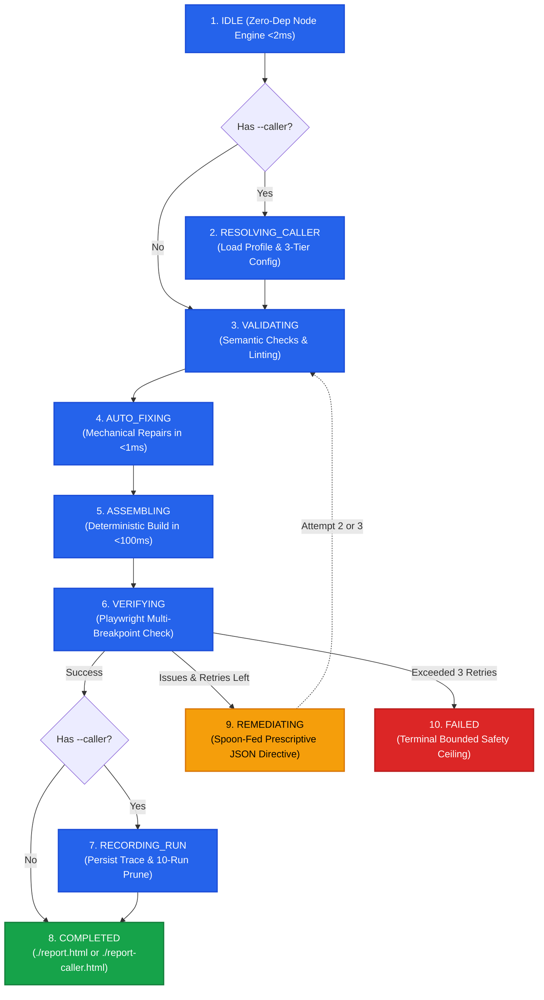

# ⚡ `html-report` — Publication-Grade HTML5 Reports for AI Coding Agents

[](https://driesverb.github.io/html-report/)
[](https://agentskills.io)
[](https://github.com/Fission-AI/OpenSpec)
[](https://daisyui.com/docs/themes/)
[](#-the-16-library-cdn-power-stack)
[](#-cryptographic-security--csp-hardening)
[](#-blazing-speed--token-efficiency)
[](#-the-superpower-of-states-deterministic-fsm-harness)
[](#-testing)

> 🌐 **Live GitHub Pages Showcase:** [https://driesverb.github.io/html-report/](https://driesverb.github.io/html-report/)  
> **The fastest, most reliable way for AI coding agents to produce publication-grade, interactive, theme-adaptive, and print/PDF-ready HTML5 reports.**  
> Built for **Antigravity, Claude Code, Cursor, Codex, OpenCode, Gemini CLI**, and autonomous agent pipelines.

---

## 🚀 Super Easy Install

### Option A: Install as a Prompt (Copy & Paste into Your AI Agent)

Paste this single prompt directly into **Antigravity, Claude Code, Cursor, Codex, OpenCode, or Gemini CLI** and let your agent configure everything automatically:

```text
Install the html-report skill from https://github.com/DriesVerb/html-report.git by cloning it into ~/.agents/html-report, symlinking ~/.agents/html-report/skills/html-report into ~/.agents/skills/html-report (and ~/.gemini/config/skills/html-report if using Antigravity/Gemini), and installing Playwright in ~/.agents/html-report/skills/html-report/playwright. Then read skills/html-report/SKILL.md.
```

### Option B: 1-Line Terminal Command

```bash
# Via the universal Agent Skills CLI:
npx skills add DriesVerb/html-report

# Or via 1-line git clone + global symlinks:
git clone https://github.com/DriesVerb/html-report.git ~/.agents/html-report && \
  mkdir -p ~/.agents/skills ~/.gemini/config/skills && \
  ln -sfn ~/.agents/html-report/skills/html-report ~/.agents/skills/html-report && \
  ln -sfn ~/.agents/html-report/skills/html-report ~/.gemini/config/skills/html-report
```

---

## 💡 Why `html-report`?

When LLMs generate full HTML documents from scratch, they waste **70% to 80% of their output tokens** writing boilerplate: doctypes, CDN imports, CSS resets, repetitive navbar markup, theme switchers, and inline JavaScript glue. Worse, models frequently hallucinate broken CDN links, omit heading anchor IDs, miscalculate responsive widths causing mobile overflow, and enter infinite retry loops.

`html-report` solves this with a **deterministic state machine pipeline**:
- **Agents emit only the semantic content fragment** (headings, metric cards, charts, diagrams, tables).
- The **deterministic harness** validates, auto-fixes, stitches the fragment into a pre-bundled publication shell in **<100ms**, and verifies it across 5 viewport breakpoints.

```
                    TRADITIONAL LLM GENERATION
┌─────────────────────────────────────────────────────────────────┐
│ 1,500+ Tokens: Doctype + 11 CDNs + CSS + Sticky Nav + JS Glue   │ ❌ Slow & Fragile
│ 500 Tokens: Actual Report Insights & Visuals                    │ ❌ High Hallucination Risk
└─────────────────────────────────────────────────────────────────┘

                    THE html-report PIPELINE
┌──────────────────────────────────────────────┐
│ Agent Emits ONLY Semantic <main> (500 Tokens)│ ⚡ ~70% Token Savings
└──────────────────────┬───────────────────────┘
                       │ <2ms Cold Startup
                       ▼
┌──────────────────────────────────────────────┐
│ Deterministic State Machine Harness (FSM)    │ 🛡️ Auto-Fixes & Small-Model Remediation
└──────────────────────┬───────────────────────┘
                       │ <100ms Deterministic Assembly
                       ▼
┌──────────────────────────────────────────────┐
│ Publication-Grade HTML5 Report + PDF         │ 🎨 32 Themes, Offline Inlining, Zero Overflows
└──────────────────────────────────────────────┘
```

---

## ⚡ Blazing Speed & Token Efficiency

| Benchmark Metric | Traditional Agent Generation | With `html-report` | Advantage |
| :--- | :--- | :--- | :--- |
| **Agent Output Tokens** | ~2,500+ tokens | **~500–800 tokens** | **~70% token savings** |
| **Compilation Latency** | Full LLM generation (~10–25s) | **<100ms** deterministic assembly | **100x faster execution** |
| **CLI Cold Startup** | 300–800ms (Heavy CLI frameworks) | **<2ms** (Zero-dependency Node engine) | **Near-instant runtime** |
| **Pre-Flight Repairs** | 1+ LLM turn (~5–10s) | **<1ms** mechanical auto-fix | **Zero token burn for trivial fixes** |
| **Viewport Verification** | Manual browser inspection | **<4s** lean Playwright check | **Instant responsive confidence** |
| **Dev Server Reload** | Manual refresh / duplicate tabs | **Instant single-tab live sync** | **Seamless developer experience** |

---

## 🛡️ The Superpower of States: Deterministic FSM Harness

At the core of `html-report` is an explicit, zero-dependency Node.js **Finite State Machine (FSM)** (`skills/html-report/scripts/harness.mjs`). By modeling the compilation lifecycle as mathematically defined states, the system achieves bulletproof reliability:



### 1. Mechanical Pre-Flight Auto-Fix State (`AUTO_FIXING`)
Smaller models frequently include accidental `<html>` or `<body>` wrappers, forget `id` attributes on headings, or omit table wrapper divs. The `AUTO_FIXING` state automatically fixes these in **<1ms with zero LLM round-trips**:
- Strips accidental outer document tags and YAML frontmatter.
- Automatically generates kebab-case slugified `id` attributes for all `h1`, `h2`, and `h3` tags (guaranteeing the navbar Table of Contents works out-of-the-box).
- Wraps unadorned tables with responsive `overflow-x-auto` wrappers.

### 2. "Small-Model-First" Spoon-Fed Remediation State (`REMEDIATING`)
When Playwright catches CSS overflow or responsive regressions, smaller models (e.g. Flash-Lite, Haiku, or local models) get overwhelmed by raw stack traces. The harness intercepts errors and outputs an **actionable, spoon-fed JSON directive**:

```json
{
  "status": "REMEDIATING",
  "attempt": 1,
  "max_attempts": 3,
  "instruction_for_agent": "CRITICAL: Fix horizontal scrollbar on element #workload-table. Replace container with <div class='overflow-x-auto w-full max-w-full'> to resolve overflow at mobile breakpoint (375px)."
}
```

### 3. Bounded Retry Supervisor
Enforces a strict **3-attempt ceiling**. If an agent cannot resolve issues within 3 attempts, the harness enters `FAILED` and stops, protecting tokens and preventing hallucination loops.

### 4. Progressive Complexity: Standalone vs. Caller-Aware Mode
The state machine operates with strict progressive disclosure:
- **Standalone Mode (`node harness.mjs run fragment.html`)**: **Zero footprint**. Does not touch or create `.caller-requests/`, performs zero profile queries, and outputs directly to `./report.html`.
- **Caller-Aware Mode (`--caller <id>`)**: Functions as a **shared visual rendering bus** for other agent skills (`memory-leak-debugging`, `debug-optimize-lcp`, etc.). Loads caller profiles, enforces 3-tier config precedence (`Runtime Overrides` > `Caller Profile` > `Core Baseline`), auto-routes to `./report-<caller>.html`, and logs ephemeral traces with a strict 10-run pruning policy.

---

## 🎨 The 16-Library CDN Power Stack

All reports utilize a carefully curated, non-blocking CDN stack pre-wired for instant interactivity, cryptographic security, and responsive elegance:

```
┌─────────────────────────────────────────────────────────────────────────────┐
│                          CORE FOUNDATION (Loaded Always)                    │
│  Tailwind CSS (CDN)  │  DaisyUI v4 (All 32 Themes)  │  Lucide  │  Alpine.js │
└─────────────────────────────────────────────────────────────────────────────┘
┌─────────────────────────────────────────────────────────────────────────────┐
│                   ON-DEMAND ADDONS (Auto-Detected by Harness)               │
│  Chart.js 4.4    — Animated Canvas Charts (2D OKLCH Palette Theme Synced)   │
│  Mermaid 11.4    — Architecture & Sequence Diagrams (DaisyUI Theme Synced)  │
│  Leaflet 1.9     — Interactive Maps (Esri Street Tiles, 0 API Keys, 0 403s) │
│  Grid.js 6.0     — Searchable, Sortable, Paginated Tables (Dark-Mode Synced)│
│  KaTeX 0.16      — Scientific & LaTeX Equation Math Rendering               │
│  Marked 14.1     — Client-Side Markdown Prose Rendering                     │
│  Highlight.js 11 — Syntax Highlighting (TypeScript, Kotlin, Python, Bash)   │
│  Day.js 1.11     — Lightweight Date Formatting & Relative Timestamps        │
│  Impress.js 1.1  — 3D Presentations (Presentation-Guarded, Print Fallback)  │
│  Mock.js 1.1     — Client-Side Synthetic Data & Schema Simulation           │
│  Showdown 2.1    — Two-Way Markdown Converter (Zero Marked Collision)       │
│  FullCalendar 6  — Interactive Scheduling Grids & Theme Palette Sync        │
└─────────────────────────────────────────────────────────────────────────────┘
```

### Detailed CDN Catalog & Addon Capabilities

| Library | Version | Loading & Guard | Purpose & Capabilities |
| :--- | :--- | :--- | :--- |
| **Tailwind CSS** | Latest Play CDN | Non-blocking | Full utility class engine across all 5 responsive breakpoints (`sm`, `md`, `lg`, `xl`, `2xl`). |
| **DaisyUI** | v4.12.14 | Stylesheet + 32 Themes | Semantic component styling with all 32 official themes defaulting to `light`. Fully custom themes supported. |
| **Lucide Icons** | v0.460.0 | `defer` + UMD | 1,400+ crisp SVG vector icons rendered dynamically via `data-lucide` attributes. |
| **Alpine.js** | v3.14.3 | `defer` + CDN | Declarative micro-reactivity (`x-data`, `x-model`, `@click`) for filters, studios, and interactive controls. |
| **Chart.js** | v4.4.6 | `defer` + UMD | High-performance HTML5 canvas charts synchronized live with active DaisyUI theme palettes. |
| **Mermaid** | v11.4.0 | `defer` + UMD | Architecture, sequence, and entity diagrams with numbered-list syntax defense and live re-theming. |
| **Leaflet** | v1.9.4 | `defer` + UMD | Geospatial maps powered by Esri World Street tiles (zero API keys, zero `file:///` 403 errors). |
| **Grid.js** | v6.0.6 | `defer` + UMD | Interactive, sortable, searchable, and paginated tables fully styled for both light and dark modes. |
| **KaTeX** | v0.16.11 | `defer` + UMD | Fast scientific math and LaTeX typesetting with automatic math delimiters (`$$...$$`, `$...$`). |
| **Marked** | v14.1.3 | `defer` + UMD | Lightning-fast client-side Markdown rendering for rich prose and technical documentation. |
| **Highlight.js** | v11.10.0 | `defer` + UMD | Syntax highlighting across TypeScript, JavaScript, Kotlin, Python, Bash, and SQL code blocks. |
| **Day.js** | v1.11.13 | `defer` + UMD | 2kB immutable date parser and relative-time calculator (`[data-dayjs="now"]`, `[data-dayjs-from-now]`). |
| **Impress.js** | v1.1.0 | Presentation-Guarded | 3D step transitions for pitch decks. Strictly guarded: renders as clean printable cards by default. |
| **Mock.js** | v1.1.0 | `defer` + UMD | Client-side synthetic data simulation engine (`Mock.mock(...)` via `[data-mock]`) with 0 backend calls. |
| **Showdown** | v2.1.0 | `defer` + UMD | Two-way Markdown parser with table and strikethrough support that co-exists cleanly with Marked. |
| **FullCalendar** | v6.1.15 | `defer` + UMD | Interactive scheduling grids (month, week, list) with theme-adaptive border and accent highlights. |

---

## 🔒 Cryptographic Security & CSP Hardening

Every report assembled by `html-report` is hardened against supply-chain injection, unauthorized script execution, and sensitive context leakage:

1. **Cryptographic Subresource Integrity (SRI)**:
   - External CDN stylesheets and scripts carry SHA-384 cryptographic integrity hashes (e.g. `integrity="sha384-..."`) with `crossorigin="anonymous"`.
   - Prevents execution of altered or compromised CDN payloads.
2. **Content Security Policy (CSP)**:
   - Strict `<meta http-equiv="Content-Security-Policy">` restricting executable scripts, styles, fonts, and images to vetted CDN domains (`cdn.jsdelivr.net`, `cdn.tailwindcss.com`, `cdnjs.cloudflare.com`, `unpkg.com`, `server.arcgisonline.com`).
3. **No-Referrer Privacy Policy**:
   - Includes `<meta name="referrer" content="no-referrer" />` on all templates and reports, preventing browsers from transmitting document paths, query params, or private caller IDs to external tile servers or CDNs.

---

---

## 🌟 Publication-Grade Features

### 1. Sticky DaisyUI Navbar with 32 Theme Swatches
- **Left (`navbar-start`)**: Prominent Report Title.
- **Right (`navbar-end`)**:
  - **Contents Dropdown (`#toc-dropdown`)**: Dynamically maps and anchors all `h1`, `h2`, and `h3` headers.
  - **32-Theme DaisyUI Selector (`#theme-dropdown`)**: Interactive color-swatch previews for every official theme (`light`, `dark`, `cupcake`, `synthwave`, `cyberpunk`, `nord`, etc.). Switching themes instantly re-themes **Chart.js**, **Mermaid**, **Grid.js**, and text colors via offscreen 2D canvas OKLCH resolution.
  - **Icon-Only Download Dropdown (`#download-dropdown`)**: Clean icon button opening two download paths:
    - **Download as HTML**: Downloads a 100% standalone offline `.html` file with all external CDN CSS and JS assets inlined into `<style>` and `<script>` tags.
    - **Download as PDF**: Direct browser print/PDF generation with print media rules.

### 2. CSV-Backed Interactive Dashboards
Easily pair data files (e.g. `example.csv`) with interactive metric summaries, live search inputs, client-side filters, and reactive Grid.js tables with instant chart synchronization.

### 3. Horizontal Scrollbar ("Insufficient Space") Detection & Playwright Gate
The runtime and Playwright verifier automatically check every element across all 5 Tailwind breakpoints (`sm`: 640px, `md`: 768px, `lg`: 1024px, `xl`: 1280px, `2xl`: 1536px). If any element has a horizontal scrollbar (`scrollWidth > clientWidth`), it is visually flagged and reported so reports are guaranteed 100% responsive.

### 4. User-Defined Custom DaisyUI Themes & Top Collapsible Studio
- **Zero-Dependency Pure JS OKLCH Engine**: Converts any hex, RGB, or HSL color into DaisyUI 4 OKLCH channels (`L% C H`) using standard Ottosson matrix math without external CDN color libraries.
- **Theme Inheritance (`extends`)**: Support for `"extends": "<baseTheme>"` allows extending any of the 32 native DaisyUI themes (`dark`, `light`, `emerald`, `synthwave`, etc.) while overriding chosen semantic colors.
- **Auto-Contrast Content Generator**: Computes optimal high-contrast values for `-content` variables (`--pc`, `--sc`, `--ac`, `--bc`, etc.) automatically.
- **Build-Time CLI Integration**: Pass `--custom-theme <path>` (supporting `.json` and raw `.css` blocks) to inject custom themes into `<style id="daisyui-custom-themes">`.
- **In-Browser Top Collapsible Studio**: Interactive accordion banner beneath the document title with real-time color pickers, OKLCH monitors, live Chart.js/Mermaid reactivity, `localStorage` persistence, and one-click CSS & Tailwind config export.

---

## 🛠️ Step-by-Step Workflow for AI Agents

### Step 1: Emit the Semantic Content Fragment
Write *only* the semantic `<main>` content (no HTML doctype, head, CDN tags, navbar, or footer):

```html
<!-- fragment.html -->
<section class="space-y-6">
  <div class="flex flex-wrap items-center justify-between gap-3">
    <div>
      <h1 id="perf-audit" class="text-3xl font-extrabold tracking-tight">Performance Audit</h1>
      <p class="text-sm opacity-70">Automated diagnostic report</p>
    </div>
    <span class="badge badge-success font-mono font-bold">100% HEALTHY</span>
  </div>

  <div class="grid grid-cols-1 sm:grid-cols-3 gap-4">
    <div class="card bg-base-100 border border-base-300 p-4">
      <div class="text-xs uppercase opacity-70">LCP Latency</div>
      <div class="text-2xl font-bold text-primary">1.1s</div>
    </div>
    <!-- More stat cards -->
  </div>
</section>
```

### Step 2: Run the Unified Harness
Execute the single-command deterministic FSM harness:

```bash
# Standalone execution (validates, auto-fixes, compiles, and verifies):
node skills/html-report/scripts/harness.mjs run fragment.html --title "Performance Audit"

# Or caller-aware execution with custom theme and PDF export:
node skills/html-report/scripts/harness.mjs run fragment.html \
  --caller debug-optimize-lcp \
  --title "LCP Diagnostic Report" \
  --theme nord \
  --pdf
```

### Step 3: Done!
Your report is compiled in <100ms to `./report.html` (or `./report-<caller>.html`), verified across viewports, theme-synced, and ready to share or view!

---

## 🔄 Single-Tab Live-Reload Dev Server

Serve and iterate on any report in real time:

```bash
node skills/html-report/scripts/serve-report.mjs report.html --port 3000
```

- **Auto-Open**: Automatically launches the report in your default browser.
- **Single-Tab Sync**: When you recompile or edit the file:
  - If open, it seamlessly refreshes the existing tab in place (zero duplicate tabs).
  - If closed, it re-opens a fresh browser tab automatically.

---

## 📁 Repository Structure

```text
html-report/
├── skills/
│   └── html-report/                              # Canonical Agent Skill
│       ├── SKILL.md                              # Main agent instructions
│       ├── assets/
│       │   ├── template-shell.html               # Pre-bundled DaisyUI shell & navbar
│       │   └── report-runtime.js                 # Theme resolver, TOC, OKLCH canvas sync
│       ├── scripts/
│       │   ├── harness.mjs                       # Zero-dep FSM Lifecycle Harness (<2ms)
│       │   ├── build-report.mjs                  # Deterministic Compiler (<100ms)
│       │   ├── caller-registry.mjs               # Caller profiles & ephemeral run vault
│       │   └── serve-report.mjs                  # Single-tab live reload dev server
│       ├── references/
│       │   ├── architecture-and-styling.md       # 16-CDN stack & styling rules
│       │   ├── charts-and-mermaid-style-guide.md # Chart.js & Mermaid theme standards
│       │   └── harness-architecture.md           # FSM states & remediation protocol
│       ├── examples/
│       │   ├── example.html                      # Complete 16-CDN showcase
│       │   └── example.csv                       # Interactive CSV demo dataset
│       └── playwright/
│           ├── package.json                      # Playwright test dependencies
│           └── verify-report.mjs                 # 5-breakpoint responsive & PDF verifier
├── .agents/skills/html-report -> skills/html-report # Universal local symlink
├── index.html                                    # Live GitHub Pages Showcase
└── tests/                                        # 144 unit & integration tests
```

---

## 🧪 Testing

Run the comprehensive test suite (all 144 unit and integration tests run in ~2s):

```bash
node --test tests/*.test.mjs
```

---

## 📄 License

MIT. Built with [OpenSpec](https://github.com/Fission-AI/OpenSpec) for the global AI agent ecosystem.
