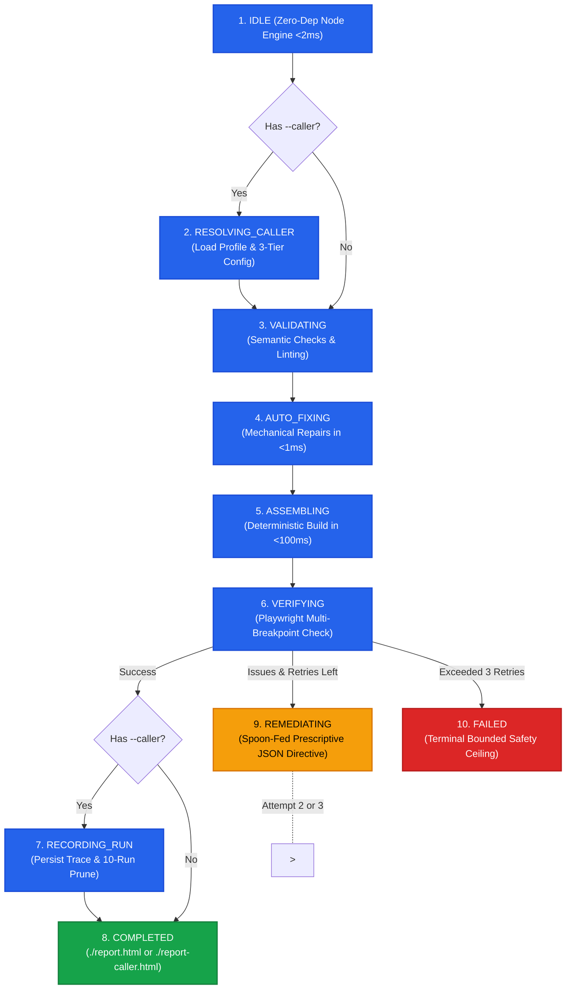

# 🛡️ Pipeline Architecture & Deterministic FSM Harness

At the core of `html-report` is an explicit, zero-dependency Node.js **Pipeline Finite State Machine (FSM)** (`skills/html-report/scripts/harness.mjs`) orchestrating validation, auto-repair, **Assembly** (`build-report.mjs`, `<100ms` mechanical join of `Semantic Fragment` + `Template Shell`), and verification. Structuring the Pipeline as mathematically defined states achieves bulletproof reliability and protects agent token budgets.

---

## 📐 The 10 Lifecycle States



---

## ⚙️ Key Harness Capabilities

### 1. Mechanical Pre-Flight Auto-Fix State (`AUTO_FIXING`)
Smaller language models frequently emit accidental boilerplate wrappers, omit anchor IDs, or forget table container elements. The `AUTO_FIXING` state automatically rectifies these in **<1ms without consuming LLM tokens**:
- **Outer Wrapper Stripping**: Removes accidental `<!DOCTYPE html>`, `<html>`, `<body>`, `<main>`, or YAML frontmatter blocks.
- **Heading Anchor Generation**: Generates kebab-case slugified `id` attributes for all `<h1>`, `<h2>`, and `<h3>` tags, guaranteeing the Table of Contents works out-of-the-box.
- **Responsive Table Wrapping**: Wraps unadorned `<table>` tags inside responsive `<div class="overflow-x-auto w-full">` containers.

### 2. "Small-Model-First" Spoon-Fed Remediation State (`REMEDIATING`)
When Playwright catches CSS overflow or responsive regressions, smaller models (e.g. Flash-Lite, Claude Haiku, or local models) get overwhelmed by raw stack traces. The harness intercepts errors and outputs an **actionable, prescriptive JSON directive**:

```json
{
  "status": "REMEDIATING",
  "attempt": 1,
  "max_attempts": 3,
  "instruction_for_agent": "CRITICAL: Fix horizontal scrollbar on element #workload-table. Replace container with <div class='overflow-x-auto w-full max-w-full'> to resolve overflow at mobile breakpoint (375px)."
}
```

The calling agent reads the directive, edits the specific container element, and re-runs the harness.

### 3. Bounded Retry Supervisor
The supervisor enforces a strict **3-attempt ceiling**. If an agent cannot resolve issues within 3 attempts, the harness enters `FAILED` and halts, preventing infinite retry loops and runaway token expenditure.

---

## 🔀 Progressive Complexity: Standalone vs. Caller-Aware Mode

The harness provides two operational modes:

| Feature | Standalone Mode (`node harness.mjs run fragment.html`) | Caller-Aware Mode (`--caller <id>`) |
| :--- | :--- | :--- |
| **Output Destination** | `./report.html` | `./report-<caller>.html` |
| **Profile Precedence** | Core baseline settings | Runtime Overrides > Caller Profile > Core Baseline |
| **Trace Vault** | Disabled (Zero disk footprint) | Enabled (`.caller-requests/<caller>/runs/`) |
| **Pruning Policy** | N/A | Strict 10-run automatic pruning ceiling |
| **Use Case** | Direct user reports, single-file generation | Shared visual bus for other skills (`memory-leak-debugging`, etc.) |

---

## 🔍 Standalone Command Example

```bash
# Basic run:
node skills/html-report/scripts/harness.mjs run fragment.html --title "Security Audit"

# With custom theme, Playwright verification, and PDF output:
node skills/html-report/scripts/harness.mjs run fragment.html \
  --title "Q3 Infrastructure Assessment" \
  --theme nord \
  --verify \
  --pdf
```
