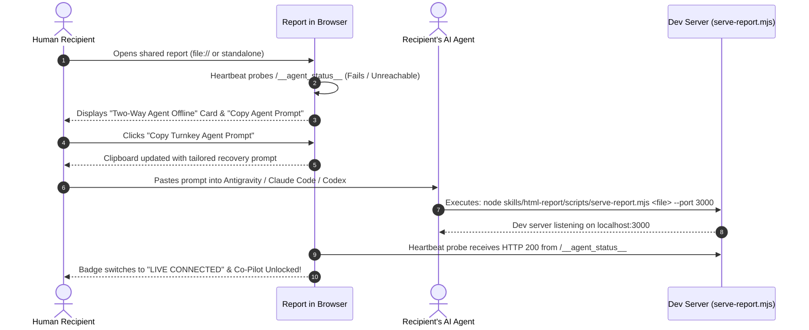

# Design: Turnkey AI Agent Reconnection Prompt & Auto-Recovery

## Context & Motivation

When an interactive report containing two-way AI co-pilots is shared as a standalone `.html` file or viewed outside the active dev server, the browser cannot communicate with `/__agent_action__`. Instead of frustrating the reader with silent failure or dead buttons, the report actively helps the reader restore two-way communication by generating an AI agent instruction prompt formatted for turnkey execution.



---

## Technical Architecture

### 1. Client Runtime Methods (`HTMLReportAgent` in `report-runtime.js`)

The `HTMLReportAgent` object is extended with connection recovery utilities:

```javascript
const HTMLReportAgent = {
  // Active connection state: 'checking' | 'connected' | 'disconnected'
  _connectionState: "checking",
  _listeners: new Set(),

  getState: function() { return this._connectionState; },

  checkConnection: async function() {
    try {
      const res = await fetch("/__agent_status__", { method: "GET" });
      if (res.ok) {
        const data = await res.json();
        this._updateState("connected", data);
        return true;
      }
    } catch (_) {}
    this._updateState("disconnected");
    return false;
  },

  getReconnectPrompt: function(options = {}) {
    const filename = options.filename || window.location.pathname.split("/").pop() || "report.html";
    const port = options.port || 3000;
    const title = options.title || document.title || "Interactive HTML Report";

    return `I am viewing an interactive publication report: "${title}" (${filename}).
This report features an active Two-Way AI Agent Bridge and Datastar live hypermedia, but the local development server is currently offline or disconnected.

Please restore the two-way agent bridge by starting the report dev server in the background:
\`\`\`bash
node skills/html-report/scripts/serve-report.mjs ${filename} --port ${port} --no-open
\`\`\`
Once started, keep this process running. The report in my browser will automatically detect the connection, update its live badges, and unlock interactive co-pilot queries.`;
  },

  copyReconnectPrompt: async function(btnEl) {
    const prompt = this.getReconnectPrompt();
    try {
      await navigator.clipboard.writeText(prompt);
      if (btnEl) {
        const originalText = btnEl.innerHTML;
        btnEl.innerHTML = `<span class="badge badge-success badge-sm gap-1">Copied to Clipboard!</span>`;
        setTimeout(() => { btnEl.innerHTML = originalText; }, 2500);
      }
      return true;
    } catch (e) {
      console.warn("Clipboard access failed:", e);
      return false;
    }
  }
};
```

---

### 2. UI Presentation & Component Design

#### Connection Status Navbar Indicator
A compact badge embedded in the navbar right items:
- **Connected**: `<span class="badge badge-success badge-xs gap-1 font-mono"><span class="w-1.5 h-1.5 rounded-full bg-success-content animate-pulse"></span> AGENT CONNECTED</span>`
- **Disconnected**: `<button onclick="HTMLReportAgent.openReconnectModal()" class="badge badge-warning badge-xs gap-1 font-mono cursor-pointer hover:badge-error transition"><i data-lucide="wifi-off" class="w-3 h-3"></i> AGENT OFFLINE &bull; RECONNECT</button>`

#### Dedicated Reconnection Modal (`#agent-reconnect-modal`)
Rendered when clicking the badge or when an action fails:
- Visual explanation of why the two-way bridge is disconnected.
- Syntax-highlighted code block displaying the exact recovery command.
- One-click `"Copy Turnkey Agent Prompt"` button with immediate visual feedback.
- `"Check Connection Now"` button to probe the server immediately without waiting for the next heartbeat.

---

## Decisions & Alternatives Considered

- **Decision 1: Client-Side Prompt Generation vs Hardcoded Server String**:
  - *Chosen*: Client-side dynamic synthesis using `document.title` and `window.location.pathname`.
  - *Why*: Shared `.html` reports opened via `file://` have NO server connection to fetch a prompt from; generating it purely client-side ensures 100% offline availability.
- **Decision 2: Exponential Heartbeat vs Infinite Tight Polling**:
  - *Chosen*: Exponential polling (2s &rarr; 5s &rarr; 10s &rarr; 15s max) with on-demand manual trigger.
  - *Why*: Avoids unnecessary battery drain or console log spam when a user chooses to view the report statically.
