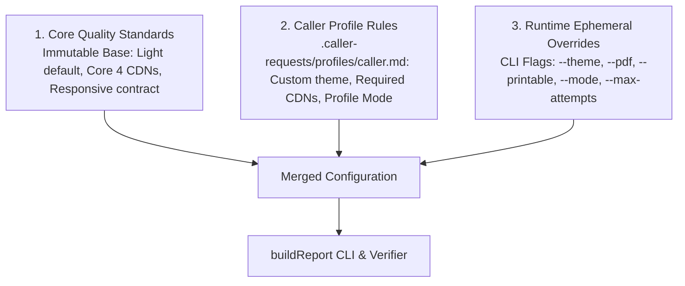

# Design: Caller-Aware Deterministic State Machine Harness

## Architecture Overview

This design marries the **Deterministic State Machine Harness** with the **Malleable Caller-Aware Integration Architecture** under a strict **Progressive Complexity Principle**.

The skill operates in two distinct execution modes:
1. **Standalone Mode (Direct User / Self Invocation)**: Pure, minimal, zero-footprint pipeline. Operates without touching, loading, or creating `.caller-requests/` vault or caller profiles. Emits directly to `./report.html`.
2. **Caller-Aware Mode (External Skill / Subagent Invocation)**: Activated strictly when `--caller <id>` is provided. Engages profile resolution, 3-tier config hierarchy merging, vault trace logging (`.caller-requests/runs/<caller>/<runId>/`), 10-run pruning, and caller CWD default routing.

```
html-report/ (Workspace Root)
├── .caller-requests/                           <-- Used ONLY when --caller is supplied
│   ├── profiles/                               <-- Persistent caller profiles
│   │   ├── memory-leak-debugging.md
│   │   ├── debug-optimize-lcp.md
│   │   └── default.md
│   └── runs/                                   <-- Ephemeral per-run traces (max 10 runs / caller)
│       └── memory-leak-debugging/
│           └── 2026-11-02T22-30-00-000Z/
│               ├── run.json                    <-- FSM state history, duration, status
│               ├── trace.json                  <-- Prescriptive remediation directives & logs
│               ├── payload.json                <-- Input fragment metadata / source
│               └── overrides.json              <-- Applied runtime overrides
└── skills/html-report/
    ├── scripts/
    │   ├── harness.mjs                         <-- Dual-mode FSM supervisor (entry point)
    │   ├── caller-registry.mjs                 <-- Vault, profile parsing & pruning engine
    │   ├── build-report.mjs                    <-- Deterministic HTML compiler
    │   └── serve-report.mjs                    <-- Live dev server
    └── playwright/
        └── verify-report.mjs                   <-- Responsive verification & PDF export
```

---

## Standalone vs. Caller-Aware Mode Comparison

| Attribute | Standalone Mode (Self Invoked) | Caller-Aware Mode (External Caller) |
| :--- | :--- | :--- |
| **CLI Invocation** | `node harness.mjs run fragment.html` | `node harness.mjs run fragment.html --caller <id>` |
| **Vault Access (`.caller-requests/`)** | **None** (zero files created or read) | Reads profile, writes `run.json`/`trace.json` |
| **Profile Resolution** | **Bypassed** | Active (auto-scaffolds if first invocation) |
| **Active FSM States** | 6 States (`IDLE -> VALIDATING -> ...`) | 10 States (includes `RESOLVING_CALLER` & `RECORDING_RUN`) |
| **Default Output Path** | `./report.html` | `./report-<callerId>.html` |
| **Theme Source** | Core default (`light`) or runtime `--theme` | Merged: Runtime > Profile > Baseline |
| **Multi-Attempt Tracking** | In-memory attempt counter | Correlated via `--run-id` in vault |
| **Output Formats** | Human-readable terminal text / banner | Human-readable text OR `--json` machine envelope |

---

## Dual-Mode FSM State Machine

The Finite State Machine dynamically forks based on whether `--caller` is present:

```mermaid
stateDiagram-v2
  [*] --> IDLE
  
  state "Standalone Path (No --caller)" as Standalone {
    IDLE --> VALIDATING : No --caller passed
    VALIDATING --> AUTO_FIXING : Structural flaws detected
    AUTO_FIXING --> VALIDATING : Re-lint auto-fixed HTML
    VALIDATING --> ASSEMBLING : HTML valid
    ASSEMBLING --> VERIFYING : Assembled successfully
    VERIFYING --> COMPLETED : Verification passed
    VERIFYING --> REMEDIATING : Error (attempt < max)
    REMEDIATING --> [*] : Print terminal banner
    COMPLETED --> [*] : Report emitted to ./report.html
  }

  state "Caller-Aware Path (--caller <id>)" as CallerAware {
    IDLE --> RESOLVING_CALLER : --caller <id> present
    RESOLVING_CALLER --> FAILED : Incompatible profile/schema
    RESOLVING_CALLER --> VALIDATING : Profile resolved & 3-tier config merged
    
    VERIFYING --> RECORDING_RUN : Verification passed
    VERIFYING --> REMEDIATING : Error (attempt < max)
    REMEDIATING --> RECORDING_RUN : Persist trace.json in vault
    RECORDING_RUN --> COMPLETED : Run recorded & pruned (success)
    RECORDING_RUN --> REMEDIATING : Trace recorded; emit prescriptive JSON
    RECORDING_RUN --> FAILED : Terminal failure recorded in vault
  }
```



---

## 3-Tier Configuration Merge (Caller-Aware Mode Only)

When `--caller` is active, the harness coordinates configuration parameters across three hierarchical layers:



1. **Precedence Hierarchy**:
   - `Runtime Overrides` (CLI flags) take highest precedence.
   - `Caller Profile Rules` supply caller-specific defaults.
   - `Core Quality Standards` provide system baseline fallbacks.
2. **Non-Destructive Guarantee**:
   - Runtime overrides apply strictly to the ephemeral run and never mutate the persistent profile file on disk.

---

## Ephemeral Vault Run Lifecycle & Trace Structure

Only instantiated when `--caller <id>` is provided:

```
.caller-requests/runs/<caller-id>/<run-id>/
├── run.json
├── trace.json
└── overrides.json
```

### `run.json` Schema
```json
{
  "callerId": "memory-leak-debugging",
  "leafCallerId": "memory-leak-debugging",
  "runId": "2026-11-02T22-30-00-000Z",
  "timestamp": "2026-11-02T22:30:00.000Z",
  "status": "COMPLETED",
  "attempt": 1,
  "maxAttempts": 3,
  "durationMs": 85,
  "outputHtml": "/home/user/project/report-memory-leak-debugging.html",
  "outputPdf": null,
  "stateHistory": [
    { "from": "IDLE", "to": "RESOLVING_CALLER", "timestamp": "..." },
    { "from": "RESOLVING_CALLER", "to": "VALIDATING", "timestamp": "..." },
    { "from": "VALIDATING", "to": "ASSEMBLING", "timestamp": "..." },
    { "from": "ASSEMBLING", "to": "VERIFYING", "timestamp": "..." },
    { "from": "VERIFYING", "to": "RECORDING_RUN", "timestamp": "..." },
    { "from": "RECORDING_RUN", "to": "COMPLETED", "timestamp": "..." }
  ]
}
```

---

## CLI Interface & Invocation Matrix

```bash
# 1. Standalone Invocation (Zero caller complexity, zero vault clutter, output: ./report.html):
node skills/html-report/scripts/harness.mjs run fragment.html

# 2. Standalone with custom title and output:
node skills/html-report/scripts/harness.mjs run fragment.html --title "My Custom Audit" --output ./custom-out.html

# 3. Caller-Aware External Invocation (Auto-scaffolds profile, routes to ./report-<caller>.html, logs to vault):
node skills/html-report/scripts/harness.mjs run fragment.html --caller memory-leak-debugging

# 4. Small-Model Programmatic Invocation (Machine-readable JSON envelope):
node skills/html-report/scripts/harness.mjs run fragment.html --caller debug-optimize-lcp --json

# 5. Remediation Retry Continuation (Linked to prior run in vault):
node skills/html-report/scripts/harness.mjs run fragment.html --caller memory-leak-debugging --attempt 2 --run-id <run-id>
```

---

## Decision Log & Trade-offs

| Decision | Selected Option | Rationale |
| :--- | :--- | :--- |
| **D1: Standalone Complexity Isolation** | Conditional FSM bypass (Zero vault touches) | Guarantees that invoking the skill by itself remains dead simple, fast (<2ms), and completely free of vault side-effects. |
| **D2: State Placement** | Dual-path FSM states (`RESOLVING_CALLER`, `RECORDING_RUN`) | Transparently reflects caller execution without burdening standalone runs. |
| **D3: Vault Placement** | Gitignored `.caller-requests/` | Keeps repository clean of ephemeral run noise and local profiles. |
| **D4: Output Location** | Standalone: `./report.html`; Caller: `./report-<caller>.html` | Context-appropriate deliverables without surprising developers or callers. |
| **D5: Zero Dependency Guarantee** | Pure standard library Node.js | Sub-2ms startup on any Node 18+ system without `npm install` or `pnpm`. |
