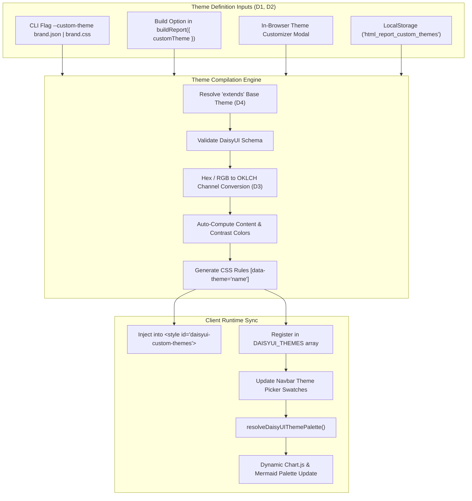

# Design: Custom DaisyUI Theme Engine

## 1. DaisyUI Theme Specification Alignment

daisyUI generates and manages themes through CSS custom properties attached to elements with `[data-theme="<name>"]`. In DaisyUI v4, color utility classes (e.g., `bg-primary`, `text-primary-content`) rely on variables formatted in OKLCH component channels:

```css
[data-theme="acme-corp"] {
  color-scheme: light;
  --p: 52.4% 0.22 258.4;        /* primary: oklch(var(--p) / <alpha>) */
  --pc: 98.2% 0.01 258.4;       /* primary-content */
  --s: 70.1% 0.18 160.2;        /* secondary */
  --sc: 15.0% 0.03 160.2;       /* secondary-content */
  --a: 65.0% 0.24 330.0;        /* accent */
  --ac: 98.0% 0.01 330.0;       /* accent-content */
  --n: 25.0% 0.03 260.0;        /* neutral */
  --nc: 95.0% 0.01 260.0;       /* neutral-content */
  --b1: 100% 0 0;               /* base-100 */
  --b2: 96% 0 0;                /* base-200 */
  --b3: 92% 0 0;                /* base-300 */
  --bc: 20% 0.02 260.0;         /* base-content */
  --in: 72% 0.18 230.0;         /* info */
  --inc: 0% 0 0;
  --su: 68% 0.16 150.0;         /* success */
  --suc: 0% 0 0;
  --wa: 82% 0.18 80.0;          /* warning */
  --wac: 0% 0 0;
  --er: 65% 0.22 25.0;          /* error */
  --erc: 0% 0 0;

  /* Component Shape & Geometry */
  --rounded-box: 1rem;
  --rounded-btn: 0.5rem;
  --rounded-badge: 1.9rem;
  --animation-btn: 0.25s;
  --animation-input: 0.2s;
  --btn-focus-scale: 0.95;
  --border-btn: 1px;
  --tab-border: 1px;
  --tab-radius: 0.5rem;
}
```

### Color Conversion & OKLCH Generator (D3)
Users define colors in Hex (`#0284c7`), RGB, or HSL. A pure JavaScript conversion utility (~35 lines) performs matrix conversions with zero external dependencies:
1. **sRGB to Linear RGB**:
   $$C_{\text{linear}} = \begin{cases} \frac{C}{12.92} & \text{if } C \le 0.04045 \\ \left(\frac{C + 0.055}{1.055}\right)^{2.4} & \text{otherwise} \end{cases}$$
2. **Linear RGB to CIE XYZ (D65 standard illuminant)**:
   $$\begin{bmatrix} X \\ Y \\ Z \end{bmatrix} = \begin{bmatrix} 0.4122214708 & 0.5363325363 & 0.0514459929 \\ 0.2119034982 & 0.6806995451 & 0.1073969566 \\ 0.0883024619 & 0.2817188376 & 0.6299787005 \end{bmatrix} \begin{bmatrix} R_{\text{linear}} \\ G_{\text{linear}} \\ B_{\text{linear}} \end{bmatrix}$$
3. **CIE XYZ to OKLab**:
   $$\begin{bmatrix} l \\ m \\ s \end{bmatrix} = M_1 \begin{bmatrix} X \\ Y \\ Z \end{bmatrix}, \quad \begin{bmatrix} L \\ a \\ b \end{bmatrix} = M_2 \begin{bmatrix} l^{1/3} \\ m^{1/3} \\ s^{1/3} \end{bmatrix}$$
4. **OKLab to OKLCH**:
   $$C = \sqrt{a^2 + b^2}, \quad H = \text{atan2}(b, a) \times \frac{180}{\pi} \pmod{360}$$
5. **Formatted Output**: `"${(L * 100).toFixed(2)}% ${C.toFixed(3)} ${H.toFixed(2)}"` matching DaisyUI 4.

### Content Auto-Contrast Algorithm
If the user does not specify a `-content` color (e.g. `primary-content`), the engine calculates relative luminance:
* If $L_{\text{oklch}} > 0.65$ or relative luminance $> 0.4$, set content to near-black (`15% 0.02 <H>`).
* Otherwise, set content to near-white (`98% 0.01 <H>`).

---

## 2. Architecture & Data Flow



---

## 3. Custom Theme Schema with Base Inheritance (D1, D4)

A custom theme file (`theme.json`) conforms exactly to DaisyUI's configuration standard and optionally extends a base theme:

```json
{
  "themes": [
    {
      "acme-brand": {
        "extends": "dark",
        "primary": "#2563eb",
        "secondary": "#ec4899",
        "accent": "#06b6d4",
        "--rounded-box": "0.75rem",
        "--rounded-btn": "0.375rem"
      }
    }
  ]
}
```

When `"extends": "<baseTheme>"` is present:
1. The compiler loads default DaisyUI tokens for that base theme (e.g., `dark`, `light`, `cupcake`, `emerald`).
2. Overrides only specified properties (e.g. `primary`, `secondary`, border radii).
3. Produces the complete `[data-theme="acme-brand"]` CSS block.

---

## 4. In-Browser Theme Studio UI & Live Showcase Integration (D2)

To ensure users can see their themes tested against a complete, publication-grade design system, the theme generator integrates directly into `example.html` using a **Top Collapsible Card Pattern**:

### Top Collapsible Accordion (`collapse collapse-arrow`)
* **Placement**: Located immediately beneath the document hero / title in `example.html`.
* **Collapsed State (Default)**:
  * Sleek 48px banner: `🎨 DaisyUI Theme Generator & Studio [Active: light ●●●● | Click to Customize]`.
  * Preserves full document readability without pushing down showcase content.
* **Expanded State**:
  * Unfolds interactive color inputs (`Primary`, `Secondary`, `Accent`, `Neutral`, `Base-100/200/300`).
  * Live OKLCH channel monitors and auto-contrast indicators.
  * Base theme selector dropdown (`extends: "dark" | "emerald" | ...`).
  * Border radius sliders (`--rounded-btn`, `--rounded-box`, `--rounded-badge`).
  * Export actions: "Copy DaisyUI CSS" and "Copy Tailwind Config".
* **Showcase Underneath**:
  * The entire 800-line `example.html` showcase (buttons, badges, alerts, charts, tables, cards, markdown) renders immediately below and reacts live to color adjustments in real-time.
