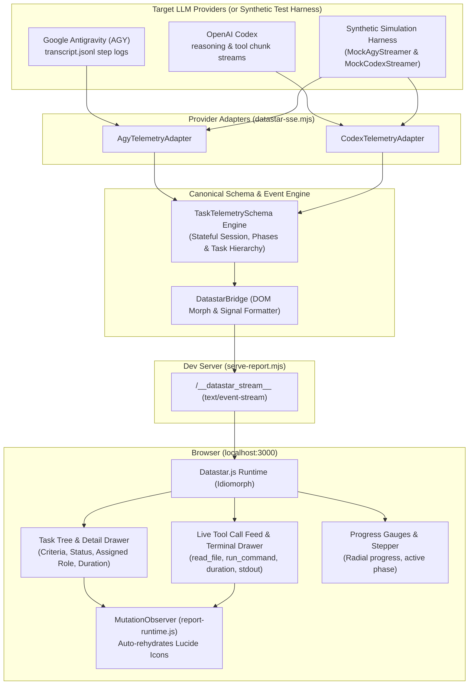
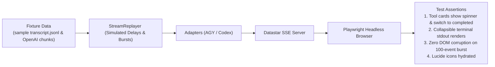

# Technical Design: Datastar.js Addon & Real-Time Live Dashboards with LLM-Agnostic Hook Streaming & Testing Harness

## 1. System Architecture Overview (Passive Observability Pipeline)

By scoping the core implementation to **passive-first telemetry**, the agent's execution loop remains safe, isolated, and unmodified. The browser dashboard acts as a high-fidelity visual mirror.



---

## 2. Dedicated Task & Tool Call Inspection UI

### A. Live Task Inspection Cards (`#task-${id}`)
Each task in the plan renders as an interactive card with:
- **Status Indicator**:
  - `pending`: Outline checkbox with muted label.
  - `running`: Pulsing primary border, spinning loader, active duration timer.
  - `completed`: Green checkmark, success badge, execution time badge (e.g. `1.8s`).
  - `failed`: Red error badge, collapsible error message.
- **Task Drawer / Collapsible Body**:
  - Shows acceptance criteria, assigned agent/subagent role (e.g. `AGY Planner`, `Codex Coder`).
  - Direct links to generated file artifacts.
  - Nested mini-feed of tools triggered specifically by this task.

### B. Live Tool Call Feed & Terminal Drawer (`#tool-call-feed`)
A dedicated chronological stream of all agent tool invocations:
- **Tool Header**:
  - Icon badge according to tool category:
    - `run_command` &rarr; `<i data-lucide="terminal">`
    - `read_file` / `write_file` &rarr; `<i data-lucide="file-code">`
    - `invoke_subagent` &rarr; `<i data-lucide="users">`
    - `web_search` &rarr; `<i data-lucide="globe">`
  - Tool execution state: animated spinner when running, duration badge (`210ms`) when finished.
  - Collapsible input inspection: shows input arguments / command line string.
- **DaisyUI Terminal Output Container (`mockup-code`)**:
  - Displays truncated stdout/stderr chunks formatted as clean terminal text with line numbers.
- **Filter Tabs**:
  - Quick filters powered by Datastar reactive signals (`data-signals="{ toolFilter: 'all' }"`):
    - `All Tools`
    - `Shell Commands`
    - `File Operations`
    - `Subagents`

---

## 3. Testing & Simulation Harness (`tests/harness/`)

To rigorously de-risk Datastar streaming before running against production agent sessions, we implement a dedicated simulation harness:



### A. `MockAgyStreamer`
Replays realistic AGY conversation transcripts (`transcript.jsonl` steps) with controllable delays:
- Emits user prompt &rarr; planning steps &rarr; `thinking` reasoning deltas &rarr; `tool_calls` (`read_file`, `run_command`) &rarr; checklist task updates.
- Supports **Burst Mode**: Streams 100 events rapidly to test backpressure and DOM rendering stability.

### B. `MockCodexStreamer`
Simulates standard OpenAI streaming response chunks:
- Emits `delta.reasoning_content` tokens chunk-by-chunk.
- Streams tool call arguments across multiple fragments.
- Emits final tool results.

---

## 4. Task & Session Schematic Language (`TaskTelemetrySchema`)

```typescript
export type TaskStatus = "pending" | "running" | "completed" | "failed" | "skipped";
export type SessionStatus = "idle" | "running" | "paused" | "completed" | "failed";

export interface ToolInvocationRecord {
  toolCallId: string;
  toolName: string;
  inputSummary?: string;
  outputSummary?: string;
  durationMs?: number;
  status: "running" | "success" | "error";
  startedAt: number;
  completedAt?: number;
}

export interface TaskItem {
  id: string;                      // e.g. "phase-1.task-2"
  title: string;                   // Concise actionable label
  description?: string;            // Acceptance criteria or detail
  status: TaskStatus;              // Current execution state
  assignedTo?: string;             // Subagent role, e.g. "Codebase Researcher"
  progressPct?: number;            // 0 - 100 for sub-progress
  toolCalls?: ToolInvocationRecord[];
  artifacts?: string[];            // Produced files or diffs
  startedAt?: number;
  completedAt?: number;
  error?: string;
}

export interface PhaseDefinition {
  id: string;                      // e.g. "phase-1"
  order: number;                   // 1, 2, 3...
  title: string;                   // e.g. "Build CLI & Shell Integration"
  status: TaskStatus;
  tasks: TaskItem[];
  progressPct: number;             // Auto-computed from tasks
}

export interface SessionMetrics {
  totalTasks: number;
  completedTasks: number;
  failedTasks: number;
  runningTasks: number;
  progressPct: number;             // Overall session percentage (0 - 100)
  stepIndex: number;
  elapsedMs: number;
}

export interface SessionState {
  sessionId: string;
  agentType: "agy" | "codex" | string;
  status: SessionStatus;
  activePhaseId?: string;
  activeTaskId?: string;
  phases: PhaseDefinition[];
  metrics: SessionMetrics;
  startedAt: number;
  updatedAt: number;
}
```

---

## 5. Datastar SSE Serialization Matrix

The `DatastarBridge` uses the schema to generate deterministic DOM updates and reactive signal merges:

| Schematic Event | Datastar Event Type | Target DOM Selector | Merge Mode | Rendered Component |
| :--- | :--- | :--- | :--- | :--- |
| `task.started` | `datastar-fragment` | `#task-${id}` | `outer` | Active Task Card with glowing badge & spinner |
| `task.completed` | `datastar-fragment` | `#task-${id}` | `outer` | Checked Task Item with green success badge & duration |
| `tool.invoked` | `datastar-fragment` | `#tool-call-feed` | `prepend` | Tool Card with spinning loader & command args |
| `tool.output` | `datastar-fragment` | `#tool-${id}` | `outer` | Tool Card with duration badge & collapsible terminal stdout |
| `phase.updated` | `datastar-fragment` | `#stepper-phase-${order}` | `outer` | DaisyUI `<li class="step step-primary">` item |
| `metrics.updated` | `datastar-merge-signals` | N/A | N/A | `data: signals {"session": { "progressPct": 75, "completed": 9 }}` |
