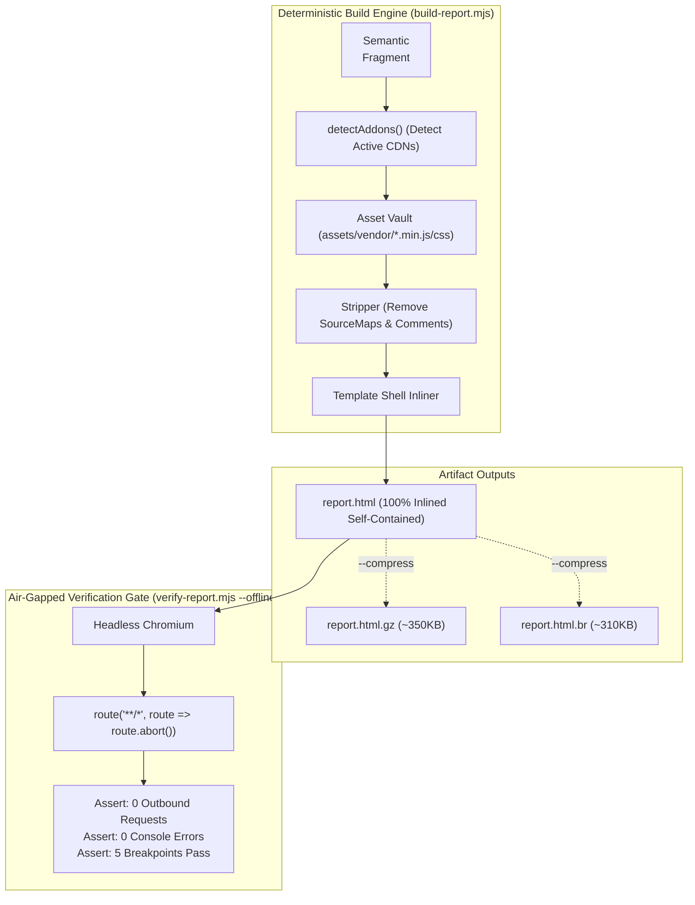

# Technical Architecture & Design: Deterministic Offline Inlining

## 1. Zero-Dependency Language & Engine Architecture
To uphold the repository's core benchmark of `<2ms` cold-startup and zero external runtime dependencies, the entire offline inlining system is implemented in pure Node.js standard library:
- `node:fs` / `node:path`: File reading, caching, and atomic asset retrieval.
- `node:zlib`: Native Brotli and Gzip compression.
- `node:crypto`: SHA-256 integrity verification.
- `node:http`: Test loopback simulation for air-gapped gates.

**Strict Constraint:** Zero `node_modules` introduced to production runtimes.

---

## 2. Inlining Pipeline & Asset Vault Architecture

---

## 3. CLI Flags & Specification

| Flag | Component | Description |
|---|---|---|
| `--inline` | `build-report.mjs`, `harness.mjs` | Embeds active CSS into `<style>` and JS into `<script>`, replacing external CDN links. |
| `--compress` | `build-report.mjs` | Generates `.html.gz` and `.html.br` alongside output for ultra-light distribution. |
| `--vendor-dir <path>` | `build-report.mjs` | Custom directory containing offline assets (defaults to `skills/html-report/assets/vendor/`). |
| `--offline` / `--air-gapped` | `verify-report.mjs` | Forces network interception to abort all HTTP/HTTPS traffic, asserting complete zero-network fidelity. |

---

## 4. Size Mitigation Strategies
1. **Selective Addon Inlining:** Core 4 libraries (Tailwind, DaisyUI v4, Lucide, Alpine.js) weigh ~620KB inlined. Only active addons (Chart.js, Mermaid, Grid.js) detected by regex signatures are injected.
2. **Deterministic SourceMap Stripping:** Regex removes `//# sourceMappingURL=...` and `/*# sourceMappingURL=... */`, saving 15%–20% file bloat.
3. **Brotli & Gzip Pre-Compression:** Modern text compression achieves ~75%–85% reduction, yielding a total air-gapped deliverable of ~350KB.

---

## 5. Honest Architectural Alignment: "Opt-In Superpower, Not Default"

### Where It Strongly Aligns With `html-report`
- **Zero `node_modules` Guarantee:** Pure Node standard library (`node:fs`, `node:zlib`).
- **Zero LLM Token Waste:** Agent emits only 500 semantic tokens; inlining is 100% mechanical and takes `<15ms`.
- **Absolute Reliability:** Solves the #1 enterprise air-gapped failure mode.

### Where It Creates Architectural Tensions
- **Repository Size Bloat:** Committing 20MB of minified vendor libraries bloats the git repo for all users.
- **Pull Request Diff Breakage:** A 40KB HTML file diffs cleanly in GitHub; a 2.5MB inlined HTML file triggers *"Diff too large to display"*.
- **Browser Memory Redundancy:** Opening 20 inlined reports loads 20 duplicate copies of Chart.js into RAM instead of reusing browser cache.

### The Strategic Synthesis
Keep **CDN-First as the default** for speed, tiny 40KB files, and instant PR diffs. Provide **`--inline` as a first-class opt-in flag** for air-gapped delivery and compliance archiving. Cache vendor assets on-demand rather than polluting git history.
