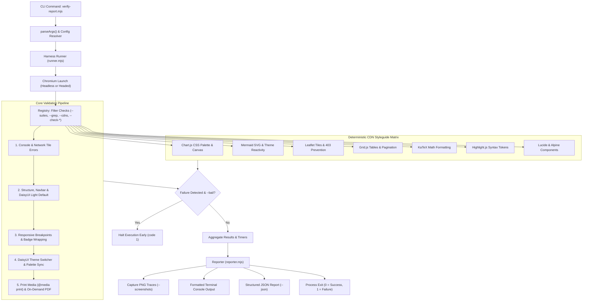

# Design: Playwright Extensible Verification Harness, CDN Styleguide Matrix & Precision Flags

## Technical Overview
This design transforms the existing monolithic `verify-report.mjs` (658 lines) into a modular, extensible Playwright testing harness. It introduces:
1. A **Pluggable Check Architecture** where checks are isolated, reusable classes/functions conforming to a universal `VerificationCheck` contract.
2. A **Dedicated CDN Styleguide Matrix** (`harness/checks/cdns/`) implementing deterministic visual and behavioral checks for every supported library (Chart.js, Mermaid, Leaflet, Grid.js, KaTeX, Highlight.js, Marked, Lucide, Alpine.js, FullCalendar).
3. An **Extensible Check Registry** allowing third parties and caller harnesses to inject custom assertions.
4. A comprehensive suite of **Precision CLI Flags** (`--timeout`, `--suites`, `--only`, `--grep`, `--all-cdns`, `--cdns`, `--check-<cdn>`, `--themes`, `--viewports`, `--screenshots`, `--bail`, `--strict`, `--json`, `--color-contrast`, `--headed`).
5. Full **backward compatibility** with existing flags (`--quick`, `--pdf`, `--mode`, `--caller`).

---

## 1. Directory Structure

```
skills/html-report/playwright/
├── verify-report.mjs            # Backward-compatible CLI entrypoint facade
├── package.json
└── harness/
    ├── runner.mjs               # Core orchestrator: launch browser, manage lifecycle, schedule checks
    ├── registry.mjs             # Registry of available checks, CDN catalog & hook registration API
    ├── reporter.mjs             # Console printer (summary, timers, pass/fail) and JSON exporter
    └── checks/
        ├── core/
        │   ├── console-errors.mjs   # Unhandled JS errors & tile 4xx/5xx responses
        │   ├── structure.mjs        # Default 'light' theme, favicon, DaisyUI navbar, download dropdown, footer
        │   ├── responsive.mjs       # Viewport resizing, badge wrapping & horizontal overflow detection
        │   ├── theme-switcher.mjs   # Theme dropdown interaction & palette sync
        │   ├── print-pdf.mjs        # @media print validation & PDF rendering
        │   └── a11y-contrast.mjs    # WCAG AA color contrast & landmark audits
        └── cdns/
            ├── charts.mjs           # Chart.js DaisyUI color palette sync, responsive canvas, zero clipping
            ├── mermaid.mjs          # SVG diagram render, DaisyUI theme re-render, strict syntax error inspection
            ├── leaflet.mjs          # Tile loading, valid unblocked provider (ESRI/Carto Voyager), pane sanity
            ├── gridjs.mjs           # Grid.js table rendering, search/sort DOM, pagination, zero overflow
            ├── katex.mjs            # Math equation formatting, prevention of unrendered LaTeX token leaks
            ├── highlight.mjs        # Code highlighting, .hljs-keyword verification, theme styling
            ├── marked.mjs           # Markdown output rendering into semantic HTML elements
            ├── lucide.mjs           # Replacement of [data-lucide] with valid inline SVGs
            ├── alpine.mjs           # Alpine.js x-data reactivity and state mounting
            └── fullcalendar.mjs     # FullCalendar grid, toolbar formatting, and event rendering
```

---

## 2. Core Architectural Design Patterns

This implementation relies on a composite of 5 classic design patterns to ensure maximum extensibility, determinism, and zero regressions:

1. **Strategy Pattern (`VerificationCheck`)**: Each check module is an isolated, interchangeable strategy conforming to a unified contract (`run({ page, context, options, reporter })`). New checks or CDN validators are added as single isolated files without touching the runner.
2. **Registry Pattern (`CheckRegistry`)**: A centralized catalog indexes all available checks by ID, category, and CLI flags. Resolves active checks based on `--suites`, `--grep`, `--all-cdns`, or `--check-<cdn>`, and allows caller harnesses or plugins to register custom checks at runtime.
3. **Pipeline with Bail (`HarnessRunner`)**: Executes active checks sequentially across a shared Chromium context. Implements Template Method lifecycle timing, per-check timeout bounds, and fail-fast early abortion upon `--bail`.
4. **Observer / Reporter Pattern (`Reporter`)**: Decouples check execution from logging. Checks emit lifecycle events (`start`, `pass`, `fail`, `warn`), consumed by independent observers: `ConsoleReporter` (terminal UI), `JsonReporter` (machine-readable diagnostics for AI agent self-healing), and `ScreenshotReporter` (PNG captures on error).
5. **Facade Pattern (`verify-report.mjs`)**: The root CLI entrypoint preserves 100% backward compatibility for existing command invocations (`--quick`, `--pdf`, `--mode`, `--caller`) while delegating under the hood to the new pipeline.

---

## 3. Universal Check Contract Interface

Each check module exports a class or object adhering to the `VerificationCheck` contract:

```javascript
export class VerificationCheck {
  constructor({ id, name, category = "core", cliFlags = [], styleguideRules = [] }) {
    this.id = id;                     // e.g. "cdn:mermaid"
    this.name = name;                 // e.g. "Mermaid Diagrams & Styleguide"
    this.category = category;         // "core" | "cdn" | "a11y" | "print"
    this.cliFlags = cliFlags;         // e.g. ["--check-mermaid", "--cdn-mermaid"]
    this.styleguideRules = styleguideRules; // List of specific rules verified
  }

  /**
   * Evaluates whether this check should run for the given report and options.
   * @param {Object} context - { page, options, htmlPath, mode }
   * @returns {Promise<boolean>|boolean}
   */
  async shouldRun(context) {
    return true;
  }

  /**
   * Executes deterministic check assertions.
   * @param {Object} ctx - { page, context, browser, options, reporter }
   * @returns {Promise<CheckResult>}
   */
  async run({ page, browser, reportUrl, options, reporter }) {
    return {
      id: this.id,
      name: this.name,
      status: "passed", // "passed" | "failed" | "skipped" | "warned"
      durationMs: 120,
      styleguide: {
        compliant: true,
        rulesChecked: this.styleguideRules
      },
      assertions: [
        { rule: "svg-rendered", passed: true, message: "3 Mermaid diagrams rendered" }
      ],
      errors: [],
      warnings: [],
      data: {}
    };
  }
}
```

---

## 3. Dedicated CDN Styleguide Matrix

Every CDN check enforces both technical presence and visual/behavioral styleguide rules:

| CDN Check Module | Flag(s) | Deterministic Styleguide Assertions |
|---|---|---|
| `charts.mjs` | `--check-charts`, `--cdn-charts` | Canvas exists; `window.reportCharts` reactive to DaisyUI color variables (`--p`, `--s`, `--a`, `--n`); no NaN labels; zero overflow. |
| `mermaid.mjs` | `--check-mermaid`, `--cdn-mermaid` | Valid SVGs rendered; theme sync on dark/light switch; strict absence of `"Syntax error in text"` or `svg[aria-roledescription='error']`. |
| `leaflet.mjs` | `--check-maps`, `--cdn-leaflet` | Map panes loaded; tile images have `naturalWidth > 0`; tile provider does NOT return 403 HTTP errors (preventing unauthenticated OSM/Carto direct calls). |
| `gridjs.mjs` | `--check-tables`, `--cdn-gridjs` | Table elements rendered with `.gridjs-table`; search input and pagination active if present; zero horizontal overflow. |
| `katex.mjs` | `--check-math`, `--cdn-katex` | Formatted `.katex` blocks rendered; no raw unparsed `$` or `\begin{...}` LaTeX markers leaking into DOM text. |
| `highlight.mjs` | `--check-code`, `--cdn-highlight` | Syntax keywords formatted with `.hljs-keyword`; theme styling applied cleanly. |
| `marked.mjs` | `--check-markdown`, `--cdn-marked` | Markdown converted to semantic HTML headings/paragraphs; zero unparsed `###` symbols. |
| `lucide.mjs` | `--check-icons`, `--cdn-lucide` | All `[data-lucide]` tags converted to `svg.lucide`; zero missing icon placeholders. |
| `alpine.mjs` | `--check-reactive`, `--cdn-alpine` | `[x-data]` components initialized; reactive state bound; no hanging `x-cloak`. |
| `fullcalendar.mjs` | `--check-calendar`, `--cdn-fullcalendar` | FullCalendar grid DOM rendered; toolbar headers formatted; viewports respected. |

---

## 4. CLI Options Matrix & Parsing

The CLI entrypoint parses the following unified options table:

| Flag | Argument | Default | Description |
|---|---|---|---|
| `--quick`, `-q` | None | `false` | Quick mode: test `sm` + `lg` breakpoints only, skip PDF |
| `--pdf` | `<path>` | `null` | Render and export PDF to specified path |
| `--mode` | `<interactive\|static>` | auto | Override report execution mode |
| `--caller` | `<caller-id>` | `null` | Caller harness integration ID |
| `--timeout` | `<ms>` | `30000` (or `5000` in quick) | Page load and assertion timeout bound |
| `--suites`, `--only` | `<comma-list>` | all | Run only named suites (`core,cdns,responsive,themes`) |
| `--grep` | `<regex>` | `null` | Filter checks or assertions matching pattern |
| `--all-cdns` | None | `false` | Run full styleguide verification on all detected CDN libraries |
| `--cdns` | `<comma-list>` | auto | Verify specific CDN libraries (e.g. `--cdns mermaid,charts,leaflet`) |
| `--check-<cdn>` | None | `false` | Explicit flag per CDN (`--check-charts`, `--check-mermaid`, `--check-maps`, etc.) |
| `--themes` | `<comma-list>` | all (or light in quick) | Target specific DaisyUI themes to verify |
| `--viewports` | `<comma-list>` | standard 5 (or 2 in quick) | Target breakpoints (`sm,md,lg,xl,2xl` or `1280x800`) |
| `--screenshots` | `[dir]` | `null` | Save screenshots on failure or per viewport |
| `--bail` | None | `false` | Abort execution immediately upon first failed check |
| `--strict` | None | `false` | Fail if warnings or overflow indicators are found |
| `--json` | `<path>` | `null` | Output structured JSON test execution report |
| `--color-contrast` | None | `false` | Run automated WCAG AA color contrast audits |
| `--headed` | None | `false` | Run browser in visible/headed mode for live debugging |

---

## 5. Execution Flow Diagram



---

## 6. Backward Compatibility Guarantee
Existing build tasks, scripts, and workflows run:
`node skills/html-report/playwright/verify-report.mjs <file> --quick`
or
`node skills/html-report/playwright/verify-report.mjs <file> --pdf report.pdf`

The refactored `verify-report.mjs` maintains this exact interface:
1. It parses legacy arguments without error.
2. It translates `--quick` into `--viewports sm,lg --themes light --timeout 5000`.
3. It defaults to the same expected console output formatting so external string matchers continue to function identically.
