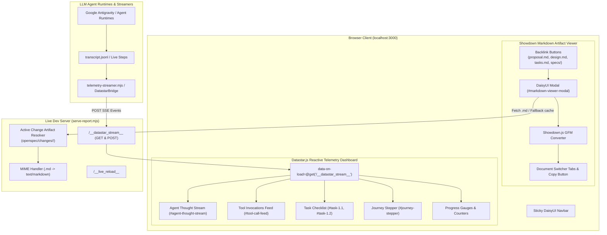

# Technical Design: Datastar Live LLM Tracking Dashboard & Showdown Markdown Artifact Viewer

## Architecture Overview


## Detailed Component Specifications

### 1. Showdown In-Browser Markdown Viewer
1. **Dev Server Artifact Routing (`serve-report.mjs`)**:
   - Detects requests for `.md` files or paths like `/proposal.md`, `/design.md`, `/tasks.md`, `/specs/...`.
   - Resolves from repo root first; if not found, locates the active change directory in `openspec/changes/` and serves the file with `Content-Type: text/markdown; charset=utf-8`.
   - Supports HTML direct preview fallback if accessed directly in the browser address bar with `Accept: text/html` or query `?preview=true`.
2. **In-Page Showdown Modal (`<dialog id="markdown-viewer-modal">`)**:
   - Clean DaisyUI modal dialog with backdrop click dismissal and `Esc` key handling.
   - Header with Lucide icon (`file-text`), document name badge, switcher tabs (`proposal.md`, `design.md`, `tasks.md`, `specs/`), and copy markdown button.
   - Showdown converter initialized with:
     ```javascript
     const converter = new showdown.Converter({
       tables: true,
       tasklists: true,
       strikethrough: true,
       ghCodeBlocks: true,
       simplifiedAutoLink: true,
       openLinksInNewWindow: true
     });
     ```
   - Renders into DaisyUI `prose prose-sm sm:prose max-w-none text-base-content`.
   - Embedded cache containing current artifacts so the viewer works instantly even offline or in standalone files.

### 2. Datastar Live LLM Tracking Dashboard
1. **Real-Time SSE Streaming Pipeline**:
   - Uses `@starfederation/datastar@1.0.0-beta.9` loaded via addon CDN.
   - Automatically connects to dev server `/__datastar_stream__` via Datastar SSE attributes or native EventSource bridge.
2. **Agent Thought Stream (`#agent-thought-stream`)**:
   - Displays real-time reasoning / Chain-of-Thought logs in expandable, distinct chat bubbles (`chat chat-start`).
   - Timestamps and token counters.
3. **Live Tool Invocations Feed (`#tool-call-feed`)**:
   - Displays real-time cards for executed tools (`read_file`, `write_file`, `edit_file`, `run_command`, `invoke_subagent`).
   - Category icons (`terminal`, `file-code`, `globe`, `users`).
   - Real-time running spinner during execution; duration badge (`120ms`) upon completion.
   - Collapsible DaisyUI terminal drawer (`mockup-code`) with stdout lines.
4. **Task Matrix & Stepper**:
   - Synchronized with `tasks.md`.
   - Surgical DOM morphing: updating task `#task-1.1` from `pending` to `running` to `completed` replaces only `#task-1.1` without reloading the page or losing scroll position.
5. **Interactive Telemetry Controller & CLI Streamer**:
   - On-screen controls to simulate live LLM steps (Burst mode, Step mode, Reset) for immediate demonstration on `localhost:3000`.
   - Streamer script (`skills/html-report/scripts/telemetry-streamer.mjs`) that can tail live agent logs or push synthetic events via `POST /__datastar_stream__`.
