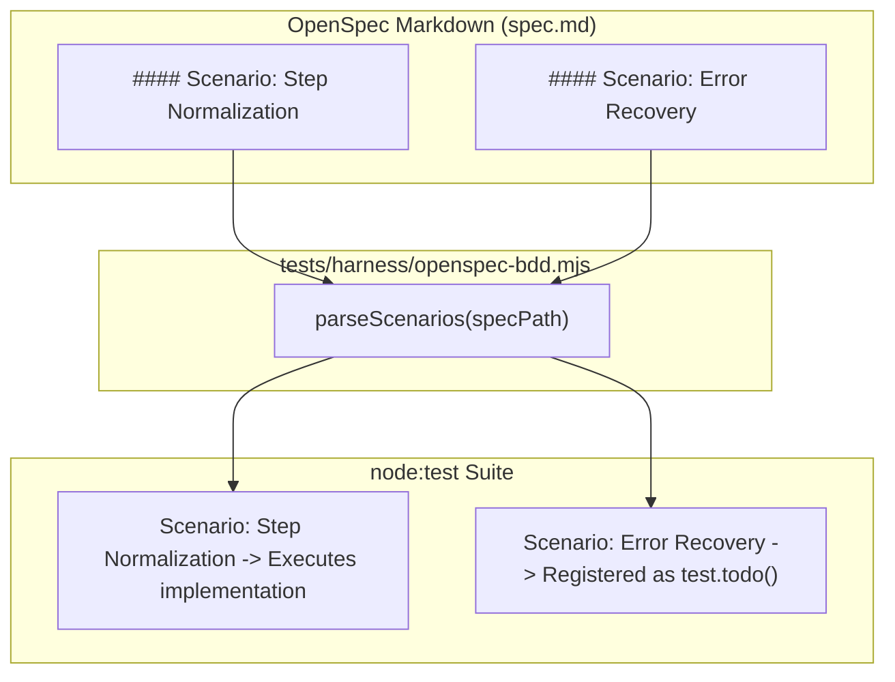

# Design: Native OpenSpec BDD-as-TDD Verification Harness

## Context

See [proposal.md](file:///home/eta/projects/html-report/openspec/changes/native-openspec-bdd/proposal.md) for background and motivation.

The repository's test architecture relies on native Node.js ESM test runners (`node:test`, `node:assert/strict`) for rapid execution (<2s across all 18+ suites) and avoids adding npm packages to the repository root. At the same time, OpenSpec specifications are authored in Markdown with explicit `#### Scenario:` headings containing `GIVEN`, `WHEN`, and `THEN` steps. 

This design establishes a minimal, zero-dependency BDD harness that transforms OpenSpec markdown files into executable test suites, enabling a structured **Double-Loop BDD-as-TDD** workflow.

## Goals / Non-Goals

**Goals:**
- Provide a zero-framework BDD DSL (`Feature`, `Scenario`, `Given`, `When`, `Then`, `And`) on top of `node:test`.
- Create a markdown scenario loader that binds OpenSpec `spec.md` scenarios directly to test functions.
- Automatically register unimplemented scenarios as `test.todo()`, providing living progress metrics without failing CI.
- Maintain 100% backward compatibility with all existing `node:test` suites in `tests/`.
- Provide an interactive companion HTML report with a 1-click copyable prompt for future feature development.

**Non-Goals:**
- Porting all 18+ existing unit test files into BDD format. (Unit tests remain focused on internal plumbing, edge cases, and color/math conversions).
- Adding `@cucumber/cucumber` or other external Gherkin interpreters.
- Complex regex step matching across disparate step registries. (Scenarios are bound explicitly by name for complete readability and agent discoverability).

## Decisions

### 1. Native ESM Primitives over Cucumber CLI
- **Decision**: Build `tests/harness/bdd.mjs` as a direct wrapper around `node:test`'s `describe` and `it`.
- **Rationale**: Keeps the root workspace 100% dependency-free, boots in milliseconds, runs in any environment with standard Node.js &ge; 18, and avoids the heavy maintenance overhead of Cucumber regex step tables.
- **Alternatives Considered**:
  - `@cucumber/cucumber`: Rejected due to 50+ transitive dependencies, slower execution, and fragile regex parameter binding.
  - `playwright-bdd`: Good for full browser UI testing, but too heavy for fast unit and backend script verification.

### 2. Direct OpenSpec `spec.md` Parsing for Scenario Binding
- **Decision**: In `tests/harness/openspec-bdd.mjs`, parse Markdown headers matching `/^####\s+Scenario:\s*(.+)$/gm` directly from the feature's `spec.md`.
- **Rationale**: Eliminates the "Two Masters" problem. Developers and AI agents only edit the OpenSpec `spec.md`. Scenarios are never duplicated into separate `.feature` files.
- **Alternatives Considered**: Generating `.feature` files from `spec.md` during build time. Rejected as unnecessary file proliferation.

### 3. Graceful Todo Drift Detection
- **Decision**: If a scenario in `spec.md` is not present in the test binder, automatically invoke `test.todo(scenarioName)`.
- **Rationale**: Enables true BDD-as-TDD. When drafting an OpenSpec change, the full specification can be written first; running `node --test` highlights pending work as `todo` rather than crashing the suite.

## Risks / Trade-offs

- **[Risk] Scenario title mismatch between `spec.md` and test code** &rarr; *Mitigation*: The loader checks titles with case and whitespace normalization, and logs a clear diagnostic listing available scenario names if a binder fails to match.
- **[Risk] Scope creep into low-level unit testing** &rarr; *Mitigation*: Maintain strict separation of concerns in guidelines: BDD scenarios test specification contracts; standard `node:test` files test internal functions, math, and edge cases.
