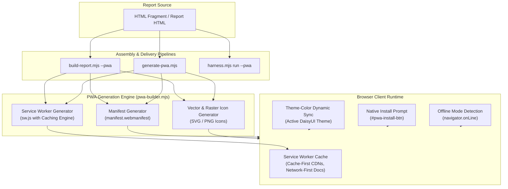
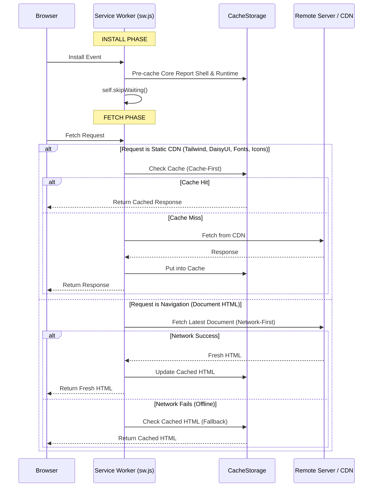

# Design Document: Instant Progressive Web App (PWA) Architecture

> Visual Plan & Companion Dashboard: [index.html](file:///home/eta/projects/html-report/openspec/changes/instant-pwa/index.html) | Servable at `http://localhost:3000`
> Backlinks: [proposal.md](file:///home/eta/projects/html-report/openspec/changes/instant-pwa/proposal.md) | [tasks.md](file:///home/eta/projects/html-report/openspec/changes/instant-pwa/tasks.md) | [specs/instant-pwa/spec.md](file:///home/eta/projects/html-report/openspec/changes/instant-pwa/specs/instant-pwa/spec.md)

## Context & Problem Statement

Users of `html-report` generate reports containing complex dashboards, telemetry logs, architectural diagrams, and data tables. In many operational workflows (field inspections, on-call debugging, presentations, travel), reports must be installable as standalone desktop or mobile apps with instant launch times and complete offline access.

Standard web pages lack installability, home-screen badges, offline service workers, and OS-level window chrome. Creating a PWA conventionally requires configuring multiple files:
1. `manifest.webmanifest` (JSON specification with theme colors, icons, scopes, categories)
2. `sw.js` (Service Worker handling fetch interception, cache quotas, lifecycle)
3. App icons (192x192, 512x512, maskable safe-zone, SVG vectors)
4. Client runtime hooks (`beforeinstallprompt`, theme synchronization, network health alerts)
5. Web server MIME type configurations (`application/manifest+json`)

Our goal is to make this **entirely instant and automated**: a single command or question turns any report into a production-grade PWA.

---

## Architectural Overview



---

## Component Details

### 1. PWA Engine (`skills/html-report/scripts/pwa-builder.mjs`)

The PWA Builder is a zero-dependency pure ESM module exporting:
- `buildManifest({ title, shortName, themeColor, backgroundColor, startUrl, icons, description })`: Produces standard W3C Web App Manifest JSON with standalone display, shortcuts, and categories.
- `buildServiceWorker({ cacheName, preCacheUrls, cdnPatterns })`: Generates a high-performance Service Worker script.
- `buildAppIcons({ title, emoji, backgroundColor, primaryColor })`: Generates clean SVG icons and data URIs that scale crisply across 192px and 512px viewports.
- `generatePwaAssets(options)`: Orchestrates writing `manifest.webmanifest`, `sw.js`, and `icon.svg` / PNGs into the target directory and returning injection HTML snippets.
- `injectPwaIntoHtml(html, pwaAssets)`: Modifies `<head>` to add `<link rel="manifest">`, `<meta name="theme-color">`, Apple mobile web app tags, and wires Service Worker registration in the runtime.

### 2. Service Worker Lifecycle & Dual Caching Strategy



### 3. Client Runtime & DaisyUI Integration (`report-runtime.js`)

1. **Service Worker Registration**:
   Registers `./sw.js` upon DOM ready with scope `./`. Listens for updates and provides notification.
2. **DaisyUI Dynamic Theme Sync**:
   When the user switches across any of the 32 DaisyUI themes (or custom theme), `setReportTheme()` resolves the theme's primary color or background color via `resolveDaisyUIThemePalette()` and updates `<meta name="theme-color">` dynamically, keeping mobile OS status bars and PWA window headers perfectly in sync.
3. **`beforeinstallprompt` & Installation Affordance**:
   Captures `beforeinstallprompt`, prevents default mini-infobar, unhides the navbar `#pwa-install-btn` and enables the Download menu item "Install as App (PWA)".
4. **Offline Status Tracking**:
   Monitors `online` and `offline` events. When offline, renders a subtle warning badge `#pwa-offline-badge`: `"Offline Mode (Cached)"`.

### 4. Converter CLI (`generate-pwa.mjs`)

Enables instant PWA transformation of any existing report without modifying original source code manually:
```bash
node skills/html-report/scripts/generate-pwa.mjs ./existing-report.html --name "My App"
```

---

## Security & CSP Considerations

- `Content-Security-Policy`:
  - `manifest-src 'self' data:` allows manifest loading.
  - `worker-src 'self' blob:` allows same-origin service worker execution.
  - `img-src` allows data URIs for dynamically generated SVG icons.
- Dev Server (`serve-report.mjs`):
  - Adds `Service-Worker-Allowed: /` HTTP header when serving `sw.js`.
  - Serves `.webmanifest` with `application/manifest+json`.

---

## Alternatives Considered

1. **Blob URL Service Worker (`URL.createObjectURL`)**:
   - *Considered*: Embedding service worker directly inside HTML via Blob URL to create a single-file zero-extra-file PWA.
   - *Rejected*: W3C Service Worker specification and modern browser security models explicitly forbid registering Service Workers from `blob:` URLs (violates same-origin script check). Companion `sw.js` is required by all major browsers.
2. **Heavy Workbox Dependency**:
   - *Considered*: Bundling Google's Workbox library (~50KB+).
   - *Rejected*: Violates repository philosophy of zero external npm dependencies. Pure vanilla Service Worker provides faster execution, zero dependency bloat, and full control over cache strategies.
