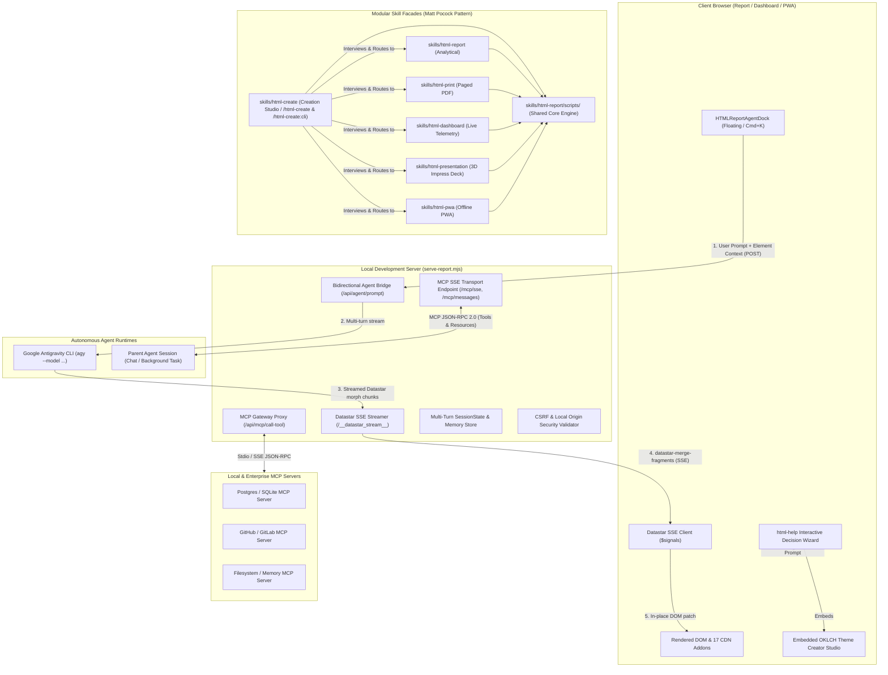
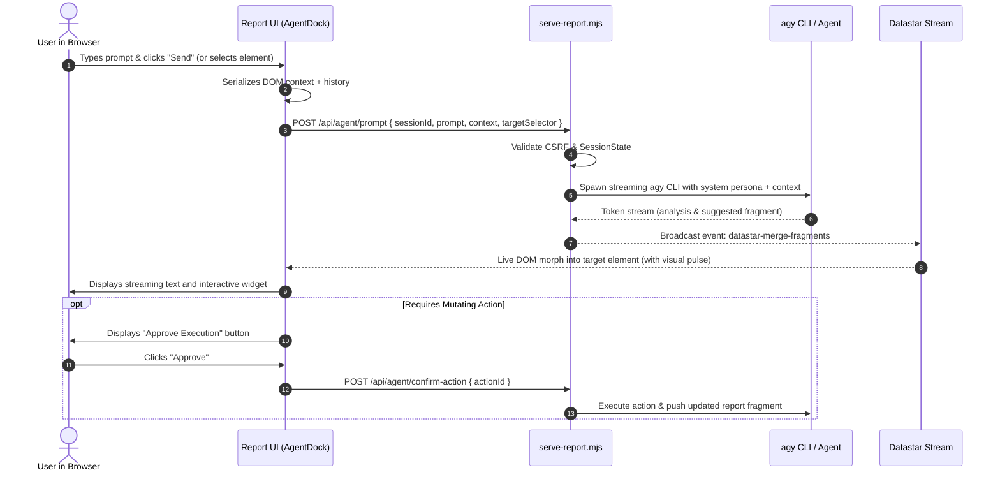
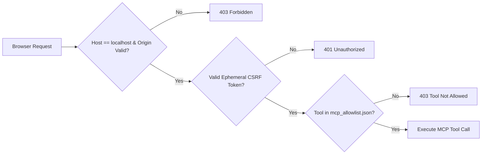
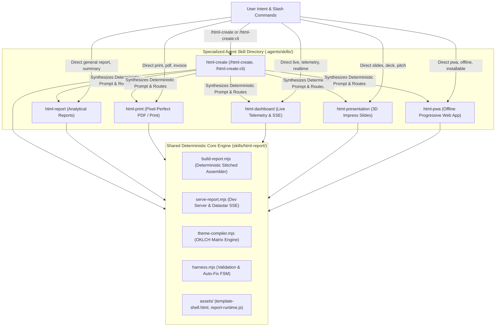
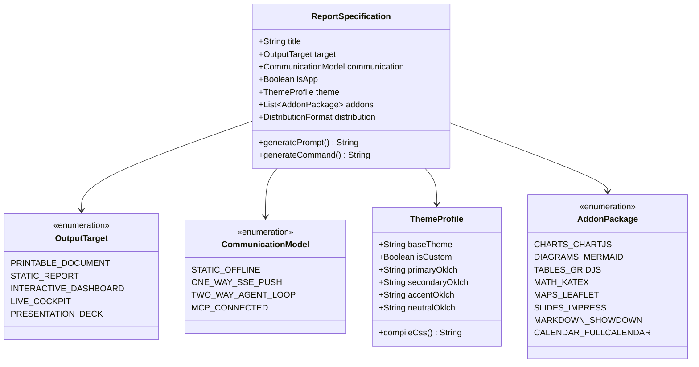

# Design Specification: Technical Architecture & Domain Modeling for Four Core Capabilities

**Change ID**: `pipeline-four-core-features`  
**Stage**: `Planning` (Refined by Tech Lead & Product Owner)  
**Date**: 2026-11-06  
**Artifact Backlinks**:
- High-Level Proposal: [proposal.md](file:///home/eta/projects/html-report/openspec/changes/pipeline-four-core-features/proposal.md)
- Task Pipeline & Milestones: [tasks.md](file:///home/eta/projects/html-report/openspec/changes/pipeline-four-core-features/tasks.md)
- Delta Specs:
  - Feature 1: [specs/bidirectional-agent-loop/spec.md](file:///home/eta/projects/html-report/openspec/changes/pipeline-four-core-features/specs/bidirectional-agent-loop/spec.md)
  - Feature 2: [specs/mcp-server-bridge/spec.md](file:///home/eta/projects/html-report/openspec/changes/pipeline-four-core-features/specs/mcp-server-bridge/spec.md)
  - Feature 3: [specs/modular-skill-decomposition/spec.md](file:///home/eta/projects/html-report/openspec/changes/pipeline-four-core-features/specs/modular-skill-decomposition/spec.md)
  - Feature 4 & 4.1: [specs/html-help-wizard-domain-model/spec.md](file:///home/eta/projects/html-report/openspec/changes/pipeline-four-core-features/specs/html-help-wizard-domain-model/spec.md)

---

## 1. System Architecture Overview

The following diagram illustrates how the four features interface across the client browser, the local Node.js development server (`serve-report.mjs`), external MCP servers, and autonomous agent CLI runtimes:



---

## 2. Feature 1: Bidirectional HTML &harr; Agent Interactive Loop

### 2.1 Interaction Protocol & Flow
The user can trigger prompts in two modes:
1. **Global Prompt**: Via the floating dock (`Cmd+K` or click bottom-right widget).
2. **Contextual Element Prompt**: Clicking "Ask Agent" on any card or chart, which captures element text, attributes, and attached Chart.js/Grid.js datasets.



### 2.2 Endpoint Specification
- **`POST /api/agent/prompt`**:
  ```json
  {
    "sessionId": "sess_982a71bf",
    "prompt": "Recalculate error rate without timeout failures",
    "targetSelector": "#incident-metrics-card",
    "context": {
      "elementId": "incident-metrics-card",
      "currentData": { "total": 1420, "timeouts": 380, "500s": 12 },
      "theme": "corporate"
    },
    "history": [
      { "role": "user", "text": "What is current error rate?" },
      { "role": "assistant", "text": "Error rate is 27.6%." }
    ]
  }
  ```
- **Response**: Server sends chunked SSE or JSON containing rendered Datastar fragments:
  ```http
  HTTP/1.1 200 OK
  Content-Type: text/event-stream
  Cache-Control: no-cache

  event: datastar-merge-fragments
  data: fragments <div id="incident-metrics-card" class="card border border-primary animate-pulse">...</div>
  ```

---

## 3. Feature 2: Two-Way Communication with MCP Server

### 3.1 Dual-Role Architecture (Server & Client)
1. **Report Server as MCP Server**:
   External AI assistants (Cursor, Claude Desktop, Antigravity) connect to `http://localhost:3000/mcp/sse`.
   The server implements JSON-RPC 2.0 and exposes the following tools:
   - `report_get_state`: Returns DOM summary, active theme, rendered cards, and errors.
   - `report_update_fragment`: Updates any element in the report by CSS selector with new HTML via Datastar SSE.
   - `report_set_theme`: Changes the active DaisyUI theme across all connected browser tabs.
   - `report_append_alert`: Injects a toast or dismissible alert banner into the top of the report.
   - `report_export_pdf`: Triggers headless PDF generation and returns the artifact path.

2. **Report Dev Server as MCP Client Gateway**:
   Allows browser widgets to invoke local MCP tools:
   - `POST /api/mcp/call-tool`:
     ```json
     {
       "server": "postgres-prod",
       "tool": "execute_query",
       "args": { "sql": "SELECT status, count(*) FROM jobs GROUP BY status;" },
       "csrfToken": "ephemeral_4fa29d..."
     }
     ```
   - Dev server dispatches over Stdio/SSE to the child MCP server process and streams results back to the browser.

### 3.2 Security Matrix & CSRF Guard


---

## 4. Feature 3: Modular Skill Decomposition (Matt Pocock Pattern)

### 4.1 The Facade Pattern vs Monolithic Skill


### 4.2 Specialization Contract Table

| Skill Facade | Slash Commands | Primary Purpose | Default Addons | Required CLI Flags | Prompt Size |
| :--- | :--- | :--- | :--- | :--- | :--- |
| **`html-create`** | `/html-create`, `/html-create:cli` | Onboarding decision wizard, OKLCH theme studio, deterministic router | DaisyUI, Alpine.js, Showdown | *Serves wizard or runs CLI* | ~3.5 KB |
| **`html-report`** | `/html-report` | Analytical summaries, business intelligence, stats | Chart.js, Grid.js, Lucide, DaisyUI | *None (baseline)* | ~4.5 KB |
| **`html-print`** | `/html-print` | Invoices, compliance documents, A4/Letter PDFs | DaisyUI (light/corporate), Lucide | `--export-pdf --print` | ~3.8 KB |
| **`html-dashboard`** | `/html-dashboard` | Real-time agent monitoring, hypermedia SSE, telemetry | Datastar, Chart.js, Lucide, DaisyUI | `--serve --datastar` | ~4.8 KB |
| **`html-presentation`** | `/html-presentation` | Executive pitch decks, presentations, structured slide decks | Reveal.js, Highlight.js, Lucide | `--presentation` | ~3.5 KB |
| **`html-pwa`** | `/html-pwa` | Offline-first field apps, installable mobile tools | PWA Manifest, Service Worker | `--pwa` | ~4.0 KB |

---

## 5. Feature 4 & 4.1: Interactive Creation Studio (`/html-create`) & Terminal Grill Service (`/html-create:cli`)

### 5.1 Domain Model Definition



### 5.2 Top-Down Questioning Decision Tree (Domain Hierarchy)

1. **Step 1: Primary Target (What is the artifact's purpose?)**
   - Option A: *Printable Document / PDF* &rarr; Locks: Zero animations, `@page` layout, print breaks, default light theme.
   - Option B: *Static Executive Report* &rarr; Locks: Self-contained single HTML file, zero server required.
   - Option C: *Interactive Web Dashboard* &rarr; Enables: Client-side sorting, tabs, filters, Chart.js.
   - Option D: *Live Streaming Cockpit* &rarr; Enables: Datastar SSE, server push, real-time widgets.
   - Option E: *3D Presentation Deck* &rarr; Enables: Impress.js transitions, slide steps, presenter notes.

2. **Step 2: Communication & Interactivity (How does data flow?)**
   - Option A: *Static / Client-side only* (No server needed).
   - Option B: *One-Way Server Push* (Dev server pushes telemetry to report via SSE).
   - Option C: *Two-Way Agent Loop* (User types prompts from report; agent morphs DOM).
   - Option D: *MCP Server Connected* (Report talks to enterprise MCP servers or exposes MCP tools).

3. **Step 3: App Status (Should this be installable?)**
   - Yes &rarr; Adds `--pwa`, generates `manifest.webmanifest`, sets up `sw.js` cache.
   - No &rarr; Standard HTML document.

4. **Step 4: Visual Identity & Theme Creator Studio**:
   - Pick from 32 native DaisyUI themes (default `light`).
   - OR use embedded OKLCH Color Studio (custom Primary, Secondary, Accent, Neutral) with real-time swatch preview.

5. **Step 5: Addon Component Selection**:
   - Checkboxes: Charts (Chart.js), Diagrams (Mermaid), Tables (Grid.js), Math (KaTeX), Maps (Leaflet), Schedules (FullCalendar).

6. **Output Generation (Deterministic Engine)**:
   - Synthesizes exact prompt matching agent standards:
     ```markdown
     Create a [Target] named "[Title]" using the html-report pipeline.
     - Mode: [CommunicationModel]
     - Theme: [ThemeName or Custom OKLCH config]
     - Addons: [List of addons]
     - PWA: [Enabled/Disabled]
     - Command: node skills/html-report/scripts/build-report.mjs --title "[Title]" ...
     ```

### 5.3 CLI Counterpart: Terminal Grill Flow (`/html-create:cli` via `html-grill.mjs`)
Zero-dependency interactive terminal wizard invoked via slash command `/html-create:cli` or CLI:
```bash
$ node skills/html-report/scripts/html-grill.mjs
# Or via slash command: /html-create:cli

? What type of report do you need to build?
  > 1. Static Executive Report (standalone, zero server)
    2. Printable PDF Document (A4/Letter, pagination-ready)
    3. Live Real-Time Dashboard (Datastar SSE streaming)
    4. Interactive 3D Presentation Deck (Impress.js)
    5. Installable Progressive Web App (PWA)

? Does it require bidirectional agent communication?
  > 1. No, static client-side only
    2. Yes, inline prompt dock with live agent DOM morphing
    3. Yes, full MCP server & client gateway

? Choose a visual theme:
  > 1. Light (Default publication clean)
    2. Corporate (Deep navy & slate)
    3. Synthwave / Cyberpunk
    4. Custom Brand Colors (Prompt for hex)

✔ Configuration generated in 24ms!
--------------------------------------------------
Deterministic Agent Prompt:
[Copied to clipboard!]
```

---

## 6. Implementation Security & Performance Guardrails

1. **Localhost Origin Bound**: Dev server strictly verifies `Origin` and `Host` headers to prevent DNS rebinding or malicious website drive-by exploitation of local endpoints.
2. **Deterministic Token Economy**: Specialized skill facades reduce prompt token consumption by 75-85%, allowing small models to generate error-free semantic fragments without getting confused.
3. **Non-Blocking Architecture**: The MCP server and SSE broadcaster operate on Node.js asynchronous event loops with zero blocking calls, supporting up to 50 concurrent browser tabs.
