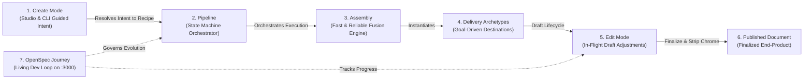

# Design: Ubiquitous Domain Language & Feature Alignment Architecture

## 1. Feature Beneficiary Distinction

Every capability in this repository is designed with an explicit target audience:

| Dimension | **User-Facing Features (Human-Centric)** | **Agent-Facing Features (Agent-Centric)** |
| :--- | :--- | :--- |
| **Primary Interface** | Visual Studio GUI (`create.html`), browser modals, buttons, point-and-click canvas. | Headless CLI commands, JSON flags, non-interactive stdin/stdout, prompt synthesizers. |
| **Value Delivered** | Aesthetic delight, visual clarity, WYSIWYG editing, zero coding required, responsive DaisyUI themes. | Zero-token waste (~70% savings), deterministic execution (<100ms), schema-validated contracts, mechanical auto-repairs. |
| **Examples** | Theme selector dropdown, Quill rich goals modal, Mermaid `[⤢ Enlarge]` button, A4 PDF download button. | Semantic `<main>` fragment linter, Turnkey reconnect prompt generator, BDD verification runner, `GET /__agent_status__`. |
| **Hybrid Tools** | **Two-Way Agent Bridge** & **Edit Mode Dock**: Human clicks element; agent receives synthesized target prompt and executes edits. |

---

## 2. The Two Orthogonal Axes: Serving Mode vs. Behavioral Mode

We explicitly separate how a document is *served/hosted* from how it *behaves*:

```text
                     BEHAVIORAL AXIS
                 Passive (Print/Document)       Interactive (Reactive)
               ┌──────────────────────────┬─────────────────────────────┐
File / Static  │  A. The Paged Document   │  B. The Standalone App      │
Hosted         │  - Invoice, PDF memo     │  - Client-side PokéAPI/JSON │
               │  - Print breaks, @page   │  - Alpine.js, Chart.js      │
SERVING        │  - 0 network required    │  - 0 backend server needed  │
AXIS           ├──────────────────────────┼─────────────────────────────┤
Server-        │  C. Dev Print Preview    │  D. The Living Cockpit      │
Connected      │  - Headless PDF compile  │  - Datastar SSE morphs      │
               │  - Live margin testing   │  - Two-Way Agent Bridge     │
               │  - Hot-reload on disk    │  - Real-time swarm telemetry│
               └──────────────────────────┴─────────────────────────────┘
```

### Serving Mode (Hosting Environment)
- **Static File (`file:///`, GitHub Pages, S3)**: Zero dedicated server required. 100% portable HTML file. JavaScript and client-side `fetch()` to external public CORS APIs (e.g. PokéAPI, Weather API) work seamlessly.
- **Server-Connected (`localhost:3000` via `serve-report.mjs`)**: Dedicated server process running. Backs real-time Server-Sent Events (SSE), filesystem watch hot-reloading, two-way agent bridge actions, and secret backend proxy endpoints.

### Behavioral Mode (User & Data Interaction)
- **Passive / Printable**: Fixed document structure. Built for reading, printing, or headless PDF export (`@html-print`).
- **Interactive / Reactive**: Dynamic user or data interactions. Tabs, filters, client-side sorting, animated Chart.js canvases, or live SSE hypermedia morphs (`@html-report`, `@html-dashboard`).

---

## 3. Core Subsystems



1. **Assembly**: The pure mechanical join putting the Semantic Fragment, Template Shell, and assets together fast (<100ms) and reliably.
2. **Pipeline**: The state machine around assembly ensuring speed and correctness (pre-flight checks, heading IDs, signature-based addon injection, caching).
3. **Delivery Archetypes**: Goal-driven destinations (`@html-report`, `@html-dashboard`, `@html-presentation`, `@html-print`, `@html-pwa`) that know what they need to become.
4. **Create Mode**: Guided intent resolution (Studio & CLI) mapping user desires to the quickest combination of assembly, pipeline, and archetype.
5. **Edit Mode**: Interactive workspace for adjustments on an unpublished product (element targeting, task staging, agent bridge).
6. **Published Document**: Clean, finalized end-product that no longer needs edit-mode, pruning authoring chrome while preserving viewer utilities.
7. **OpenSpec Journey**: The spec-driven development protocol (`proposal.md`, `design.md`, `tasks.md`, `specs/`) connecting feature changes to live dev servers on `localhost:3000`.

---

## 4. The 5-Step Feature Alignment Rubric

When any feature is proposed, it must pass these 5 gates:
1. **Target Beneficiary**: Is this feature **User-Facing** (visual GUI/Studio), **Agent-Facing** (CLI/headless/tokens), or **Hybrid**?
2. **Core Subsystem**: Does it belong to **Assembly**, **Pipeline**, **Delivery Archetypes**, **Create Mode**, **Edit Mode**, **Published Document**, or the **OpenSpec Journey**?
3. **Two-Axis Classification**:
   - Serving Mode: *Static File* vs. *Server-Connected*?
   - Behavioral Mode: *Passive/Printable* vs. *Interactive/Reactive*?
4. **Assembly Invariant**: Does it preserve <100ms compilation and zero boilerplate token waste?
5. **OpenSpec Quad & Live Mirror**: Are the 4 markdown planning files defined and mirrored live to `localhost:3000`?
