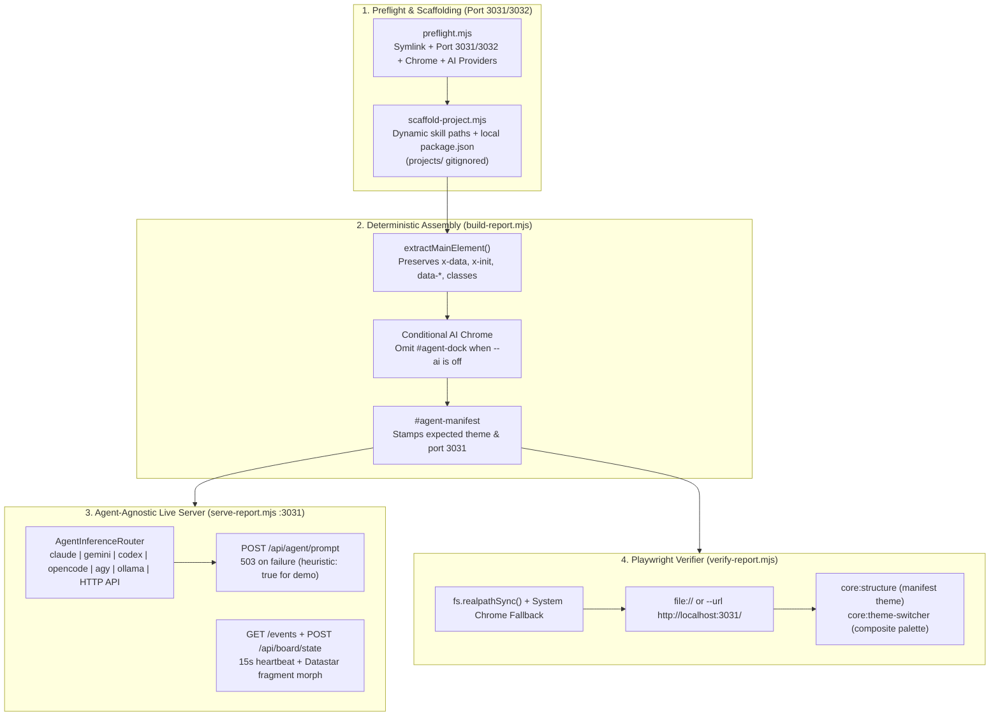

# Design: Experience Review Remediations

## Context

The *Stone / Form* experience review (13 Nov 2026) and subsequent architectural review identified seven reproducible integration defects and six deeper architectural friction points across `skills/html-report/`:
- **Workspace Pollution**: Generated reports under `projects/` were tracked in git instead of treated as ephemeral local deliverables.
- **Port `3000` Collisions & Missing Preflight**: Defaulting project servers and the AI bridge to port `3000` collided with existing services; no preflight CLI existed to check ports (`3031`/`3032`), symlink paths, Playwright vs. system Chrome, or AI provider readiness before authoring.
- [build-report.mjs](file:///home/eta/projects/html-report/skills/html-report/scripts/build-report.mjs#L300-L318) & [template-shell.html](file:///home/eta/projects/html-report/skills/html-report/assets/template-shell.html#L694-L795): `extractMainContent()` strips `<main>` attributes (`x-data`, `x-init`, `id`), while `template-shell.html` injects `#agent-dock-container` and `#agent-reconnect-modal` into every report even when `--ai` is disabled.
- [verify-report.mjs](file:///home/eta/projects/html-report/skills/html-report/playwright/verify-report.mjs#L150-L155) & [runner.mjs](file:///home/eta/projects/html-report/skills/html-report/playwright/harness/runner.mjs#L45): `pathToFileURL(process.argv[1]).href === import.meta.url` exits `0` without running when invoked via a symlink, and `chromium.launch()` fails when Playwright's bundled revision is missing even if system Google Chrome is installed.
- [scaffold-project.mjs](file:///home/eta/projects/html-report/skills/html-report/scripts/scaffold-project.mjs#L101-L130) & [build-report.mjs](file:///home/eta/projects/html-report/skills/html-report/scripts/build-report.mjs#L722-L770): Hardcoded `node skills/html-report/scripts/...` commands fail outside the monorepo.
- [structure.mjs](file:///home/eta/projects/html-report/skills/html-report/playwright/harness/checks/core/structure.mjs#L140-L175) & [theme-switcher.mjs](file:///home/eta/projects/html-report/skills/html-report/playwright/harness/checks/core/theme-switcher.mjs#L38-L59): `core:structure` rejects configured non-`light` themes (`dracula`), and `core:theme-switcher` checks only `datasets[0].borderColor`.
- [serve-report.mjs](file:///home/eta/projects/html-report/skills/html-report/scripts/serve-report.mjs#L1208-L1247) & [report-runtime.js](file:///home/eta/projects/html-report/skills/html-report/assets/report-runtime.js): Hardcodes `execFile("agy", ...)`, fabricates `"14.2% across observed cohorts"` claims on CLI failure, conflates SSE/Bridge/AI status in `#agent-dock-status`, and lacks turnkey `/events` SSE + `/api/board/state` routes and public context/board hooks.

See [proposal.md](file:///home/eta/projects/html-report/openspec/changes/experience-review-remediations/proposal.md) for the full problem statement and capability map.

## Goals / Non-Goals

**Goals:**
- Gitignore `projects/` and delete all tracked files inside `projects/` so generated reports never enter git history.
- Use dedicated default ports `3031` (primary server / Turnkey AI Bridge) and `3032` (secondary / fallback) with free-port discovery, and provide `scripts/preflight.mjs` to check skill paths, ports, browsers, and AI providers upfront.
- Preserve `<main>` reactive/application attributes on `<main id="report-main">`, conditionally strip AI dock chrome when `ai === false`, and emit installation-aware commands plus project-local `package.json` scripts.
- Make all CLI scripts symlink-safe via `fs.realpathSync`, automatically fall back to system Chrome in `runner.mjs`, honor `#agent-manifest` themes in `core:structure`, check composite chart palettes in `core:theme-switcher`, and support `--url <http://...>`.
- Make the Turnkey AI Bridge **agent-agnostic** (`AgentInferenceRouter` supporting `claude`, `gemini`, `codex`, `opencode`, `agy`, `ollama`, custom `HTML_REPORT_AI_CMD`, and HTTP APIs), return honest HTTP `503` on failure, and expose `/api/agent/preflight`, `/events`, `/api/board/state`, and `window.HTMLReportBoard` / `registerContextProvider`.

**Non-Goals:**
- Bundling third-party CDN libraries offline into single binaries (handled separately by PWA service worker caching).

## Decisions

### 1. Ephemeral `projects/` Workspace Hygiene & Dedicated Ports (`3031` / `3032`)
- **Decision**:
  - Add `projects/` to [.gitignore](file:///home/eta/projects/html-report/.gitignore), run `git rm -rf projects/` to untrack and remove `projects/create-a-profile-on-5-different-pokemon*` and `projects/headless-bridge-test`, and keep `projects/` clean.
  - Change the default `aiPort` / project server port from `3000` to `3031` (with `3032` as secondary/fallback port) across `build-report.mjs`, `scaffold-project.mjs`, `serve-report.mjs`, `domain-model.mjs`, and `report-runtime.js`. Note: explicit `--port 3000` remains supported for the repository's OpenSpec journey dashboard (`implementation-progress.html`).

### 2. Pre-Authoring Environment Preflight CLI (`scripts/preflight.mjs`) & System Chrome Fallback
- **Decision**:
  - Create `skills/html-report/scripts/preflight.mjs` exporting `runPreflight({ port = 3031, fallbackPort = 3032 })` and a symlink-safe CLI entrypoint. It probes:
    1. Canonical `skillRoot` via `fs.realpathSync`.
    2. TCP port availability on `3031` and `3032` (plus next open port in `3031..3039`).
    3. Playwright bundled Chromium executable vs. system Chrome/Chromium (`/usr/bin/google-chrome`, `/usr/bin/google-chrome-stable`, `/usr/bin/chromium`, `/usr/bin/chromium-browser`, `/Applications/Google Chrome.app/Contents/MacOS/Google Chrome`).
    4. Available AI inference providers via `AgentInferenceRouter.detectProviders()`.
  - In [runner.mjs](file:///home/eta/projects/html-report/skills/html-report/playwright/harness/runner.mjs), wrap `chromium.launch()` so if the bundled revision is missing, it retries with `{ executablePath: detectedSystemChrome }` or `{ channel: "chrome" }`.

### 3. Preserving `<main>` Attributes & Conditional AI Chrome in `build-report.mjs`
- **Decision**:
  - Introduce `extractMainElement(rawContent)` in [build-report.mjs](file:///home/eta/projects/html-report/skills/html-report/scripts/build-report.mjs) returning `{ innerHtml, attributes, classes, id }`, while keeping `extractMainContent(rawContent)` returning `innerHtml` for backward compatibility.
  - Merge custom classes and inject preserved attributes (`id`, `x-data`, `x-init`, `x-*`, `@*`, `data-*`, `aria-*`) onto `<main id="report-main" ...>` in [template-shell.html](file:///home/eta/projects/html-report/skills/html-report/assets/template-shell.html).
  - Wrap `#agent-dock-container` and `#agent-reconnect-modal` in `<!-- html-report:ai-chrome:start -->...<!-- html-report:ai-chrome:end -->` markers in `template-shell.html` and strip them when `!ai || published`.

### 4. Agent-Agnostic Turnkey AI Bridge (`AgentInferenceRouter`) & Honest HTTP `503`
- **Decision**:
  - Implement `AgentInferenceRouter` in [serve-report.mjs](file:///home/eta/projects/html-report/skills/html-report/scripts/serve-report.mjs) (or a shared module imported by `serve-report.mjs` and `preflight.mjs`) that resolves an inference backend in priority order:
    1. Explicit override via `--ai-provider <name>` / `HTML_REPORT_AI_PROVIDER` or custom command `HTML_REPORT_AI_CMD`.
    2. HTTP API provider if `HTML_REPORT_AI_URL`, `OPENAI_API_KEY`, `ANTHROPIC_API_KEY`, or `GEMINI_API_KEY` is set in `process.env`.
    3. Installed CLI harness auto-detection on `PATH`: `claude` (`claude -p`), `gemini` (`gemini -p`), `codex` (`codex exec`), `opencode` (`opencode run`), `agy` (`agy --model <m> -p`), or `ollama` (`ollama run <m>`).
  - In `POST /api/agent/prompt`, only return synthetic `"14.2%"` telemetry when `payload.heuristic === true`. When no provider is available or the provider call fails, return HTTP `503 Service Unavailable` with `{ status: "error", code: "inference_unavailable", error, reason, preflight }`.
  - Expose `GET /api/agent/preflight` (and enrich `GET /api/agent/health`) with `{ uiConfigured, bridgeReachable, providerAvailable, activeProvider, checkedProviders, streamConnected, modelConfigured }`.

### 5. Turnkey `/events` Datastar SSE, `/api/board/state` & Client `HTMLReportBoard` SDK
- **Decision**:
  - Add `GET /events` to [serve-report.mjs](file:///home/eta/projects/html-report/skills/html-report/scripts/serve-report.mjs) with `text/event-stream`, initial `#live-board-status` fragment, and 15-second `: heartbeat\n\n` keepalive.
  - Add `GET /api/board/state` and `POST /api/board/state` with same-origin validation (`403` on cross-origin `Origin` header), JSON object validation (`400` on invalid payload), persistence, and Datastar `#live-board-status` broadcast to `/events` subscribers.
  - In [report-runtime.js](file:///home/eta/projects/html-report/skills/html-report/assets/report-runtime.js), add `window.HTMLReportAgent.registerContextProvider(fn)`, `window.HTMLReportAgent.setTransportAdapter(fn)`, `window.HTMLReportBoard`, a `file://` guard for SSE streams, and 3-channel status reporting (`Stream`, `Bridge`, `AI Provider`) in `#agent-dock-status`.

## Architecture Flow

## Risks / Trade-offs

- **[Risk] Changing default AI/project port from `3000` to `3031` could affect existing unit tests** → **Mitigation**: Update port assertions in unit tests where default `aiPort` is checked, while keeping `--port <n>` explicit overrides unchanged (so `serve-report.mjs implementation-progress.html --port 3000` continues to serve the OpenSpec dashboard on `3000`).
- **[Risk] Existing tests expecting HTTP 200 on `/api/agent/prompt` without an AI provider** → **Mitigation**: Ensure heuristic tests pass `heuristic: true` and add dedicated tests verifying HTTP `503` when no provider is available and `heuristic` is omitted.
