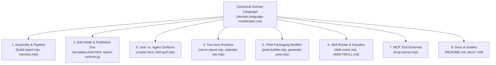

# Design: Domain-Language Code Review & Cross-Codebase Alignment

## 1. Audit Architecture & Review Scope

This plan audits 8 key surfaces of the `html-report` codebase against our Ubiquitous Domain Language:

---

## 2. Detailed Audit Targets & Alignment Rules

### Area 1: Assembly vs. Pipeline (`build-report.mjs`, `harness.mjs`)
- **Assembly (`assembleFragmentIntoShell`)**: Must remain a pure, fast (<100ms) deterministic join of `SemanticFragment` + `TemplateShell` + resolved addons.
- **Pipeline (`HarnessFSM`)**: Must own pre-flight repairs (auto-generating `HeadingId` slugs, container padding checks), addon signature detection, and post-assembly hooks.
- **Cleanup**: Replace vague comments like "stitch snippet" or "bundle partial" with `SemanticFragment` and `TemplateShell`.

### Area 2: Edit Mode vs. Published Document (`template-shell.html`, `report-runtime.js`)
- **Edit Mode**: Standardize authoring comments and runtime namespaces (`#edit-dock`, `HTMLReportEdit`, `TargetElement`).
- **Published Document**: Verify `stripAuthoringMarkup()` in `build-report.mjs` cleanly removes all Edit Mode chrome while preserving Appearance (32 DaisyUI themes) and Download/Export controls.

### Area 3: User-Facing vs. Agent-Facing Surfaces (`create.html`, `html-grill.mjs`, CLI)
- **User-Facing**: Ensure `create.html` exposes visual choices cleanly (Studio GUI, Quill modal, OKLCH color preview, Projects hub) and surfaces the **Beneficiary** and **Two-Axis** selectors.
- **Agent-Facing**: Ensure CLI scripts (`build-report.mjs`, `html-grill.mjs`, `skill-router.mjs`) provide structured `--json` outputs, deterministic exit codes, and zero interactive prompts when run headlessly.

### Area 4: Two-Axis Runtime Decoupling (`serve-report.mjs`, `datastar-sse.mjs`)
- **Static File + Interactive**: Verify that static builds without `--live` do not inject broken localhost SSE hooks, allowing client-side Alpine.js + `fetch()` (e.g. PokéAPI, OpenMeteo) to run cleanly via `file:///`.
- **Server-Connected + Interactive**: Scope Datastar SSE (`/__datastar_stream__`) and Two-Way Agent Bridge (`/__agent_action__`) cleanly to Server-Connected mode.

### Area 5: PWA Packaging Modifier vs. Delivery Archetype (`pwa-builder.mjs`, `generate-pwa.mjs`)
- **Resolution**: Clarify in `domain-model.mjs` and `skills/html-pwa/SKILL.md` that PWA is an **Offline Packaging Modifier** (`--pwa`) that can wrap any Interactive Delivery Archetype (Report, Dashboard, Presentation, Studio) rather than conflicting with the 4 content archetypes.

### Area 6: Skill Router & Sibling Facades (`skill-router.mjs`, `skills/*/SKILL.md`)
- Annotate each `SKILL.md` header/matrix with its canonical **Beneficiary**, **Serving Mode**, and **Behavioral Mode** while respecting the 5KB facade limit.

### Area 7: MCP Server Tool Schemas (`mcp-server.mjs`)
- Audit `NATIVE_MCP_TOOLS` descriptions and parameter names to use canonical terms (`SemanticFragment`, `OutputDeliverable`, `PublishedDocument`) and document that MCP operates as an **Agent-Facing / Hybrid Gateway** in **Server-Connected** mode.

### Area 8: Documentation (`README.md`, `docs/*.md`)
- Align `docs/architecture-fsm.md`, `docs/api-and-cli-reference.md`, and `docs/live-telemetry.md` with the 2-Axis model and Assembly vs. Pipeline distinction.
