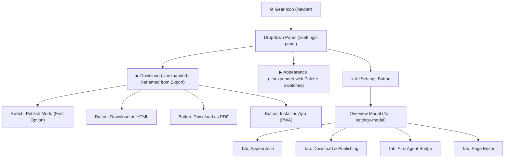

# Design: Settings Gear Menu Redesign & Tabbed Overview

## Context

The initial gear menu implementation relocated the theme switcher and download actions into a single dropdown. However, sections were fully expanded by default, taking up excessive vertical screen space, and a separate "Publishing" section was scheduled to be added later. Consolidating the publish toggle into the Download section and introducing an "All Settings" tabbed modal dramatically simplifies the user interface.

## Architectural Design

### 1. Gear Menu Dropdown Layout (`#settings-panel`)

```
+-------------------------------------------------------+
|  ⚙ Settings                                           |
+-------------------------------------------------------+
|  [⚡ All Settings]  (opens tabbed overview modal)     |
+-------------------------------------------------------+
|  ▶ Appearance  [ light  ■ ■ ■ ■ ] (unexpanded)       |
+-------------------------------------------------------+
|  ▶ Download    [ HTML / PDF / PWA ] (unexpanded)      |
|    - [Toggle] Publish Mode (First option)             |
|    - [Button] Download as HTML                        |
|    - [Button] Download as PDF                         |
|    - [Button] Install as App (PWA)                    |
+-------------------------------------------------------+
|  ▶ Registered Extensions (Edit, AI, etc.)             |
+-------------------------------------------------------+
```

- **Top Action**: A prominent "All Settings" button (`#open-all-settings-btn`) at the very top of `#settings-panel`.
- **Unexpanded Accordions**: Each section is rendered using DaisyUI `collapse collapse-arrow` or `<details class="collapse collapse-arrow">`, unexpanded by default.
- **Appearance Header**: Displays `<span>Appearance</span>` alongside the current palette preview: `<span id="active-theme-label">light</span>` followed by the 4 colored badge dots (`bg-primary`, `bg-secondary`, `bg-accent`, `bg-neutral`).
- **Download Section**: Renamed from "Export" to "Download". The first element inside is `<input type="checkbox" id="settings-publish-toggle" class="toggle toggle-success toggle-sm">` labeled "Publish". Below it are `#download-html-btn`, `#download-pdf-btn`, and PWA install buttons.
- **Removed Standalone Publishing**: `HTMLReportSettings.registerSection({ id: "publishing", ... })` is eliminated.

### 2. "All Settings" Overview Modal (`#all-settings-modal`)

A dedicated modal dialog featuring DaisyUI boxed tabs:
- **Tab 1: Appearance**:
  - Active theme preview with full DaisyUI theme palette swatches.
  - Interactive grid to switch between all 32 supported themes.
- **Tab 2: Download & Publishing**:
  - Live "Publish Mode" toggle switch with explanation of clean export (strips authoring chrome, gear menu, edit docks).
  - One-click "Download Published HTML" and standard "Download as HTML".
  - PDF export status checker and PWA installation state.
- **Tab 3: AI & Agent Bridge**:
  - AI capability switch for the current board.
  - Bridge connection status, heartbeat indicators, and turnkey reconnection prompt with 1-click clipboard copy.
- **Tab 4: Page Editor & Tasks**:
  - Task queue summary, prompt synthesizer preview, and dock launcher.

### 3. State Synchronization

- Changes made inside the "All Settings" modal (e.g., toggling the publish switch or switching the theme) immediately synchronize with the gear dropdown controls and `localStorage`.
- Esc key or clicking the modal backdrop closes the modal; Esc on the dropdown closes the dropdown.

### 4. Technical Flow



## Risks & Mitigations

- **Selector Breakage**: IDs such as `#theme-swatch-list`, `#active-theme-label`, `#download-html-btn`, `#download-pdf-btn`, and `#settings-publish-toggle` remain preserved to guarantee test compatibility.
- **Accessibility**: Modals and collapses maintain proper ARIA attributes (`aria-expanded`, `aria-selected`, `role="tab"`, `role="dialog"`).
