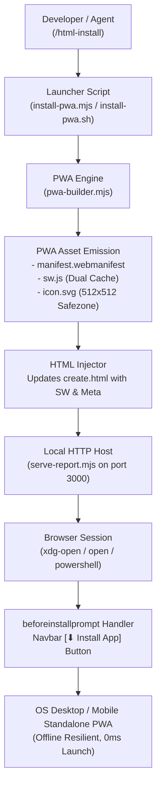
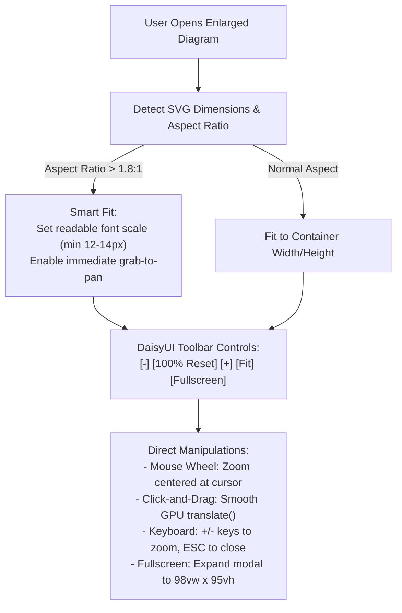

# Design: `/html-install` — PWA Packaging & Installation Architecture

## Architecture Overview

The `/html-install` solution bridges the **Interactive Creation Studio** ([create.html](file:///home/eta/projects/html-report/create.html)) and the **PWA Engine** ([skills/html-report/scripts/pwa-builder.mjs](file:///home/eta/projects/html-report/skills/html-report/scripts/pwa-builder.mjs)). It creates a persistent, offline-capable application shell installable onto desktop and mobile OS platforms.



---

## Detailed Technical Design

### 1. Web App Manifest Specification (`manifest.webmanifest`)

The studio manifest is customized for productivity and development tools:
- **`name`**: `"HTML Report Creation Studio"`
- **`short_name`**: `"HTML Studio"`
- **`start_url`**: `"./create.html"`
- **`scope`**: `"./"`
- **`display`**: `"standalone"`
- **`orientation`**: `"any"`
- **`theme_color`**: `"#2563eb"` (primary DaisyUI blue, dynamically updated)
- **`background_color`**: `"#ffffff"`
- **`categories`**: `["productivity", "developer", "utilities"]`
- **`icons`**:
  - `icon.svg` (`sizes: "any"`, `purpose: "any maskable"`)
  - `icon-192.png` and `icon-512.png` fallback entries
- **`shortcuts`**:
  - `New Report`: `"./create.html#step-purpose"`
  - `Theme Studio`: `"./create.html#step-theme"`
  - `Live Preview`: `"./create.html#mockup-preview-card"`

### 2. Dual-Caching Offline Service Worker (`sw.js`)

The service worker guarantees complete offline operation of [create.html](file:///home/eta/projects/html-report/create.html):

| Asset Group | Strategy | Targeted URLs / Domains |
| :--- | :--- | :--- |
| **CDN Scripts & Styles** | Cache-First | `cdn.tailwindcss.com`, `cdn.jsdelivr.net/npm/daisyui@4.12.14/dist/full.min.css`, `cdn.jsdelivr.net/npm/lucide@0.460.0/dist/umd/lucide.min.js`, `cdn.jsdelivr.net/npm/showdown@2.1.0` |
| **Studio Document** | Network-First with Cache-Fallback | `create.html`, `./`, index navigations |
| **App Shell Metadata** | Cache-First | `manifest.webmanifest`, `icon.svg` |
| **Live SSE Streams** | Bypass (No Cache) | `/__live_reload__`, `/__datastar_stream__` |

During the `install` lifecycle event, the service worker pre-caches `create.html`, `manifest.webmanifest`, `icon.svg`, and the 4 critical CDN bundles. Once fetched, the studio functions with 0ms network latency even when disconnected.

### 3. In-Studio Installation User Experience

In [create.html](file:///home/eta/projects/html-report/create.html):

1. **Navbar Action Button**:
   - An install button (`#pwa-install-btn`) sits in the top navbar next to the Sections and Theme dropdowns.
   - Initial state: Hidden until `beforeinstallprompt` fires (or displays a polite instructions drawer on iOS Safari).
   - When clicked, invokes `deferredPrompt.prompt()` and awaits user confirmation.
   - If installed, displays a subtle `Installed` check badge.

2. **Offline Ready Indicator**:
   - Listens to `navigator.serviceWorker` message `CACHE_READY` or registration completion.
   - Displays a brief toast badge: `⚡ Offline Ready`.

3. **Dynamic Theme-Color Sync**:
   - An internal `MutationObserver` on `document.documentElement` (`data-theme`) extracts the computed `--p` (primary) color and dynamically updates `<meta name="theme-color">` to maintain seamless OS title bar tinting across all 32 DaisyUI themes.

### 4. CLI & Slash Command Workflow (`/html-install`) & Unique Port Strategy

#### Standard Port 3030 & Auto-Hunting
To prevent collisions with popular development frameworks (Next.js, React, Rails, Grafana) that claim port `3000`, the dev server and `/html-install` standardize on **port `3030`**:
- **Default Port**: `3030` (configurable via `HTML_REPORT_PORT` or `PORT` environment variables).
- **Auto-Hunting Fallback**: If port `3030` is occupied, `serve-report.mjs` automatically probes `3031`, `3032`, etc., without crashing, notifying the developer in the console.

1. **Invocation**:
   ```bash
   # Slash command trigger in chat:
   /html-install
   
   # Or CLI script execution:
   node skills/html-create/scripts/install-pwa.mjs
   
   # Or fast bash launcher:
   ./skills/html-create/scripts/install-pwa.sh
   ```

2. **Execution Steps**:
   - Checks if `create.html` is present in repo root or `skills/html-report/assets/create.html`.
   - Invokes `generatePwaAssets()` from [skills/html-report/scripts/pwa-builder.mjs](file:///home/eta/projects/html-report/skills/html-report/scripts/pwa-builder.mjs).
   - Injects PWA `<head>` links, navbar button, and registration script into [create.html](file:///home/eta/projects/html-report/create.html).
   - Starts or reuses the local dev server on dedicated port `3030` (with auto-fallback).
   - Launches browser to `http://localhost:3030/create.html`.
   - Outputs clear terminal guidance on completing the 1-click install in Chrome, Edge, Safari, or Brave.

### 5. Interactive Diagram Zoom, Pan & Viewport Architecture

To solve the issue where wide horizontal diagrams (e.g. `flowchart LR` or complex architecture graphs) shrink to unreadable scales inside `#mermaid-enlarge-modal`, an interactive GPU-accelerated pan-and-zoom engine is added directly into the shell and runtime:



#### Toolbar UI Specifications (DaisyUI)
Placed directly in the header of `#mermaid-enlarge-modal`:
```html
<div class="join border border-base-300 bg-base-100 rounded-lg shadow-xs">
  <button id="mermaid-zoom-out-btn" class="join-item btn btn-xs btn-ghost gap-1" title="Zoom Out (-)">
    <svg class="w-3.5 h-3.5" viewBox="0 0 24 24" fill="none" stroke="currentColor" stroke-width="2"><path d="M5 12h14"/></svg>
  </button>
  <button id="mermaid-zoom-reset-btn" class="join-item btn btn-xs btn-ghost font-mono text-3xs px-2" title="Reset Zoom">
    <span id="mermaid-zoom-level">100%</span>
  </button>
  <button id="mermaid-zoom-in-btn" class="join-item btn btn-xs btn-ghost gap-1" title="Zoom In (+)">
    <svg class="w-3.5 h-3.5" viewBox="0 0 24 24" fill="none" stroke="currentColor" stroke-width="2"><path d="M12 5v14M5 12h14"/></svg>
  </button>
  <button id="mermaid-zoom-fit-btn" class="join-item btn btn-xs btn-ghost gap-1" title="Fit to Viewport">
    <svg class="w-3.5 h-3.5" viewBox="0 0 24 24" fill="none" stroke="currentColor" stroke-width="2"><path d="M15 3h6v6M9 21H3v-6M21 3l-7 7M3 21l7-7"/></svg>
  </button>
</div>
<button id="mermaid-fullscreen-btn" class="btn btn-xs btn-ghost btn-square" title="Toggle Fullscreen Viewport">
  <svg class="w-3.5 h-3.5" viewBox="0 0 24 24" fill="none" stroke="currentColor" stroke-width="2"><path d="M8 3H5a2 2 0 00-2 2v3m18 0V5a2 2 0 00-2-2h-3m0 18h3a2 2 0 002-2v-3M3 16v3a2 2 0 002 2h3"/></svg>
</button>
```

#### Viewport Interactions
1. **Transform State**: Maintained via clean state object `{ scale: 1.0, x: 0, y: 0, isDragging: false, startX: 0, startY: 0 }`.
2. **GPU Acceleration**: Updated via `el.style.transform = `translate(${x}px, ${y}px) scale(${scale})`; `el.style.transformOrigin = 'center center'`.
3. **Grab-to-Pan**: Cursor switches dynamically to `cursor: grab` and `cursor: grabbing` on mousedown.
4. **Mouse Wheel Zoom**: Detects deltaY and smoothly updates `scale` between `0.25` (25%) and `4.0` (400%) in 0.1 increments.
5. **Double Click**: Resets zoom to default 100% or fit-to-view.

---

## Alternative Solutions Considered

1. **Electron or Tauri Desktop Binary**:
   - *Rejected*: Requires heavy native toolchains (Rust, C++, multi-hundred MB downloads), violates zero-dependency ethos, and prevents instant web distribution.
2. **Static file:// launch only**:
   - *Rejected*: Modern browsers strictly disable Service Worker registration and PWA installation over the `file://` protocol due to origin security policies. A lightweight local HTTP server (such as [serve-report.mjs](file:///home/eta/projects/html-report/skills/html-report/scripts/serve-report.mjs)) is mandatory for standard PWA installation.
3. **PWA Wizard as a separate web page**:
   - *Rejected*: Fracturing `create.html` creates drift and duplicate maintenance. Packaging `create.html` directly preserves a single source of truth for both static web and standalone PWA usage.
