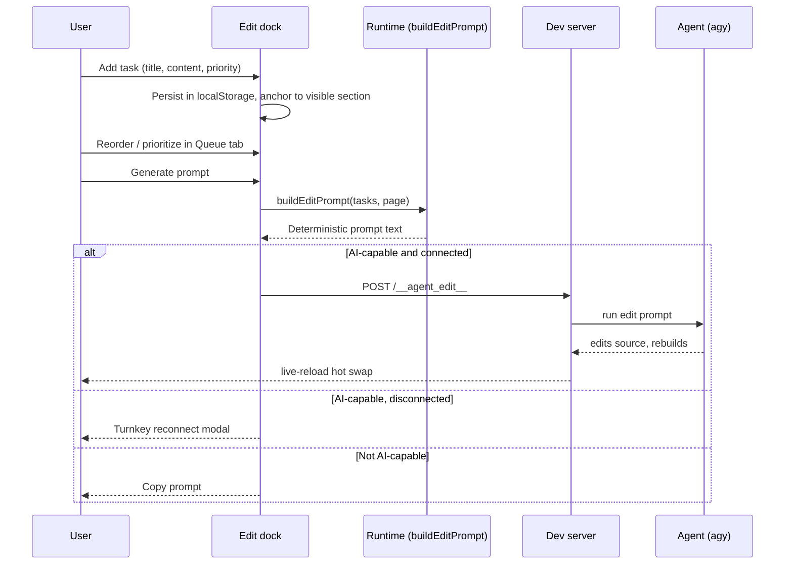

# Design: Page Edit Queue & Deterministic Prompt Editor

## Context

Reviewing a report produces a stream of small change requests (fix this chart, reword that heading). Today they live in your head or a chat. A per-page task queue lets you capture them in place while reading, rank them, and hand the agent one clean, reproducible prompt. Everything is deterministic and baked into every html-report, so no LLM is needed to build the prompt.

## Design

### Dock UI

`#edit-dock` is `position: fixed; bottom: 0`, full-width capped at `max-w-3xl` centered. **Collapsed**: 40px bar (task-count badge, current-section chip, `+` button). **Expanded**: `max-h: min(38vh, 320px)`, internal scroll. `body` gets `padding-bottom` equal to the dock height via `ResizeObserver` so content is never covered. `print:hidden`, `z-index` below modals, above content.

### Tabs

**Compose**: title input, content textarea (auto-grow to 4 lines), priority select, optional section anchor chip (defaults to the current section), `Add` (Ctrl/Cmd+Enter). **Queue**: sortable list with P1/P2/P3 chips, up/down + drag reorder, done checkbox, delete, click to scroll to anchor. Footer: **Generate prompt**.

### Scroll-following

An `IntersectionObserver` over headings and `section[id]` tracks the section nearest the viewport top and writes it to the dock chip. New tasks anchor to it. In the Queue tab, tasks anchored to the visible section are highlighted, and clicking a task smooth-scrolls to its anchor and flashes an outline. This gives the better overview of what needs editing.

### Data model

Task `{ id, title, content, priority: 1|2|3, order, done, anchor: { id, label } | null }`. Stored in `localStorage` key `html_report_edit_queue:<pageKey>`; `pageKey` = `<meta name="html-report-source">` (emitted by build-report) else `location.pathname`.

### Deterministic prompt

Pure function `buildEditPrompt(tasks, page, options)` in the runtime, unit-testable in Node. Order: priority asc, then manual order; done tasks excluded. Output is byte-identical for identical input (no timestamps, no randomness). Sections: page identity (title, source path, report mode), numbered tasks with priority and anchor, standing constraints (preserve html-report conventions, edit the source fragment, rebuild with `build-report.mjs`, keep localhost:3000 live, update tasks if OpenSpec). Supports an **Auto-priority** mode adding explicit agent instructions to prioritize tasks based on complexity and dependencies.

### Prompt freshness & copy gating

The copy prompt action is gated by prompt freshness:
- Disabled initially until the user clicks **Generate prompt**.
- Any state change to the queue (adding tasks, editing content, reordering, marking done, deleting, or changing auto-priority) immediately resets the generated prompt and disables the copy button with an explanatory tooltip (`Generate a prompt first to copy or send`).
- Prevents sending or copying stale prompts that do not reflect the current queue.

### Accessibility, darkmode & small-viewport resilience

- **Darkmode**: `#edit-dock` uses a 2px top primary accent border (`border-t-2 border-primary/70`), upward drop shadow (`shadow-[0_-10px_35px_-5px_rgba(0,0,0,0.5)]`), ring outline, and distinct card styling on `#edit-queue-list` items to maintain high contrast across all dark DaisyUI themes.
- **Narrow viewports (mobile / small mode)**: Fixed controls (`checkbox`, priority `chip`, reorder/delete buttons) use `shrink-0`, and task titles use `min-w-0 flex-1 truncate` so text next to the priority chip never collapses. Anchor badges use `badge-outline` with responsive max-width so section context remains legible.

### Send to agent

States: **AI-capable + connected** → primary button *Send to agent* posts the prompt to a new dev-server endpoint `POST /__agent_edit__` (localhost only, scoped to the served file) and streams status; hot-swap live reload shows the result. **AI-capable + disconnected** → button becomes *Turnkey reconnect* opening the existing reconnect modal with the edit prompt included. **Not AI-capable** → *Copy prompt* only, with a link to Settings → Activate AI (Story 2).

## Flow

## Alternatives Considered

- **Right-side drawer**: Rejected: steals horizontal reading width on dashboards; bottom dock matches chat/prompt mental model.
- **LLM-composed prompt**: Rejected: user asked for deterministic generation; pure template is testable and free.
- **Store tasks in the HTML file**: Deferred: requires write access; localStorage first, export/import later.

## Risks

- `/__agent_edit__` lets an agent modify files: restrict to localhost, the served file only, and require an explicit user click.
