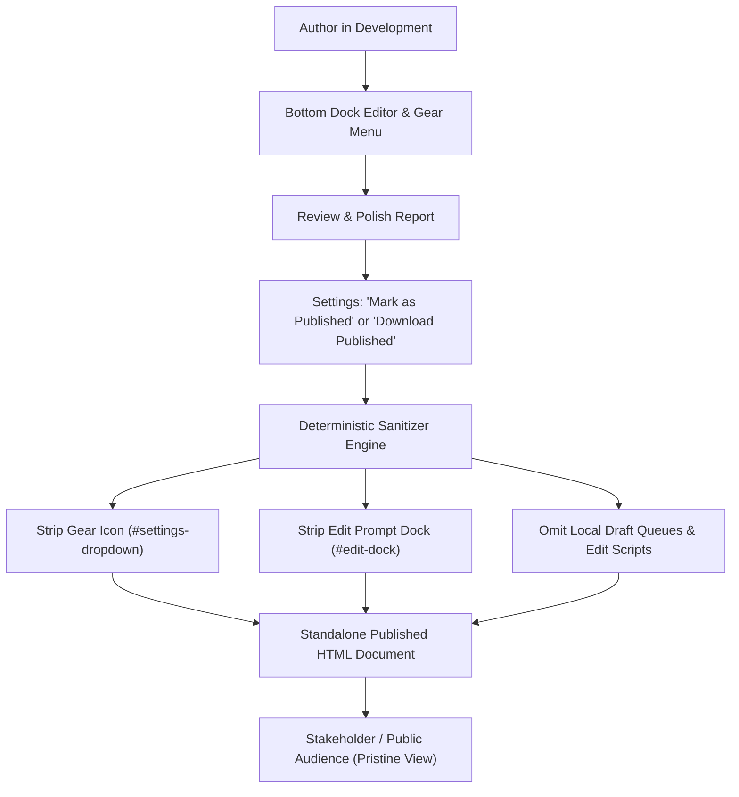

# Design: Publish Mode & Deterministic Clean Download

## Context

Reports are iteratively authored using the bottom-dock editor and agent bridge. Once editing is finalized, stakeholders and public audiences need a clean, uncluttered deliverable without developer tools, gear menus, or prompt editors. Offering a deterministic publish flow guarantees that exported reports are completely self-contained, pristine, and byte-reproducible across identical builds.

## Design

### Publishing Toggle & Action

In Settings panel -> Export & Publishing section: add 'Publish State' toggle and 'Download Published (Clean HTML)' button. When marked as published, the active report sets `<meta name="html-report-published" content="true">` and offers the clean download.

### Deterministic DOM Tree Stripping

In `buildInlinedHtmlSnapshot({ mode: 'published' })`, clone the DOM tree, prune `#settings-dropdown`, remove `#edit-dock`, strip authoring modals/toolbars, strip `data-agent-authoring` attributes, and omit draft task queues. Output is serialized with sorted attributes and standardized whitespace.

### Deterministic Output Guarantee

Zero non-deterministic IDs (e.g. `_sessionId` or random math tokens), zero generation timestamps, and normalized whitespace so hashing identical input HTML yields identical output checksums.

### CLI Pipeline Parity

`build-report.mjs --published` applies the same DOM pruning template transform at build time, omitting the gear icon and editor from the start.

### Standalone Viewer Preservation

The published HTML retains responsive layout, Table of Contents dropdown (TOC stays in navbar or standalone header), offline scripts, Grid.js, Chart.js, Mermaid, and print CSS.

## Flow

## Alternatives Considered

- **CSS-only hide (display: none)**: Rejected: leaving the editor markup and task queue in the DOM leaks draft edit notes into client source.
- **Server-only headless build**: Rejected: users in client-side or offline viewing must be able to download clean published copies directly from their browser.

## Risks

- Regressions in existing navbar/bridge behavior: mitigated by keeping IDs and legacy detection.
