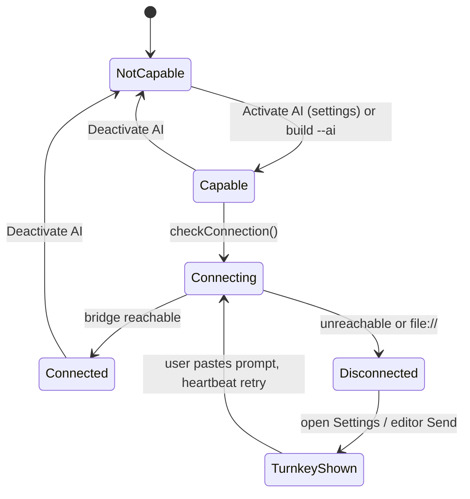

# Design: Activate AI from Settings + Turnkey per Board

## Context

Today a report only shows the agent bridge if the DOM happens to contain agent triggers, and nothing tells a visitor how to enable it. Making AI an explicit, discoverable setting lets any board opt in, and gives each board its own copy-paste turnkey that starts the bridge for that exact file.

## Design

### AI-capable resolution

`HTMLReportAgent.isAiCapable()` returns true if any of: `<meta name="html-report-ai" content="on">` (build flag `--ai`), localStorage `html_report_ai:<pageKey>` = `on`, or legacy DOM triggers (backward compatible). Toggling in settings updates localStorage, shows the status badge, and starts the connection check + heartbeat immediately.

### Settings AI section

Toggle *Activate AI*. When on: live status line (connected / connecting / disconnected), **Turnkey** card with the prompt preview, *Copy turnkey prompt*, *Retry connection*, and Node.js note (reuses `getReconnectPrompt`). When off: short explainer.

### Per-board turnkey

A *board* is one report page. The prompt is generated per page: includes the board's source path (from `html-report-source` meta) and serve command, so pasting it into any agent starts `serve-report.mjs` on that file. Optional v1.1: when served, `GET /__boards__` lists sibling reports with their AI flag and a turnkey copy button each.

### Build-time marking

`build-report.mjs --ai` writes the meta tag so shared files arrive pre-marked and show the turnkey when opened via `file://`.

### Editor integration

Story 1's send button reads `isAiCapable()` and connection state to choose Send / Turnkey / Copy.

## Flow

## Alternatives Considered

- **Global AI switch for all reports**: Rejected: user asked for a turnkey per board; per-page state avoids surprising other reports.
- **Auto-detect only**: Rejected: invisible to visitors; explicit setting is discoverable.

## Risks

- Regressions in existing navbar/bridge behavior: mitigated by keeping IDs and legacy detection.
