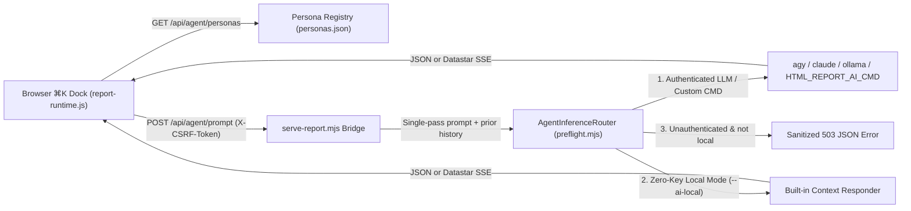

# Design: Zero-API-Key Agent Bridge, Clean Error UX & Dynamic Persona Sync

> **Journey Companion:** [index.html](index.html) | **Proposal:** [proposal.md](proposal.md) | **Tasks:** [tasks.md](tasks.md)

## 1. Architecture Overview

The Two-Way Agent Bridge sits between the browser dock ([`report-runtime.js`](../../../skills/html-report/assets/report-runtime.js)) and the Node.js dev server ([`serve-report.mjs`](../../../skills/html-report/scripts/serve-report.mjs)) using a fixed JSON + Datastar SSE + MCP message schema. The root failures stemmed from **provider selection**, **prompt construction**, **client persona hydration**, and **port collision visibility**, not from the message schema itself.

## 2. Key Technical Decisions

### 2.1 Accurate Auth Gating & Sandbox Safety (`preflight.mjs`)
- **Problem:** `_checkProviderAuthenticated("gemini")` currently returns `true` whenever `~/.gemini` exists (which is true for Antigravity setups that do not configure `gemini-cli`), and `detectProviders()` falls back to `available[0]` even when `authenticated === false`.
- **Decision:**
  1. For `"gemini"`, require either `GEMINI_API_KEY`, `GOOGLE_GENAI_USE_VERTEXAI`, `GOOGLE_GENAI_USE_GCA`, or a readable `~/.gemini/settings.json` containing an explicit auth configuration.
  2. In `detectProviders()`, separate `installed` from `authenticated`, and in `dispatch()`, refuse to execute a CLI provider whose `authenticated === false` unless `allowUnauthenticated: true` is passed explicitly.
  3. Add a lightweight `sanitizeCliError(stderr, err)` helper that maps `EROFS` (`read-only file system`), `Please set an Auth method`, `ENOENT`, and `ETIMEDOUT` to single-sentence user guidance without raw stack traces.

### 2.2 Zero-API-Key Server Assistant Mode (`--ai-local` / `local-bridge`)
- **Problem:** Users who want the AI dock connected to the local server without paying for or configuring external API keys hit `503` unless they manually craft `HTML_REPORT_AI_CMD`.
- **Decision:**
  1. Support `--ai-local` (in `build-report.mjs` / `serve-report.mjs`), `HTML_REPORT_AI_MODE=local`, and automatic detection of a sibling `local-assistant.mjs` in the served project folder (e.g., [`projects/quilt-101/local-assistant.mjs`](../../../projects/quilt-101/local-assistant.mjs)).
  2. When active, `/api/agent/preflight` reports `authenticated: true`, `activeProvider: "local-bridge"` (or `"custom-cmd"`), and `POST /api/agent/prompt` answers using the active persona, report headings/DOM context, Chart.js/table dataset context, and reference metadata—streaming over the exact same JSON and `datastar-merge-fragments` SSE schema.
  3. Preserve strict `503` behavior whenever `--ai-local` / `HTML_REPORT_AI_CMD` / `heuristic: true` is **not** set and no authenticated LLM exists (preserving `reactive-data-copilot` compliance).

### 2.3 Single-Pass Prompt Assembly (`serve-report.mjs` + `preflight.mjs`)
- **Problem:** `sessionStore.addMessage(sessionId, "user", prompt)` runs at line `2171` *before* `historySnippet` is sliced at line `2179`, and `User Prompt: ${prompt}` is embedded inside `systemPrompt` while `dispatch()` appends `prompt` again.
- **Decision:** Build `historySnippet` from prior turns *before* pushing the current user turn (or slice `(-7, -1)`), and pass `systemPrompt` containing only persona + prior history + DOM/dataset context while letting `dispatch()` append the active `prompt` once.

### 2.4 Dynamic Persona Hydration & Port-Fallback Signaling
- **`report-runtime.js`:** On initial connection / dock open, fetch `GET /api/agent/personas` and merge returned personas into `#agent-dock-persona` while respecting `<meta name="html-report-ai-persona">`.
- **`serve-report.mjs`:** Track `requestedPort !== boundPort`; when falling back (e.g., `3031` busy → `3034`), print a prominent warning in the console banner and expose `requestedPort` + `portMismatch` in `/api/agent/preflight`.

### 2.5 Scaffold & Documentation Hardening (`scaffold-project.mjs`, `architecture-and-styling.md`)
- Replace `stats stats-vertical lg:stats-horizontal` in `scaffold-project.mjs` with `grid grid-cols-1 sm:grid-cols-2 xl:grid-cols-4 gap-4`.
- Forward `--ai-port` and `--ai-persona` in the generated `package.json` `build` script and CLI rebuild hint.
- Document in `architecture-and-styling.md` that Alpine `<template x-for>` inside `<svg>` fails across browsers due to SVG namespace parsing; use explicit `<g>` elements or HTML grid containers instead.
