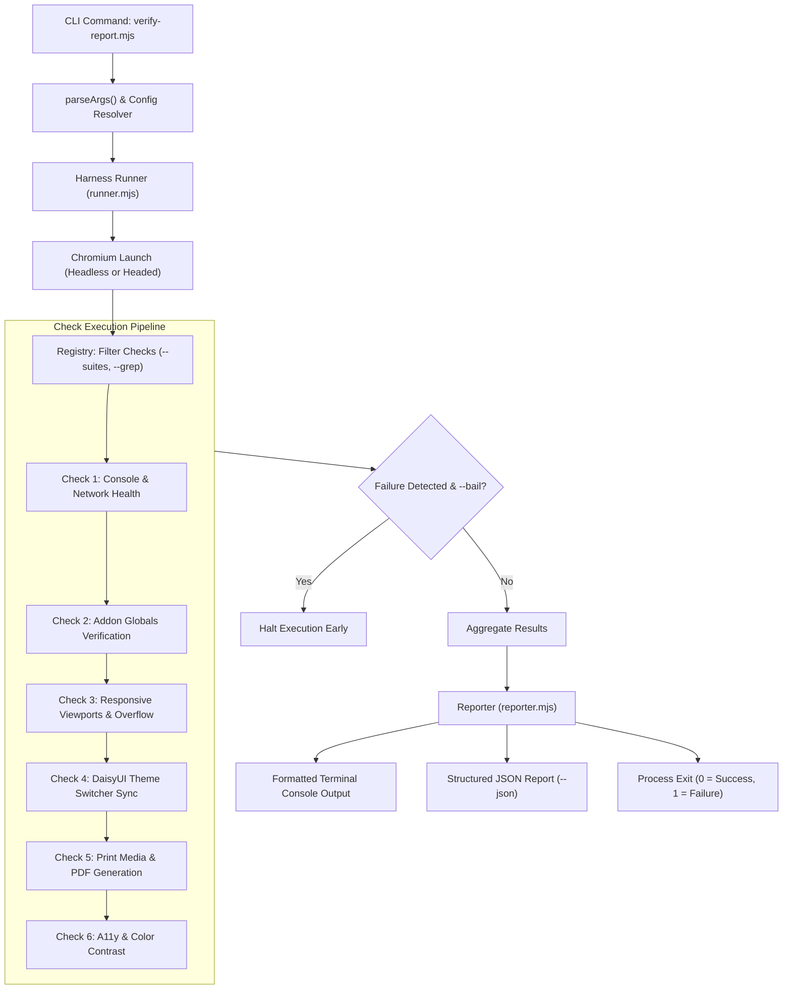

# Design: Playwright Extensible Verification Harness & Precision Flags

## Technical Overview
This design transforms the existing monolithic `verify-report.mjs` (645 lines) into a modular, extensible Playwright testing harness. It introduces:
1. A **Pluggable Check Architecture** where checks are isolated, reusable classes/functions.
2. An **Extensible Check Registry** allowing third parties and caller harnesses to inject custom assertions.
3. A comprehensive suite of **Precision CLI Flags** (`--timeout`, `--suites`, `--only`, `--grep`, `--themes`, `--viewports`, `--screenshots`, `--bail`, `--strict`, `--json`, `--color-contrast`, `--headed`).
4. Full **backward compatibility** with existing flags (`--quick`, `--pdf`, `--mode`, `--caller`).

---

## 1. Directory Structure

```
skills/html-report/playwright/
├── verify-report.mjs            # Backward-compatible CLI entrypoint facade
├── package.json
└── harness/
    ├── runner.mjs               # Core orchestrator: launch browser, manage lifecycle, schedule checks
    ├── registry.mjs             # Registry of available checks & hook registration API
    ├── reporter.mjs             # Console printer (summary, timers, pass/fail) and JSON exporter
    └── checks/
        ├── console-errors.mjs   # Unhandled JS errors & tile 4xx/5xx responses
        ├── addons-health.mjs    # Validates active CDN globals (Chart, Mermaid, FullCalendar, etc.)
        ├── responsive.mjs       # Viewport resizing & horizontal overflow detection
        ├── theme-switcher.mjs   # Theme dropdown interaction & palette sync
        ├── print-pdf.mjs        # @media print validation & PDF rendering
        └── a11y-contrast.mjs    # WCAG AA color contrast & landmark audits
```

---

## 2. Check Contract Interface

Each check module exports a class or object adhering to the `VerificationCheck` contract:

```javascript
export class VerificationCheck {
  constructor(id, title) {
    this.id = id;
    this.title = title;
  }

  /**
   * Evaluates whether this check should run for the given report and options.
   * @param {ReportContext} context
   * @returns {boolean}
   */
  shouldRun(context) {
    return true;
  }

  /**
   * Executes the check assertions.
   * @param {CheckExecutionContext} ctx
   * @returns {Promise<CheckResult>}
   */
  async run({ page, browser, reportUrl, options, reporter }) {
    // Assertions and verifications
    return {
      id: this.id,
      status: "passed", // "passed" | "failed" | "skipped" | "warned"
      durationMs: 120,
      errors: [],
      warnings: [],
      data: {}
    };
  }
}
```

---

## 3. CLI Options Matrix & Parsing

The CLI entrypoint parses the following unified options table:

| Flag | Argument | Default | Description |
|---|---|---|---|
| `--quick`, `-q` | None | `false` | Quick mode: test `sm` + `lg` breakpoints only, skip PDF |
| `--pdf` | `<path>` | `null` | Render and export PDF to specified path |
| `--mode` | `<interactive\|static>` | auto | Override report execution mode |
| `--caller` | `<caller-id>` | `null` | Caller harness integration ID |
| `--timeout` | `<ms>` | `30000` (or `5000` in quick) | Page load and assertion timeout |
| `--suites`, `--only` | `<comma-list>` | all | Run only named checks (`responsive,themes,addons`) |
| `--grep` | `<regex>` | `null` | Filter checks or assertions matching pattern |
| `--themes` | `<comma-list>` | all (or light in quick) | Target specific DaisyUI themes to verify |
| `--viewports` | `<comma-list>` | standard 5 (or 2 in quick) | Target breakpoints (`sm,md,lg,xl,2xl` or `1280x800`) |
| `--screenshots` | `[dir]` | `null` | Save screenshots on failure or per viewport |
| `--bail` | None | `false` | Abort execution immediately upon first failed check |
| `--strict` | None | `false` | Fail if warnings or overflow indicators are found |
| `--json` | `<path>` | `null` | Output structured JSON test execution report |
| `--color-contrast` | None | `false` | Run automated WCAG AA color contrast audits |
| `--headed` | None | `false` | Run browser in visible/headed mode for live debugging |

---

## 4. Execution Flow Diagram



---

## 5. Backward Compatibility Guarantee
Existing build tasks, scripts, and workflows run:
`node skills/html-report/playwright/verify-report.mjs <file> --quick`
or
`node skills/html-report/playwright/verify-report.mjs <file> --pdf report.pdf`

The refactored `verify-report.mjs` maintains this exact interface:
1. It parses legacy arguments without error.
2. It translates `--quick` into `--viewports sm,lg --themes light --timeout 5000`.
3. It defaults to the same expected console output formatting so external string matchers continue to function identically.
