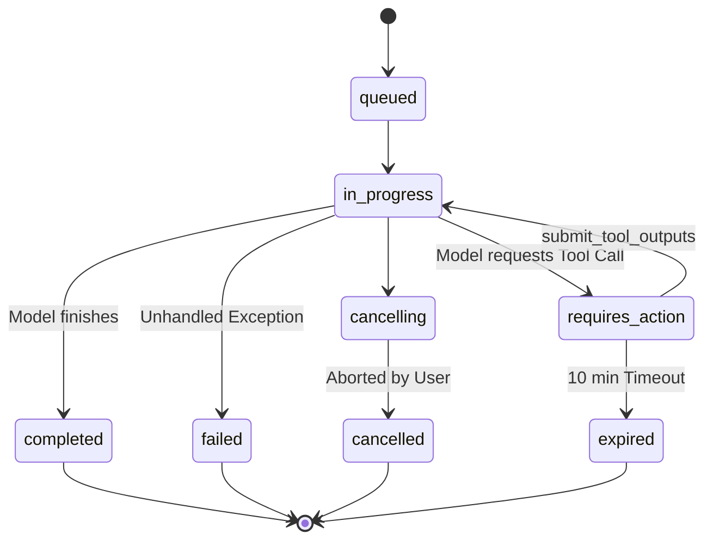

# OpenAI Codex & Agent Telemetry Reference Guide

> **Target Audience**: Developers, telemetry engineers, and autonomous agent builders integrating OpenAI models (GPT-4o, o1, o3-mini, Codex) and agent runtimes into monitoring systems, live dashboards, and execution observers.

---

## Table of Contents
1. [Architectural Overview & Ecosystem Flavors](#1-architectural-overview--ecosystem-flavors)
2. [JSON Structures for Tool Calls](#2-json-structures-for-tool-calls)
   - [Streaming Mode (`delta.tool_calls`)](#streaming-mode-deltatool_calls)
   - [Non-Streaming Mode (`message.tool_calls`)](#non-streaming-mode-messagetool_calls)
   - [Assistants API v2 (`submit_tool_outputs`)](#assistants-api-v2-submit_tool_outputs)
3. [Human-in-the-Loop (HITL), Approvals & Clarification Questions](#3-human-in-the-loop-hitl-approvals--clarification-questions)
   - [Protocol-Level Approval: `requires_action`](#protocol-level-approval-requires_action)
   - [Tool-Level Questions: `ask_user` / `request_approval`](#tool-level-questions-ask_user--request_approval)
4. [Determining the Active Model & Reasoning Telemetry](#4-determining-the-active-model--reasoning-telemetry)
   - [Model Snapshot Resolution](#model-snapshot-resolution)
   - [Reasoning Tokens & Hidden Thoughts (`reasoning_content`)](#reasoning-tokens--hidden-thoughts-reasoning_content)
5. [Detecting Turn & Session Termination](#5-detecting-turn--session-termination)
   - [Streaming `finish_reason` States](#streaming-finish_reason-states)
   - [Assistants API Run State Lifecycle](#assistants-api-run-state-lifecycle)
6. [Hooks Offered by OpenAI & How to Listen](#6-hooks-offered-by-openai--how-to-listen)
   - [SSE Streaming Hooks (Assistants & Chat)](#sse-streaming-hooks-assistants--chat)
   - [OpenAI Swarm & Agent Lifecycle Callbacks](#openai-swarm--agent-lifecycle-callbacks)
   - [OpenAI Webhooks & Verification](#openai-webhooks--verification)
7. [Mapping Complex Tracker Features to OpenAI Codex](#7-mapping-complex-tracker-features-to-openai-codex)
   - [Feature 1: Active Tool Stopwatch & State Machine](#feature-1-active-tool-stopwatch--state-machine)
   - [Feature 2: Terminal Output & Code Diff Drawers](#feature-2-terminal-output--code-diff-drawers)
   - [Feature 3: Human Attention Alerts & Sound Chimes](#feature-3-human-attention-alerts--sound-chimes)
   - [Feature 4: Multi-Agent Swarm Handoff Hierarchy](#feature-4-multi-agent-swarm-handoff-hierarchy)
   - [Feature 5: Context Window Saturation & Velocity](#feature-5-context-window-saturation--velocity)
8. [Official Documentation Links](#8-official-documentation-links)
9. [Next-Gen Frontier Models: GPT-5, o1/o3, Claude Opus & Project Astra](#9-next-gen-frontier-models-gpt-5-o1o3-claude-opus--project-astra)
   - [Do Newer Models Follow the Same Logic?](#do-newer-models-follow-the-same-logic)
   - [The 4 Architectural Evolutions in Frontier Models](#the-4-architectural-evolutions-in-frontier-models)
   - [Cross-Model Ecosystem Comparison Matrix](#cross-model-ecosystem-comparison-matrix)
   - [Why the Strategy Pattern Protects You from Model Churn](#why-the-strategy-pattern-protects-you-from-model-churn)

---

## 1. Architectural Overview & Ecosystem Flavors

When using OpenAI with code-generation agents (often referred to generically as "Codex" or OpenAI coding agents), telemetry originates from one of four API flavors:

| API Flavor | Primary Use Case | Transport | Tool Call Handling |
| :--- | :--- | :--- | :--- |
| **Chat Completions API** | Coding CLIs, Cursor, OpenHands, Aider | SSE (`stream: true`) or REST | Client parses `tool_calls` chunks, executes tools locally, and posts back `role: "tool"`. |
| **Assistants API v2** | Stateful server-side agent threads | SSE streaming or Polling | OpenAI manages conversation state; pauses in `requires_action` for client tool execution. |
| **OpenAI Swarm / Agent SDK** | Multi-agent coordination and handoffs | Client-side Python/Node library | Python/JS functions define agent handoffs and tool execution callbacks. |
| **Realtime API** | Bi-directional streaming voice/coding | WebSockets / WebRTC | Real-time events for audio, text, and client tool calling over a persistent socket. |

---

## 2. JSON Structures for Tool Calls

### Streaming Mode (`delta.tool_calls`)
In streaming mode (`stream: true`), OpenAI chunks tool calls across multiple Server-Sent Events (`data: {...}`).

> [!IMPORTANT]
> In OpenAI streaming, **`function.arguments` is streamed as fragmented strings**, not pre-parsed JSON objects. A client observer must accumulate these fragments by `index` until the model finishes the tool call.

#### Wire Example: First Chunk (Tool Initiation)
```json
{
  "id": "chatcmpl-Aw123XyZ",
  "object": "chat.completion.chunk",
  "created": 1730740000,
  "model": "gpt-4o-2024-08-06",
  "choices": [
    {
      "index": 0,
      "delta": {
        "role": "assistant",
        "content": null,
        "tool_calls": [
          {
            "index": 0,
            "id": "call_AbC123Def456Ghi789",
            "type": "function",
            "function": {
              "name": "run_command",
              "arguments": ""
            }
          }
        ]
      },
      "finish_reason": null
    }
  ]
}
```

#### Wire Example: Intermediate Chunks (Argument Fragments)
```json
{
  "choices": [
    {
      "index": 0,
      "delta": {
        "tool_calls": [
          {
            "index": 0,
            "function": {
              "arguments": "{\"CommandLine\": \"npm test"
            }
          }
        ]
      },
      "finish_reason": null
    }
  ]
}
```
Next chunk:
```json
{
  "choices": [
    {
      "index": 0,
      "delta": {
        "tool_calls": [
          {
            "index": 0,
            "function": {
              "arguments": "\"}"
            }
          }
        ]
      },
      "finish_reason": null
    }
  ]
}
```

#### Wire Example: Terminal Chunk (Finish Reason)
```json
{
  "choices": [
    {
      "index": 0,
      "delta": {},
      "finish_reason": "tool_calls"
    }
  ]
}
```

#### JavaScript Streaming Tool Accumulator Pattern
```javascript
// Accumulates streaming OpenAI tool_calls chunks into complete objects
class OpenAIToolCallAccumulator {
  constructor() {
    this.toolsByIndex = new Map();
  }

  processChunk(chunk) {
    const delta = chunk.choices?.[0]?.delta;
    if (!delta?.tool_calls) return null;

    for (const tc of delta.tool_calls) {
      const idx = tc.index ?? 0;
      if (!this.toolsByIndex.has(idx)) {
        this.toolsByIndex.set(idx, {
          id: tc.id || "",
          type: tc.type || "function",
          name: tc.function?.name || "",
          argumentsBuffer: tc.function?.arguments || ""
        });
      } else {
        const item = this.toolsByIndex.get(idx);
        if (tc.id) item.id = tc.id;
        if (tc.function?.name) item.name += tc.function.name;
        if (tc.function?.arguments) item.argumentsBuffer += tc.function.arguments;
      }
    }

    if (chunk.choices?.[0]?.finish_reason === "tool_calls") {
      return this.finalize();
    }
    return null;
  }

  finalize() {
    return Array.from(this.toolsByIndex.values()).map(t => {
      let parsedArgs = {};
      try {
        parsedArgs = JSON.parse(t.argumentsBuffer);
      } catch (e) {
        parsedArgs = { raw: t.argumentsBuffer };
      }
      return { id: t.id, name: t.name, arguments: parsedArgs };
    });
  }
}
```

---

### Non-Streaming Mode (`message.tool_calls`)
In standard non-streaming requests (`POST /v1/chat/completions`), the entire tool call is returned in one shot:

```json
{
  "id": "chatcmpl-9xyz876",
  "object": "chat.completion",
  "created": 1730740500,
  "model": "gpt-4o-2024-08-06",
  "choices": [
    {
      "index": 0,
      "message": {
        "role": "assistant",
        "content": null,
        "tool_calls": [
          {
            "id": "call_L90184KlmbOp",
            "type": "function",
            "function": {
              "name": "edit_file",
              "arguments": "{\"path\": \"src/auth.ts\", \"target\": \"let token;\", \"replacement\": \"const token = getBearer();\"}"
            }
          }
        ]
      },
      "finish_reason": "tool_calls"
    }
  ],
  "usage": {
    "prompt_tokens": 1284,
    "completion_tokens": 48,
    "total_tokens": 1332
  }
}
```

---

### Assistants API v2 (`submit_tool_outputs`)
When using the stateful Assistants API, the run transitions to `requires_action`:

```json
{
  "id": "run_019aBCdEfGhIjKlMnOp",
  "object": "thread.run",
  "status": "requires_action",
  "model": "gpt-4o",
  "required_action": {
    "type": "submit_tool_outputs",
    "submit_tool_outputs": {
      "tool_calls": [
        {
          "id": "call_ZxcV987123",
          "type": "function",
          "function": {
            "name": "read_file",
            "arguments": "{\"path\": \"package.json\"}"
          }
        }
      ]
    }
  }
}
```

#### Submitting Tool Output Back to the Run
The client executes the tool and posts the result back to continue the agent thread:
```bash
POST /v1/threads/{thread_id}/runs/{run_id}/submit_tool_outputs
Content-Type: application/json
Authorization: Bearer $OPENAI_API_KEY

{
  "tool_outputs": [
    {
      "tool_call_id": "call_ZxcV987123",
      "output": "{\"name\": \"my-project\", \"version\": \"1.0.0\"}"
    }
  ]
}
```

---

## 3. Human-in-the-Loop (HITL), Approvals & Clarification Questions

Autonomous coding agents often require human approval before performing destructive actions (deleting files, executing shell commands, pushing git branches). OpenAI supports this in two primary patterns:

### Protocol-Level Approval: `requires_action`
In the Assistants API, the model **automatically halts execution** when a custom function is triggered. The run enters `status: "requires_action"`.
* **State**: The agent is paused indefinitely (up to a 10-minute timeout).
* **Observer Trigger**: Your UI displays the **Human Attention Banner** with an "Approve / Reject" prompt.
* If approved, client executes the command and submits the outputs.
* If rejected, client submits:
  ```json
  {
    "tool_outputs": [
      {
        "tool_call_id": "call_ZxcV987123",
        "output": "Error: User declined permission to run this command."
      }
    ]
  }
  ```
  Or cancels the run via `POST /v1/threads/{thread_id}/runs/{run_id}/cancel`.

### Tool-Level Questions: `ask_user` / `request_approval`
In Chat Completions and coding CLIs (e.g., Codex CLI, Swarm), explicit approval and clarification are modeled as dedicated tools:

#### 1. The Schema Registered with OpenAI:
```json
{
  "type": "function",
  "function": {
    "name": "ask_user",
    "description": "Ask the human developer a clarifying question or request approval before taking a critical action.",
    "parameters": {
      "type": "object",
      "properties": {
        "question": {
          "type": "string",
          "description": "The exact question or decision required."
        },
        "options": {
          "type": "array",
          "items": { "type": "string" },
          "description": "Optional list of choices for the user to select from."
        },
        "is_critical": {
          "type": "boolean",
          "description": "True if this action can cause data loss or system changes."
        }
      },
      "required": ["question"]
    }
  }
}
```

#### 2. The Tool Call Wire Payload Emitted by the Model:
```json
{
  "id": "call_req_9981",
  "type": "function",
  "function": {
    "name": "ask_user",
    "arguments": "{\"question\": \"Are you sure you want to drop the database table 'users_backup'?\", \"options\": [\"Yes, proceed\", \"No, keep table\"], \"is_critical\": true}"
  }
}
```
* **Observer State**: The telemetry strategy detects `name === "ask_user"` or `name === "confirm_action"` and maps the state to canonical `waiting_user`.

---

## 4. Determining the Active Model & Reasoning Telemetry

### Model Snapshot Resolution
Models configured as aliases (such as `gpt-4o` or `o3-mini`) resolve to concrete timestamped releases on OpenAI's servers.

* **In Chat Completions response**: Read top-level `model` property:
  ```json
  {
    "id": "chatcmpl-123",
    "model": "gpt-4o-2024-08-06"
  }
  ```
* **In HTTP Response Headers**:
  - `openai-model: gpt-4o-2024-08-06`
  - `x-request-id: req_4abc98124...`
* **In Assistants API**: Read `run.model` or `run.step.model`.

### Reasoning Tokens & Hidden Thoughts (`reasoning_content`)
With OpenAI reasoning models (**o1-preview**, **o1-mini**, **o1**, **o3-mini**):
1. **Streaming Reasoning Chunks**: Reasoning models stream their thought process under the delta field `reasoning_content`:
   ```json
   {
     "choices": [
       {
         "delta": {
           "reasoning_content": "We need to verify if the file exists before editing. Let's call read_file first."
         }
       }
     ]
   }
   ```
2. **Token Usage Metrics**: The final response includes a detailed breakdown of completion tokens allocated to internal reasoning vs visible output:
   ```json
   "usage": {
     "prompt_tokens": 520,
     "completion_tokens": 420,
     "total_tokens": 940,
     "completion_tokens_details": {
       "reasoning_tokens": 384,
       "accepted_prediction_tokens": 0,
       "rejected_prediction_tokens": 0
     }
   }
   ```
   > [!TIP]
   > `reasoning_tokens` allows your telemetry dashboard to calculate the **Reasoning-to-Action ratio**: a high ratio indicates deep strategic planning before executing a tool.

---

## 5. Detecting Turn & Session Termination

### Streaming `finish_reason` States
In the streaming delta chunk (`chunk.choices[0].finish_reason`):

| `finish_reason` | State Meaning | Next Action for Observer |
| :--- | :--- | :--- |
| `null` | Turn actively generating (tokens or tool call fragments arriving). | Maintain `running_tool` or `thinking` state; advance live stopwatch. |
| `"tool_calls"` | Model has finished formulating one or more tool calls. | Switch status to **Executing Tool** (`running_tool`); dispatch tool to local runner. |
| `"stop"` | Model has completed its natural response / turn. | Transition tracker to **Idle** (`idle`) or wait for user prompt. |
| `"length"` | Generation truncated due to `max_completion_tokens` or model context limit. | Transition to **Error / Truncated**; flag token saturation alert. |
| `"content_filter"` | Response blocked by OpenAI safety filters. | Flag **Error** status with policy alert banner. |

### Assistants API Run State Lifecycle
In the Assistants API, the `run.status` progresses through a strict finite state machine:



* **Terminal States**: `completed`, `failed`, `cancelled`, `expired`.
* When a terminal state is reached, the session is completed and the tracker stops the session timer.

---

## 6. Hooks Offered by OpenAI & How to Listen

### SSE Streaming Hooks (Assistants & Chat)
When streaming with the official OpenAI Node.js SDK (`npm install openai`), rich event hooks are exposed via EventEmitter-style methods:

```typescript
import OpenAI from "openai";
const openai = new OpenAI();

// 1. Assistants Streaming Lifecycle Hooks
const runStream = openai.beta.threads.runs.stream(threadId, {
  assistant_id: assistantId
});

// Run lifecycle
runStream
  .on("run", (run) => console.log(`[Run Created]: ${run.id}`))
  .on("textDelta", (delta, snapshot) => {
    // Live text streaming to observer
  })
  .on("toolCallCreated", (toolCall) => {
    // Fired as soon as an active tool is initiated
    console.log(`[Tool Started]: ${toolCall.type} -> ${toolCall.id}`);
  })
  .on("toolCallDelta", (delta, snapshot) => {
    // Streaming arguments buffer
  })
  .on("event", (event) => {
    // Raw SSE events: thread.run.step.in_progress, thread.run.requires_action, etc.
    if (event.event === "thread.run.requires_action") {
      console.log("[WAITING ON HUMAN APPROVAL]", event.data.required_action);
    }
  })
  .on("end", () => {
    console.log("[Session Ended]");
  });
```

#### Native Server-Sent Events (SSE) Listener (Pure JavaScript / Zero Dependencies)
If writing a lightweight client in Node.js or browser without the full SDK:

```javascript
// Native SSE connection to OpenAI Chat Completions endpoint
async function listenToOpenAIStream(apiKey, requestPayload, onEvent) {
  const response = await fetch("https://api.openai.com/v1/chat/completions", {
    method: "POST",
    headers: {
      "Authorization": `Bearer ${apiKey}`,
      "Content-Type": "application/json"
    },
    body: JSON.stringify({ ...requestPayload, stream: true })
  });

  const reader = response.body.getReader();
  const decoder = new TextDecoder("utf-8");
  let buffer = "";

  while (true) {
    const { done, value } = await reader.read();
    if (done) break;

    buffer += decoder.decode(value, { stream: true });
    const lines = buffer.split("\n");
    buffer = lines.pop(); // Retain remainder

    for (const line of lines) {
      const trimmed = line.trim();
      if (!trimmed || trimmed === "data: [DONE]") continue;
      if (trimmed.startsWith("data: ")) {
        try {
          const json = JSON.parse(trimmed.slice(6));
          onEvent(json);
        } catch (err) {
          console.error("Failed to parse chunk", err);
        }
      }
    }
  }
}
```

---

### OpenAI Swarm & Agent Lifecycle Callbacks
In multi-agent systems built with [OpenAI Swarm](https://github.com/openai/swarm), orchestration is defined by Python / JS functions that return an `Agent` instance.

```python
from swarm import Swarm, Agent

client = Swarm()

def process_refund(order_id):
    """Executes a financial refund tool."""
    return f"Refund processed for {order_id}"

def transfer_to_billing_agent():
    """Handoff hook: Transfers active control to the billing specialist agent."""
    return billing_agent

triage_agent = Agent(
    name="Triage Agent",
    instructions="Determine user issue and hand off to specialist.",
    functions=[transfer_to_billing_agent]
)

billing_agent = Agent(
    name="Billing Agent",
    instructions="Handle invoice disputes and issue refunds.",
    functions=[process_refund]
)

# Intercepting agent lifecycle hooks
response = client.run(
    agent=triage_agent,
    messages=[{"role": "user", "content": "I need a refund for order #123"}],
    # Hook for observing handoffs
)
print("Active Agent after execution:", response.agent.name)
```

In telemetry, when a function returns another `Agent`, the tracker logs an **Agent Handoff Event** (`Triage Agent` $\rightarrow$ `Billing Agent`).

---

### OpenAI Webhooks & Verification
OpenAI provides asynchronous Webhooks for long-running batch operations, fine-tuning jobs, and enterprise events:

* **Webhook Headers**:
  - `webhook-id`: Unique event delivery identifier.
  - `webhook-timestamp`: Epoch timestamp in seconds.
  - `webhook-signature`: Standard HMAC-SHA256 signature using `svix` format (`v1,base64...`).
* **Verifying Webhook Signatures** (Node.js):
  ```javascript
  import { Webhook } from "svix";

  const secret = process.env.OPENAI_WEBHOOK_SECRET;
  const wh = new Webhook(secret);

  export function handleOpenAIWebhook(req, res) {
    const payload = req.rawBody;
    const headers = req.headers;

    try {
      const evt = wh.verify(payload, headers);
      console.log("Verified event:", evt.type, evt.data);
      res.status(200).send("OK");
    } catch (err) {
      res.status(400).send("Invalid signature");
    }
  }
  ```

---

## 7. Mapping Complex Tracker Features to OpenAI Codex

Here is how each advanced telemetry feature maps directly to OpenAI wire fields:

### Feature 1: Active Tool Stopwatch & State Machine
* **Start Condition**: A chunk arrives with `delta.tool_calls[0].function.name` or `run.status === "in_progress"`.
* **State**: Transition to `running_tool` (blue badge with pulsing animation).
* **Target Extraction**: Extract `CommandLine`, `path`, or `query` from accumulated `argumentsBuffer`.
* **Stop Condition**: Local tool returns output and emits `POST /submit_tool_outputs` or sends `role: "tool"` message. Record elapsed milliseconds (e.g., `42ms`).

### Feature 2: Terminal Output & Code Diff Drawers
* When the agent calls `run_command` or `bash`:
  * Capture stdout/stderr from child process.
  * Pack stdout/stderr into the `role: "tool"` message content:
    ```json
    {
      "role": "tool",
      "tool_call_id": "call_AbC123Def456Ghi789",
      "name": "run_command",
      "content": "{\"exit_code\": 0, \"stdout\": \"4 passing (12ms)\", \"stderr\": \"\"}"
    }
    ```
  * In the tracker UI, render an expandable DaisyUI `mockup-code` drawer displaying stdout in green and stderr in red.

### Feature 3: Human Attention Alerts & Sound Chimes
* **Trigger 1**: Assistants API returns `status === "requires_action"`.
* **Trigger 2**: Model calls `ask_user`, `confirm_action`, or `request_permission`.
* **Action**:
  - Flip status badge to amber: `WAITING ON USER`.
  - Trigger web audio chime via standard HTML5 Audio / Web Audio API:
    ```javascript
    const ctx = new AudioContext();
    const osc = ctx.createOscillator();
    osc.frequency.setValueAtTime(440, ctx.currentTime);
    osc.connect(ctx.destination);
    osc.start();
    osc.stop(ctx.currentTime + 0.2);
    ```
  - Display sticky DaisyUI alert banner with actionable buttons.

### Feature 4: Multi-Agent Swarm Handoff Hierarchy
* **Trigger**: A tool execution returns an agent transfer (e.g. `transfer_to_code_reviewer`).
* **UI Representation**:
  - Render an interactive swimlane or Mermaid flowchart mapping parent $\rightarrow$ child agents.
  - Show active turn counter per subagent.

### Feature 5: Context Window Saturation & Velocity
* **Telemetry Source**: Extract `usage` from non-streaming response or the terminal stream event.
* **Calculation**:
  $$\text{Saturation Percentage} = \frac{\text{usage.prompt\_tokens} + \text{usage.completion\_tokens}}{\text{Model Context Limit (e.g. 128,000)}} \times 100$$
* **Token Velocity**:
  $$\text{Velocity} = \frac{\Delta \text{completion\_tokens}}{\Delta \text{seconds}} \quad (\text{tokens/sec})$$
* **UI Representation**: DaisyUI radial progress gauge (`radial-progress text-primary`) with color warning at >85% capacity.

---

## 8. Official Documentation Links

Always verify against official OpenAI API documentation:

- **OpenAI Function Calling & Tool Use Guide**:  
  https://platform.openai.com/docs/guides/function-calling
- **OpenAI Assistants API v2 Overview**:  
  https://platform.openai.com/docs/assistants/overview
- **OpenAI Assistants Deep Dive & Tool Execution**:  
  https://platform.openai.com/docs/assistants/deep-dive
- **OpenAI Streaming Server-Sent Events Reference**:  
  https://platform.openai.com/docs/api-reference/streaming
- **OpenAI Reasoning Models (o1, o3-mini) & `reasoning_content`**:  
  https://platform.openai.com/docs/guides/reasoning
- **OpenAI Swarm Framework (GitHub Repository)**:  
  https://github.com/openai/swarm
- **OpenAI Realtime API (WebSocket Voice & Tool Calls)**:  
  https://platform.openai.com/docs/guides/realtime
- **OpenAI Webhooks Guide**:  
  https://platform.openai.com/docs/guides/webhooks

---

## 9. OpenAI Codex Tier Family: Astra, Sol, Terra, and Luna

OpenAI structures its GPT-5.6 / GPT-6 generation models into a cost-intelligence hierarchy using celestial tier codenames (**Astra**, **Sol**, **Terra**, **Luna**). These models power the modern **OpenAI Codex CLI**, IDE extensions, and autonomous agent swarms.

### The Codex Model Hierarchy Explained
1. **Astra (e.g. `gpt-6-astra`)**:
   - **Role**: The absolute flagship intelligence tier.
   - **Codex Use Case**: Massive architectural overhauls, formal verification, complex system design, and highest-order reasoning where cost is secondary.
   - **Telemetry Signature**: Heavy reasoning token allocation (`reasoning_tokens` often exceeds 4,000+ per turn before the first tool call).
2. **Sol (e.g. `gpt-6.1-sol`)**:
   - **Role**: The high-performance workhorse and primary "sweet spot".
   - **Codex Use Case**: The default and recommended model for multi-file agents, autonomous refactoring, git branch fixes, test generation, and tool calling. Near-Astra performance at a substantially lower cost and latency.
   - **Telemetry Signature**: Balanced reasoning-to-action ratio; typical tool execution bursts of 3–8 parallel tool calls.
3. **Terra (e.g. `gpt-6-terra`)**:
   - **Role**: Fast, balanced intermediate communication model.
   - **Codex Use Case**: Pull request summaries, technical documentation generation, code reviews, and visual diagram/UI evaluation.
   - **Telemetry Signature**: Low reasoning overhead, rapid token emission velocity (>80 tokens/sec).
4. **Luna (e.g. `gpt-6-luna`)**:
   - **Role**: Ultra-fast, lightweight execution engine.
   - **Codex Use Case**: Narrow single-file edits, lint remediation, syntax checks, formatting, and high-frequency automated subagents.
   - **Telemetry Signature**: Minimal reasoning tokens, near-instant first-chunk TTFT (<200ms).

---

### Do Astra, Sol, Terra, and Luna Follow the Same Logic?
**Yes, 100% identically.** Every model in the family implements the exact same OpenAI streaming tool-calling protocol:

1. **Identical Wire Protocol**:
   - In streaming: `chunk.choices[0].delta.tool_calls` with `call_*` IDs.
   - Arguments arrive as fragmented string chunks across `function.arguments`.
   - The same `OpenAIToolAccumulator` Map handles chunks for all 4 models.
2. **Identical Turn Lifecycle**:
   - `finish_reason: "tool_calls"` when pausing to wait for local tool output.
   - `finish_reason: "stop"` when the agent turn completes.
3. **Identical Approval & HITL Mechanics**:
   - Both Astra and Sol pause with `requires_action` (Assistants API) or emit `ask_user` tool calls when human approval is required for destructive operations.
4. **Identifying the Active Tier in Telemetry**:
   - The active model tier is explicitly reflected in `chunk.model` / `response.model` (e.g. `gpt-6.1-sol`, `gpt-6-astra`, `gpt-6-terra`, `gpt-6-luna`), and in the HTTP response header `openai-model`.

---

### Codex Model Comparison Matrix

| Dimension | Astra (`gpt-6-astra`) | Sol (`gpt-6.1-sol`) | Terra (`gpt-6-terra`) | Luna (`gpt-6-luna`) |
| :--- | :--- | :--- | :--- | :--- |
| **Tier Purpose** | Maximum Intelligence | Primary Coding Workhorse | Balanced Communication | Fast Narrow Execution |
| **Codex Recommendation** | Architectural Overhauls | Autonomous Coding Agents | PR Summaries & Reviews | Lint / Single-file Edits |
| **Tool Calling Format** | `delta.tool_calls` (Identical) | `delta.tool_calls` (Identical) | `delta.tool_calls` (Identical) | `delta.tool_calls` (Identical) |
| **Arguments Stream** | String buffer (Identical) | String buffer (Identical) | String buffer (Identical) | String buffer (Identical) |
| **Reasoning Intensity** | Maximum (`reasoning_content`) | High / Adaptive (`reasoning_content`) | Moderate / Minimal | Minimal / Zero |
| **Structured Outputs** | Native `strict: true` (CFG) | Native `strict: true` (CFG) | Native `strict: true` (CFG) | Native `strict: true` (CFG) |
| **Parallel Tool Calls** | Complex Multi-Tool Graphs | High (3–8 parallel tools) | Moderate (1–2 tools) | Low (Single tool) |
| **Turn Finish Signal** | `finish_reason: "tool_calls"` | `finish_reason: "tool_calls"` | `finish_reason: "tool_calls"` | `finish_reason: "tool_calls"` |

The underlying UI components, stopwatch, terminal drawers, and status badges **never change**. Only the lightweight strategy mapper translates the vendor wire envelope into the canonical `AgentHeartbeatState`.
