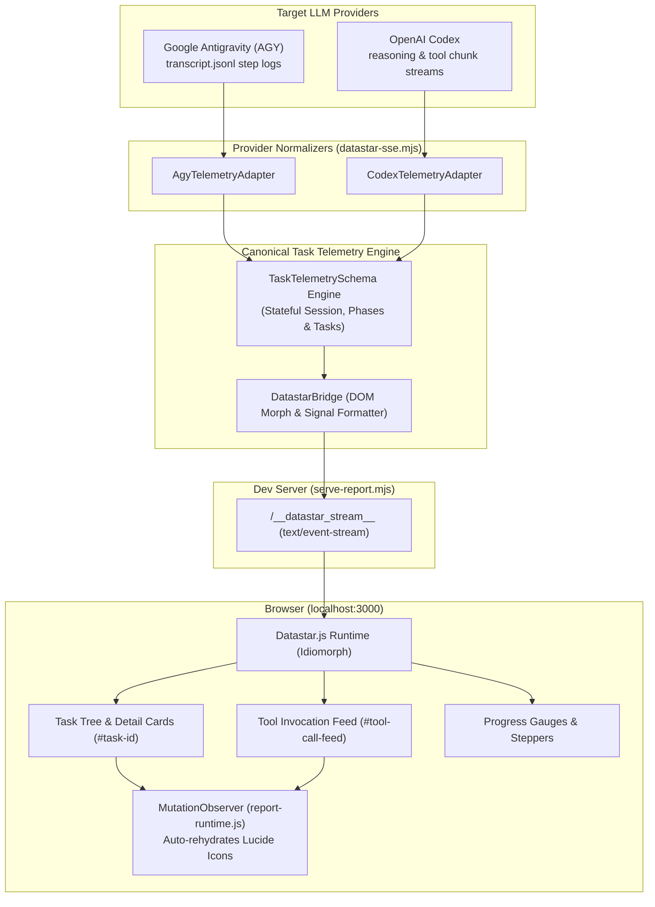
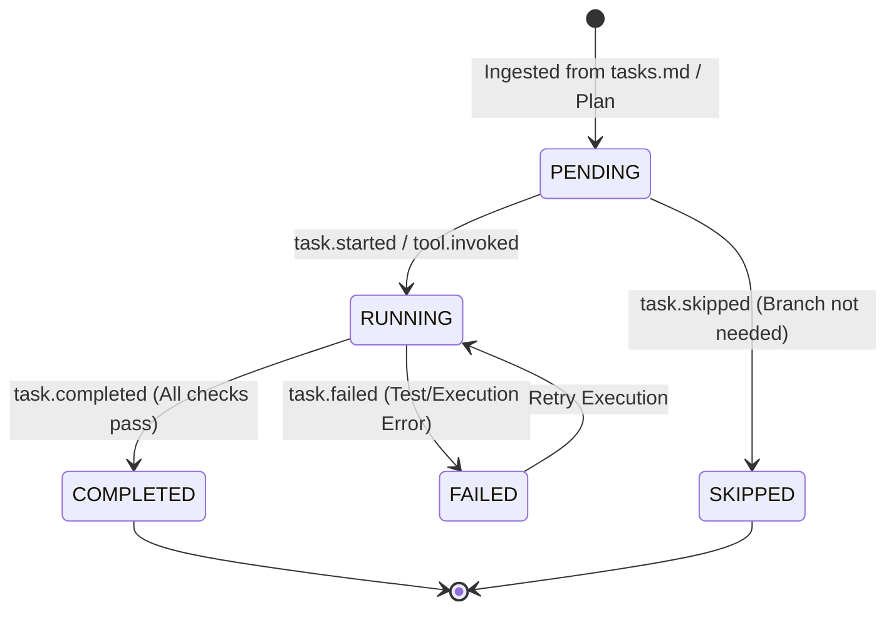

# Architecture Reference: Datastar.js Live Dashboards & Task Telemetry Streaming

## Overview

The Datastar Live Dashboard system provides a **zero-dependency, real-time hypermedia streaming pipeline** for `html-report`. It bridges high-velocity autonomous agent runtimes (such as Google Antigravity and OpenAI Codex) with the browser using **Server-Sent Events (SSE)** and **reactive HTML morphing (Idiomorph)**.

Unlike full single-page application (SPA) architectures that require heavy JavaScript bundlers, WebSockets, and build steps, Datastar operates via a single ~12KB ESM script tag and standard HTML5 `data-*` attributes.

---

## 1. Non-Blocking CDN Addon & CLI Integration

Datastar is registered in the deterministic builder (`build-report.mjs`) as an on-demand addon:

* **CDN Script**:
  ```html
  <script type="module" src="https://cdn.jsdelivr.net/npm/@starfederation/datastar@1.0.0-beta.9/dist/datastar.js"></script>
  ```
* **Auto-Detection Signatures**:
  Automatically triggered whenever report markup contains:
  `data-signals`, `data-bind`, `data-on-`, `data-indicator`, `data-computed`, `data-text`, `data-show`, `data-ref`, or `data-fetch-indicator`.
* **CLI Flags**:
  - `--live` or `-l`: Automatically activates `datastar` addon, sets `data-report-mode="live"` on `<html>`, and optimizes connection handling.
  - `--addons datastar` (or aliases `data-star`, `star`).

---

## 2. End-to-End Architectural Flow



---

## 3. Task & Session Schematic Language (`TaskTelemetrySchema`)

All agent events are normalized into a canonical schema defined in `skills/html-report/scripts/datastar-sse.mjs`:

```typescript
export interface TaskItem {
  id: string;                      // e.g. "1.1", "phase-1.task-2"
  title: string;                   // Concise actionable label
  description?: string;            // Acceptance criteria or detail
  status: "pending" | "running" | "completed" | "failed" | "skipped";
  assignedTo?: string;             // Subagent role, e.g. "AGY Planner", "Codex Coder"
  progressPct?: number;            // 0 - 100 for sub-progress
  toolCalls?: ToolInvocationRecord[];
  artifacts?: string[];            // Produced files or diffs
  startedAt?: number;
  completedAt?: number;
  durationMs?: number;
  error?: string;
}

export interface PhaseDefinition {
  id: string;                      // e.g. "phase-1"
  order: number;                   // 1, 2, 3...
  title: string;                   // e.g. "Build CLI & Shell Integration"
  status: "pending" | "running" | "completed" | "failed";
  tasks: TaskItem[];
  progressPct: number;             // Auto-computed from tasks
}

export interface SessionMetrics {
  totalTasks: number;
  completedTasks: number;
  failedTasks: number;
  runningTasks: number;
  progressPct: number;             // Overall session percentage (0 - 100)
  stepIndex: number;
  elapsedMs: number;
}
```

---

## 4. Deterministic Task State Machine

Tasks follow strict state transitions that trigger surgical DOM morphs:



### Event Serialization Matrix

| Schematic Event | Datastar Event Type | Target Selector & Merge Mode | Rendered DaisyUI Component |
| :--- | :--- | :--- | :--- |
| `task.started` | `datastar-fragment` | `#task-${id}` (`outer`) | Active card with primary glowing border and animated spinner |
| `task.completed` | `datastar-fragment` | `#task-${id}` (`outer`) | Completed card with `line-through` title, green check, and duration |
| `tool.invoked` | `datastar-fragment` | `#tool-call-feed` (`prepend`) | New tool card with spinning loader and argument preview |
| `tool.output` | `datastar-fragment` | `#tool-${id}` (`outer`) | Terminal drawer `<div class="mockup-code">` with stdout lines |
| `phase.updated` | `datastar-fragment` | `#stepper-phase-${order}` (`outer`) | `<li class="step step-primary">` progress item |
| `metrics.updated` | `datastar-merge-signals` | N/A | `data: signals {"session": {"progressPct": 75, "completed": 9}}` |

---

## 5. Provider Adapters: AGY & Codex Normalization

### Google Antigravity (AGY) Adapter (`AgyTelemetryAdapter`)
* Ingests transcript steps (`transcript.jsonl`):
  - `step.thinking`: Streamed token-by-token into `#agent-thought-stream`.
  - `step.tool_calls`: Converted to active tool cards with icon categories (`read_file`, `run_command`, `invoke_subagent`).
  - `TOOL_RESPONSE` / `SYSTEM` output: Collapsible terminal stdout container attached to the tool card.
  - `- [x]` markdown checklist items in assistant responses: Automatically updates matching tasks to `completed`.

### OpenAI Codex Adapter (`CodexTelemetryAdapter`)
* Ingests OpenAI streaming response chunks:
  - `delta.reasoning_content`: Streamed directly into thought containers.
  - `delta.tool_calls`: Tool call arguments assembled across chunks and attached to active task.
  - Tool execution results: Formatted as completed badges with elapsed time.

---

## 6. Live Dev Server & HTTP API Integration

The live reload dev server (`serve-report.mjs`) exposes dedicated SSE streaming routes:

* **Listen for Streams (Browser)**:
  `GET /__datastar_stream__` &rarr; `text/event-stream` connection.
* **Post Updates from Agent Process (Backend / CLI)**:
  `POST /__datastar_stream__` with JSON payload:
  ```json
  {
    "selector": "#task-1.1",
    "mergeMode": "outer",
    "html": "<div id=\"task-1.1\">...</div>"
  }
  ```
  The dev server instantly broadcasts the morphed fragment to all connected browser tabs.

---

## 7. Client Runtime Rehydration & Icon Safety

When Datastar dynamically injects HTML fragments via SSE, newly inserted vector icon placeholders (`<i data-lucide="...">`) must be instantiated.

In [`report-runtime.js`](file:///home/eta/projects/html-report/skills/html-report/assets/report-runtime.js):
```javascript
const observer = new MutationObserver((mutations) => {
  let needsRehydrate = false;
  for (const m of mutations) {
    if (m.type === "childList" && m.addedNodes.length > 0) {
      for (const node of m.addedNodes) {
        if (node.nodeType === 1 && (node.hasAttribute("data-lucide") || node.querySelector("[data-lucide]"))) {
          needsRehydrate = true;
          break;
        }
      }
    }
  }
  if (needsRehydrate) {
    window.lucide.createIcons();
  }
});

observer.observe(document.body, { childList: true, subtree: true });
```
This guarantees zero broken or empty icon slots during rapid streaming bursts.

---

## 8. DaisyUI Badge Spinner Safeguard

When placing animated loading indicators inside DaisyUI status badges (`badge-xs`, `badge-sm`), default `.loading` classes (`loading-spinner`) render at 1.5rem (24px), which overflows small badges.

Always enforce the badge loading constraint:
```css
.badge .loading,
.badge .loading-spinner,
.badge .loading-xs,
.badge .loading-3xs,
.loading-3xs {
  width: 0.65rem !important;
  height: 0.65rem !important;
  min-width: 0.65rem !important;
  min-height: 0.65rem !important;
  vertical-align: middle;
  display: inline-block;
}
```

---

## 9. Reusable Templates & Automatic Markdown Linking

* **Reusable Starter Template**: Located at [`skills/html-report/examples/datastar-live-dashboard.html`](../examples/datastar-live-dashboard.html) demonstrating zero-config SSE connections, Chain-of-Thought feeds, tool call terminal drawers, and reactive signals.
* **Automatic Markdown File Linking**: Any `.md` file mentioned in dashboard text or rendered Showdown markdown (`proposal.md`, `design.md`, `tasks.md`, `spec.md`) is automatically linked by `autoLinkMarkdownFiles()` to the in-browser Showdown Markdown Viewer modal.
