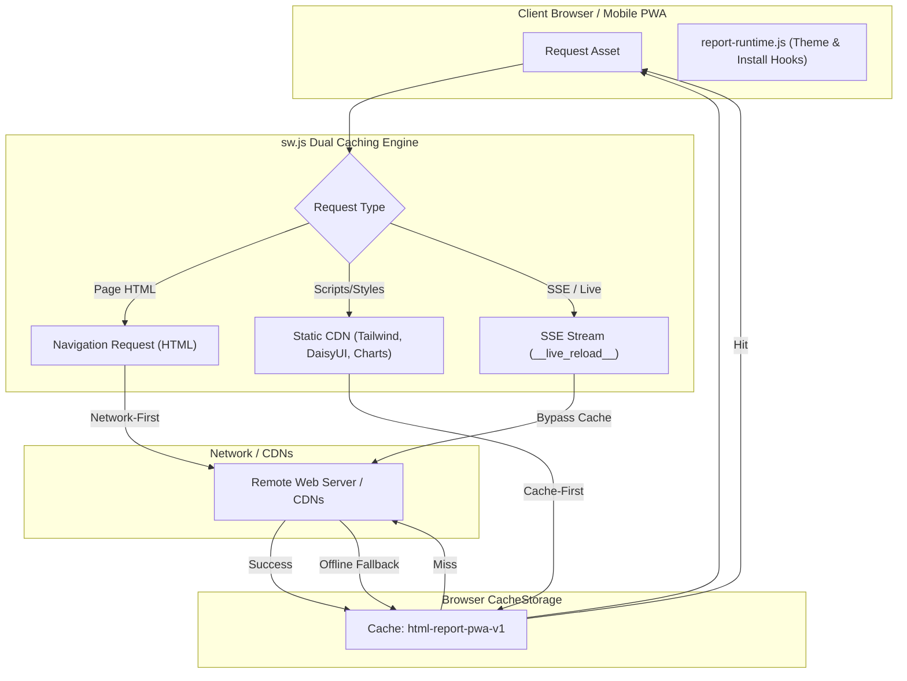

# Instant Progressive Web App (PWA) Guide

This reference explains how to generate, configure, and serve instant Progressive Web Apps (PWAs) from any report generated by `html-report`.

---

## 1. Overview & Capability Matrix

Every report generated by `html-report` can be turned into a fully functional, installable, and offline-ready Progressive Web App with zero external runtime dependencies.

| Feature | Standard Report | Instant PWA (`--pwa`) |
| :--- | :--- | :--- |
| **Installable as Standalone App** | ❌ No | ✔️ Yes (`display: "standalone"`) |
| **Offline Cache for Core Shell & CDNs** | ❌ No (requires internet) | ✔️ Yes (`sw.js` Cache-First for CDNs) |
| **Native Install Prompt Affordance** | ❌ None | ✔️ Yes (`#pwa-install-btn` + Download item) |
| **Dynamic DaisyUI Theme-Color Sync** | ❌ Only CSS variables | ✔️ Yes (syncs `<meta name="theme-color">`) |
| **Network Status Detection** | ❌ None | ✔️ Yes (`#pwa-offline-badge` indicator) |
| **Existing Report Retrofitting** | N/A | ✔️ Yes (`generate-pwa.mjs`) |

---

## 2. Quickstart: 3 Ways to Create an Instant PWA

### Option A: Assemble a New Report with `--pwa`
When generating a new report from a semantic fragment, pass the `--pwa` flag:

```bash
node skills/html-report/scripts/build-report.mjs \
  --content report-fragment.html \
  --title "Operational Health Dashboard" \
  --pwa \
  --output report.html
```
This automatically:
1. Injects `<link rel="manifest" href="manifest.webmanifest">` and mobile meta tags into the report `<head>`.
2. Emits companion `manifest.webmanifest`, `sw.js`, and `icon.svg` into the output directory.
3. Wires the client runtime to register `sw.js` and listen for `beforeinstallprompt`.

### Option B: Transform ANY Existing Report with `generate-pwa.mjs`
If you already have a generated report (e.g., `audit.html` or `index.html`), convert it into a PWA with zero regeneration overhead:

```bash
# Convert in-place:
node skills/html-report/scripts/generate-pwa.mjs ./audit.html

# Custom title, theme color, and homescreen icon emoji:
node skills/html-report/scripts/generate-pwa.mjs ./audit.html \
  --title "Audit Inspector" \
  --short-name "Audit" \
  --theme-color "#10b981" \
  --emoji "🛡️"
```

### Option C: Execute via Harness with `--pwa`
```bash
node skills/html-report/scripts/harness.mjs run fragment.html --pwa --title "System Status"
```

---

## 3. PWA Architecture & Caching Strategy



### Caching Policies

1. **Navigation Requests (Document HTML)**:
   - **Network-First**: The Service Worker always attempts to fetch the latest version of the report over the network.
   - **Cache-Fallback**: If the network is unavailable or offline, the cached HTML document is served instantly from `CacheStorage`.

2. **Static CDN Scripts & Stylesheets**:
   - **Cache-First**: Core CDNs (`cdn.tailwindcss.com`, `cdn.jsdelivr.net`, `cdnjs.cloudflare.com`, `unpkg.com`) are checked in cache first.
   - On cache hit, resources load with 0ms local latency.
   - On cache miss, they are fetched from the remote CDN and stored in cache for future offline visits.

3. **Dynamic Streaming Endpoints**:
   - `/__live_reload__` and `/__datastar_stream__` bypass the Service Worker entirely to avoid caching real-time SSE streams.

---

## 4. UI Controls & Client Runtime

### 1. Install App Button (`#pwa-install-btn`)
- Hidden by default.
- When the browser fires `beforeinstallprompt`, the button unhides in the DaisyUI navbar and within the Download dropdown menu (`#pwa-install-menu-item`).
- Clicking the button invokes `deferredInstallPrompt.prompt()`, opening the native browser installation modal.
- Upon installation (`appinstalled` event), the button hides and the status badge updates to `Installed`.

### 2. Offline Status Badge (`#pwa-offline-badge`)
- Watches `window.addEventListener('online')` and `window.addEventListener('offline')`.
- When offline, renders a subtle warning pill in the navbar header, assuring users that they are viewing a cached offline version.

### 3. Dynamic DaisyUI Theme-Color Sync
- When a user changes the active theme in the DaisyUI 32-theme picker (or expands the Custom Theme Studio), `syncPwaThemeColor()` dynamically resolves the new theme's primary color and updates `<meta name="theme-color">`.
- This ensures mobile status bars and desktop app window headers stay visually matched to the active theme.

---

## 5. Local Development & Production Serving

### Local Dev Server
The included development server (`serve-report.mjs`) automatically handles PWA requirements:
- Sets `Content-Type: application/manifest+json` for `.webmanifest` files.
- Injects `Service-Worker-Allowed: /` and `Cache-Control: no-cache` for `sw.js`.

```bash
node skills/html-report/scripts/serve-report.mjs report.html --port 3000
```

### Production Hosting
To host the PWA on GitHub Pages, Netlify, Vercel, S3, or Nginx:
1. Ensure the following files are copied to your web root:
   - `report.html` (or `index.html`)
   - `manifest.webmanifest`
   - `sw.js`
   - `icon.svg` (and any custom raster icons)
2. Ensure HTTPS is enabled (Service Workers require HTTPS, except on `localhost`).
