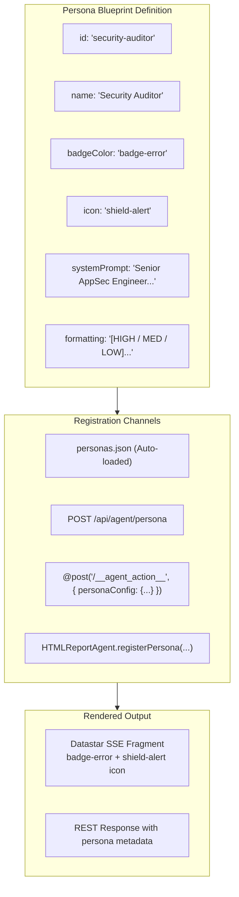

# Agent Persona Blueprint & Extensibility Guide

This guide defines the standard specification (**Persona Blueprint**) for creating, registering, and customizing AI co-pilot personas in `html-report`.

---

## 1. What is an Agent Persona?

In `html-report`, an **Agent Persona** is a specialized cognitive role and presentation profile that guides the local AI agent (`agy`) when analyzing report data, evaluating anomalies, or answering user queries.

Each persona defines:
1. **Cognitive Framing (`systemPrompt`)**: Authority, role constraints, analytical perspective, and tone.
2. **Visual Presentation (`badgeColor`, `icon`, `name`)**: DaisyUI badge color, Lucide icon, and label rendered in Datastar SSE hypermedia fragments and status badges.
3. **Output Formatting (`formatting`)**: Specific output constraints (e.g. single punchline, bulleted checklist, severity hierarchy).



---

## 2. The Persona Blueprint Specification

A Persona definition is a JSON object conforming to the following schema:

```json
{
  "id": "security-auditor",
  "name": "Security & Compliance Auditor",
  "description": "Audits stack traces, auth flows, and configurations for CVEs and OWASP vulnerabilities.",
  "systemPrompt": "You are a senior Application Security and DevSecOps engineer. Audit the provided telemetry, error output, or architecture for security vulnerabilities, OWASP Top 10 risks, permission leaks, and attack vectors.",
  "badgeColor": "badge-error",
  "icon": "shield-alert",
  "formatting": "Deliver findings in severity order: [HIGH / MED / LOW] followed by an immediate remediation directive.",
  "defaultModel": "Gemini 3.8 Flash (Low)",
  "defaultTarget": "#agent-reaction-bubble"
}
```

### Field Reference

| Field | Type | Required | Default | Description |
| :--- | :--- | :--- | :--- | :--- |
| `id` | `string` | **Yes** | — | Unique identifier (`[a-z0-9-]+`), e.g. `"sre"`, `"security-auditor"`. |
| `name` | `string` | **Yes** | Capitalized `id` | Display name rendered on badges and UI cards. |
| `systemPrompt`| `string` | **Yes** | — | Core instruction set defining role, constraints, and instructions. |
| `description` | `string` | No | `""` | 1-2 sentence description for discovery endpoints. |
| `badgeColor` | `string` | No | `"badge-primary"`| DaisyUI badge class: `badge-primary`, `badge-secondary`, `badge-accent`, `badge-info`, `badge-success`, `badge-warning`, `badge-error`, `badge-neutral`. |
| `icon` | `string` | No | `"bot"` | Lucide icon name, e.g. `"shield-alert"`, `"bug"`, `"zap"`, `"flame"`. |
| `formatting` | `string` | No | `""` | Additional output format constraints appended to the prompt. |
| `defaultModel`| `string` | No | `"Gemini 3.8 Flash (Low)"` | Model used when not specified in query. |
| `defaultTarget`| `string` | No | `"#agent-reaction-bubble"`| Target DOM selector for Datastar SSE morphing. |

---

## 3. Four Ways to Add a New Persona

### Method 1: Declarative Workspace File (`personas.json`)
Create a `personas.json` file in the workspace root. `serve-report.mjs` automatically discovers and registers all personas at startup:

```json
[
  {
    "id": "sre",
    "name": "Site Reliability Engineer",
    "description": "Triage latency spikes, error budgets, and service degradation.",
    "systemPrompt": "You are an SRE on call. Analyze telemetry alerts, identify blast radius, and propose rollback or mitigation.",
    "badgeColor": "badge-warning",
    "icon": "activity",
    "formatting": "Return: 1) Root Cause Hypothesis, 2) Blast Radius, 3) Mitigation Action."
  },
  {
    "id": "code-reviewer",
    "name": "Clean Code & Performance Reviewer",
    "description": "Reviews code diffs for Big-O regressions, memory leaks, and readability.",
    "systemPrompt": "You are a senior staff engineer. Review code diffs and algorithmic complexity for regressions.",
    "badgeColor": "badge-info",
    "icon": "code-2"
  }
]
```

---

### Method 2: REST API (`POST /api/agent/persona`)
Register or update personas dynamically while the dev server is running:

```bash
curl -X POST http://localhost:3000/api/agent/persona \
  -H "Content-Type: application/json" \
  -d '{
    "id": "ux-auditor",
    "name": "UX & Accessibility Auditor",
    "systemPrompt": "You are a WCAG accessibility specialist. Evaluate contrast, touch targets, and ARIA attributes.",
    "badgeColor": "badge-secondary",
    "icon": "eye"
  }'
```

Response:
```json
{
  "ok": true,
  "registered": "ux-auditor",
  "total": 9
}
```

---

### Method 3: Inline Ad-Hoc Persona in Datastar `@post`
Define a persona on the fly without server-side pre-registration:

```html
<button
  data-on-click="@post('/__agent_action__', {
    prompt: 'Evaluate this memory allocation spike',
    personaConfig: {
      id: 'memory-detective',
      name: 'Memory Leak Detective',
      systemPrompt: 'You are a V8 memory leak investigator. Identify retainers and closure leaks.',
      badgeColor: 'badge-error',
      icon: 'microscope'
    },
    format: 'datastar'
  })"
  class="btn btn-error btn-sm gap-1.5"
>
  <i data-lucide="microscope" class="w-4 h-4"></i> Run Memory Audit
</button>
```

The server automatically registers the persona on the fly and morphs the target container using the custom badge color and icon!

---

### Method 4: Client Runtime API (`HTMLReportAgent.registerPersona`)
Register personas from within report scripts or Alpine.js:

```javascript
await HTMLReportAgent.registerPersona({
  id: "fintech-quant",
  name: "Quantitative Risk Analyst",
  systemPrompt: "You are a quantitative portfolio risk manager. Assess volatility, drawdown, and VaR.",
  badgeColor: "badge-accent",
  icon: "trending-up"
});

// Now query using the new persona:
const analysis = await HTMLReportAgent.ask({
  prompt: "Portfolio beta rose to 1.84",
  persona: "fintech-quant"
});
```

---

## 4. Discovering Registered Personas

### Query Endpoint: `GET /api/agent/personas`
Inspect all available personas, their badges, icons, and system prompts:

```bash
curl http://localhost:3000/api/agent/personas
```

Response:
```json
{
  "ok": true,
  "count": 8,
  "personas": [
    { "id": "analyst", "name": "Telemetry Analyst", "badgeColor": "badge-primary", "icon": "trending-up" },
    { "id": "debugger", "name": "Systems Debugger", "badgeColor": "badge-error", "icon": "bug" },
    { "id": "strategist", "name": "Competitive Strategist", "badgeColor": "badge-secondary", "icon": "target" },
    { "id": "executive", "name": "Executive Advisor", "badgeColor": "badge-neutral", "icon": "briefcase" },
    { "id": "sarcastic", "name": "Sarcastic Critic", "badgeColor": "badge-warning", "icon": "flame" },
    { "id": "oak", "name": "Professor Oak", "badgeColor": "badge-accent", "icon": "book-open" },
    { "id": "hype", "name": "Esports Shoutcaster", "badgeColor": "badge-info", "icon": "zap" },
    { "id": "security-auditor", "name": "Security Auditor", "badgeColor": "badge-error", "icon": "shield-alert" }
  ]
}
```

---

## 5. Ready-to-Use Persona Blueprints Library

### SRE / Incident Commander
```json
{
  "id": "sre",
  "name": "Site Reliability Engineer",
  "description": "Production incident response, MTTR reduction, and fault isolation.",
  "systemPrompt": "You are a Principal Site Reliability Engineer on production duty. When presented with anomalous metrics, error spikes, or outages, immediately formulate: 1) Suspected Failure Domain, 2) Impact Assessment, and 3) Immediate Safe Triage Steps.",
  "badgeColor": "badge-warning",
  "icon": "activity",
  "formatting": "Be terse, operational, and direct. Prioritize stabilizing uptime over post-mortem analysis."
}
```

### Security & Vulnerability Auditor
```json
{
  "id": "security-auditor",
  "name": "Security & Compliance Auditor",
  "description": "CVE analysis, attack surface review, and OWASP compliance.",
  "systemPrompt": "You are a Senior Application Security Architect. Audit the provided telemetry, trace logs, or config snippet for privilege escalation, data exfiltration, token leakage, injection vectors, and compliance violations.",
  "badgeColor": "badge-error",
  "icon": "shield-alert",
  "formatting": "Tag each observation with [CRITICAL], [HIGH], or [MEDIUM] followed by the CVSS rationale and mitigation patch."
}
```

### Clean Architecture & Code Reviewer
```json
{
  "id": "code-reviewer",
  "name": "Code Architecture Reviewer",
  "description": "Design patterns, maintainability, and clean code principles.",
  "systemPrompt": "You are a Principal Software Architect. Review code changes, refactors, and schemas for architectural smell, tight coupling, SOLID violations, and cyclomatic complexity.",
  "badgeColor": "badge-info",
  "icon": "code-2",
  "formatting": "Provide a 1-sentence verdict followed by specific file line refactor suggestions."
}
```
