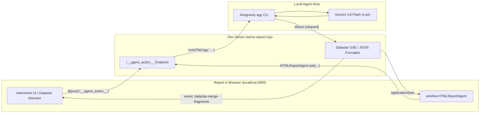

# Universal Two-Way Agent Bridge & Co-Pilot Architecture

## Overview

Traditional reports and telemetry dashboards are passive: they display numbers, charts, and tables, leaving human observers or operators to deduce meaning, spot regressions, or diagnose anomalies manually.

The **Universal Two-Way Agent Bridge** transforms `html-report` documents into **interactive, bidirectional co-pilot workspaces**. A report in the browser can query local AI models directly, evaluate live anomalies, stream synthetic insights, or trigger agent actions—all with **zero external API keys** by executing within the user's authenticated Google Antigravity environment via the `agy` CLI.



---

## Key Features

1. **Zero External API Keys Needed**:
   - Seamlessly uses the developer's existing local `agy` authenticated session.
   - Out-of-the-box support for `Gemini 3.8 Flash (Low)`, `pro`, and customizable models.
2. **Dual Communication Formats**:
   - **Datastar SSE Hypermedia**: Server returns `event: datastar-merge-fragments`, allowing HTML elements with `@post('/__agent_action__', ...)` to morph target cards in place without writing client-side JavaScript.
   - **JSON / REST**: Clean REST API (`/api/agent`, `/__agent_action__`) for Alpine.js or vanilla JavaScript components.
3. **Pluggable Personas**:
   - `analyst`: High-signal, actionable telemetry and metric diagnostics.
   - `debugger`: Root-cause isolation, regression analysis, and remediation patches.
   - `strategist`: Competitive analysis, viability assessments, and counter-tactics.
   - `executive`: 2 punchy bullet points summarizing business impact.
   - `sarcastic`: Humorous, devastating roasts targeting design flaws and absurdities.
   - `oak`: Exasperated field-research commentary.
   - `hype`: Over-the-top Esports shoutcaster excitement.
   - `custom`: Provide any custom `systemPrompt` inline.
4. **Resilient Offline / Standalone Fallback & Turnkey Reconnection**:
   - If an exported report is opened as a standalone file (`file://`), shared with another person, or the dev server is unreachable, `HTMLReportAgent` and `serve-report.mjs` automatically engage a deterministic local fallback.
   - **Turnkey Agent Reconnection Prompt**: When the two-way bridge is broken or offline in a shared report, clicking the status indicator in the navbar opens a modal presenting a copy-ready agent prompt. Pasting this prompt into any autonomous AI agent (Google Antigravity, Claude Code, Cursor, Codex) restores the dev server and bridge instantly.
   - **Zero-Reload Auto-Recovery**: The client runtime maintains an automatic background heartbeat poll; as soon as the agent starts the dev server, the browser report reconnects seamlessly without page reload.

---

## Server Endpoints (`serve-report.mjs`)

### 1. `GET /__agent_status__` / `GET /api/agent/status`
Returns server bridge health and available capabilities:

```json
{
  "ok": true,
  "bridge": "Google Antigravity agy CLI Bridge",
  "defaultModel": "Gemini 3.8 Flash (Low)",
  "personas": ["analyst", "debugger", "strategist", "executive", "sarcastic", "oak", "hype"],
  "actions": ["query", "analyze", "summarize", "roast", "action"],
  "version": "1.0.0"
}
```

### 2. `POST /__agent_action__` / `POST /api/agent`
Executes agent inference or action.

#### Request Parameters
| Field | Type | Default | Description |
| :--- | :--- | :--- | :--- |
| `prompt` | `string` | *(Required)* | The user query, instruction, or metric to evaluate. |
| `action` | `string` | `"query"` | Action mode (`query`, `analyze`, `summarize`, `roast`, `action`). |
| `persona` | `string` | `"analyst"` | Persona preset (`analyst`, `debugger`, `strategist`, `executive`, `sarcastic`, etc.). |
| `systemPrompt` | `string` | `undefined` | Custom system prompt (overrides persona preset). |
| `context` | `object \| string` | `undefined` | Structured telemetry, stats, or error logs to include in context. |
| `model` | `string` | `"Gemini 3.8 Flash (Low)"` | Model name passed to `agy --model`. |
| `format` | `string` | `"json"` | Output format: `"json"` or `"datastar"`. |
| `targetSelector` | `string` | `"#agent-reaction-bubble"` | Target DOM ID or selector for Datastar fragment morphing. |
| `fallbackText` | `string` | `undefined` | Custom message returned if `agy` is unreachable. |

---

## Usage Patterns

### Pattern A: Declarative Datastar Hypermedia (No Client JS)
Embed directly in your HTML content fragment:

```html
<!-- Agent Query Card -->
<div class="card bg-base-100 shadow border border-base-300 p-6 space-y-4">
  <h3 class="text-lg font-bold flex items-center gap-2">
    <i data-lucide="bot" class="w-5 h-5 text-primary"></i>
    Telemetry AI Co-Pilot
  </h3>

  <div class="flex gap-2">
    <button
      data-on-click="@post('/__agent_action__', { prompt: 'Analyze current CPU and latency spikes', format: 'datastar', targetSelector: '#copilot-output' })"
      class="btn btn-primary btn-sm gap-1.5"
    >
      <i data-lucide="sparkles" class="w-4 h-4"></i> Ask Co-Pilot
    </button>
  </div>

  <!-- Morph Target -->
  <div id="copilot-output" class="p-4 rounded-xl border border-dashed border-base-300 text-xs text-base-content/60">
    Co-pilot ready. Click above to trigger live telemetry assessment.
  </div>
</div>
```

### Pattern B: Programmatic Client Runtime (`HTMLReportAgent`)
Available globally via `window.HTMLReportAgent` (or `window.HTMLReport.agent`):

```javascript
// 1. Check if local agent bridge is available
const isOnline = await HTMLReportAgent.isAvailable();

// 2. Query co-pilot with structured context
const response = await HTMLReportAgent.ask({
  prompt: "What is causing the sudden error spike at 14:02?",
  action: "analyze",
  persona: "debugger",
  context: {
    endpoint: "/api/checkout",
    statusCode: 504,
    dbLatencyMs: 4200,
    connections: 150
  }
});

if (response.ok) {
  console.log("AI Insight:", response.result);
  console.log("Agent:", response.agent);
} else {
  console.warn("Fallback Mode:", response.result);
}
```

---

## Turnkey AI Agent Reconnection Prompt & Auto-Recovery

When an interactive report featuring the Two-Way Agent Bridge is shared across developers or moved to a machine where the dev server (`serve-report.mjs`) is not currently running, the bridge is temporarily broken/disconnected.

The built-in client runtime provides a **turnkey AI agent reconnection prompt** and zero-reload auto-recovery:

### 1. Visual Status Affordance & Modal
* The navbar features `#agent-bridge-status-container` with an interactive button (`#agent-bridge-status-btn`) displaying:
  * 🟢 **Bridge Connected**: Dev server and local agent session active.
  * 🟠 **Checking Bridge**: Initial handshake in progress.
  * 🔴 **Bridge Offline / Disconnected**: Dev server offline or unreachable.
* Clicking the offline status button immediately opens `#agent-reconnect-modal`.

### 2. Copy-Ready Turnkey AI Agent Prompt
The modal presents a pre-configured prompt synthesized client-side via `HTMLReportAgent.getReconnectPrompt()`:

````markdown
# Restore Two-Way Agent Bridge for Report

The two-way AI agent bridge for interactive report **"<Report Title>"** is currently offline or disconnected.

Please restore the agent bridge by running the following dev server command in your workspace:

```bash
node skills/html-report/scripts/serve-report.mjs <ReportFile> --port 3000 --no-open
```

Once started, this report at `http://localhost:3000` will automatically detect the bridge and reconnect without requiring a page reload.
````

A single click on **"Copy AI Agent Prompt"** copies the exact instruction to the clipboard. The recipient developer can paste this directly into their autonomous coding agent (Antigravity CLI `agy`, Claude Code, Cursor, Codex, etc.).

### 3. Zero-Reload Background Heartbeat
* While disconnected, `HTMLReportAgent` runs a lightweight heartbeat probing `/__agent_status__` every 4 seconds.
* As soon as the agent starts the dev server in the background, the client automatically detects the online bridge, transitions to `connected`, and updates the badge to green—with zero manual browser refreshes needed.

### 4. Client Runtime API
Available on `window.HTMLReportAgent`:
* `HTMLReportAgent.checkConnection()`: Probes server health and returns `{ connected: boolean, state: string }`.
* `HTMLReportAgent.getReconnectPrompt(options)`: Generates the customized turnkey Markdown prompt.
* `HTMLReportAgent.copyReconnectPrompt(btnEl, options)`: Copies prompt to clipboard with visual checkmark feedback.
* `HTMLReportAgent.openReconnectModal()` / `HTMLReportAgent.closeReconnectModal()`: Controls modal visibility.
* `HTMLReportAgent.onConnectionChange(callback)`: Registers listener for connection state transitions (`connected`, `disconnected`, `checking`).

---

## Backward Compatibility & Directory Structure

To keep workspaces organized, historical and experimental files are segmented cleanly:

- **`experiments/`**: Standalone proofs-of-concept, test scripts, and historical prototypes (e.g. `pokemon-fragment.html`, `pokemon-live-report.html`).
- **`dev/`**: Prior feature dashboards and verification fragments (e.g. `current-feature.html`, `report-codex-telemetry.html`).
- **Root**: Active showcase (`index.html`), current journey preview (`implementation-progress.html`), and built reports (`report.html`).

The dev server automatically searches `dev/` and `experiments/` as fallback directories, so legacy links and tests continue functioning seamlessly.
